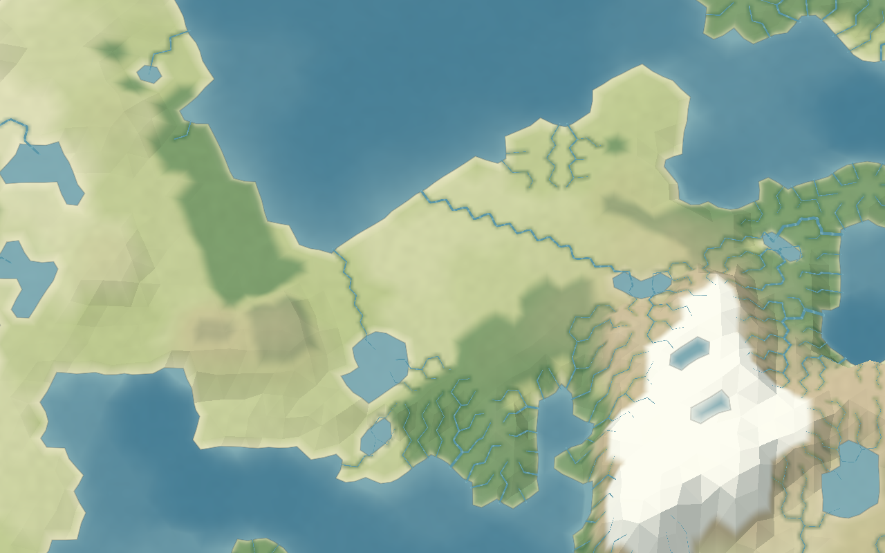

# World Forge

A TypeScript planet-generation prototype for worldbuilding. Explore a generated
world as a globe or flat map, inspect its physical fields, and switch between
natural, shaded-relief and ink-atlas styles.

Application **2.13.2**, generator **2.13.0**. This is the standalone React/Vite
edition of the browser prototype.



## Run locally

Use Node.js **22.13 or newer** and npm.

```sh
npm ci
npm run dev
```

Open the local URL printed by Vite. The initial world is generated in a Web
Worker. No account, database, environment variables or server API is required.

```sh
npm run build
npm run preview
```

The build produces a static application in `dist/`. Serve it over HTTP; opening
`index.html` directly from disk does not provide the module-worker environment
the app needs. Relative asset paths also support hosting beneath a URL prefix.

## Explore

- Change the seed and generation settings, then generate a world.
- Inspect tectonics, climate, rivers, lakes, wetlands, vegetation, minerals and fertility.
- Switch between Globe and Flat map, choose a season, or change the map style.
- Click a cell or deposit for its values and explanatory details.
- Use **Save project** and **Load** to exchange JSON recipes. Examples are in
  [`examples/`](examples/), including AETHER-0004.

Project files store recipes rather than computed worlds. Exact reproduction
requires the same generator version. A subdivision increase roughly quadruples
the cell count; the highest optional settings take substantial time and memory.

## Develop

| Command                                            | Purpose                                        |
| -------------------------------------------------- | ---------------------------------------------- |
| `npm run dev`                                      | Development server                             |
| `npm run build`                                    | Type-check and build the static application    |
| `npm run preview`                                  | Serve the production build locally             |
| `npm run typecheck`                                | Check TypeScript without building              |
| `npm test`                                         | Run the generator and rendering-geometry tests |
| `npm run lint`                                     | Check source conventions and unused code       |
| `npm run format`                                   | Format maintained source and documentation     |
| `npm run format:check`                             | Check formatting                               |
| `npm run measure -- examples/AETHER-0004.json 5 4` | Measure a world at explicit detail levels      |

Start with [`src/core/pipeline.ts`](src/core/pipeline.ts) for generation,
[`src/core/model.ts`](src/core/model.ts) for fields and units, and
[`src/render/WorldView.tsx`](src/render/WorldView.tsx) for the viewer.

| Directory            | Responsibility                                                      |
| -------------------- | ------------------------------------------------------------------- |
| `src/core/`          | Spherical grids, deterministic generation and world data            |
| `src/app/`           | Editor, inspection, styles and worker lifecycle                     |
| `src/render/`        | Three.js meshes, materials, projections and overlays                |
| `src/components/ui/` | Shared UI primitives used by the editor                             |
| `tests/`             | Numerical, data-contract and geometry checks                        |
| `scripts/`           | Optional generation and tectonics measurements                      |
| `docs/`              | Architecture, algorithms, development notes and historical evidence |

## Documentation

The [documentation index](docs/README.md) is the entry point.

- [Architecture](docs/architecture.md): current boundaries, data flow and ownership.
- [Illustrated algorithms](docs/algorithms.md): formulas, diagrams and worked examples.
- [Development guide](docs/development.md): naming, array conventions and checks.
- [History](docs/history/README.md): revision notes, proposals and comparisons.
- [Changelog](CHANGELOG.md): repository preparation and source provenance.

This is an approximate worldbuilding model: prescribed plate motion is
kinematic, climate uses representative seasons, and several river and resource
processes use procedural proxies. The documentation identifies their limits.
Civilizations, mining and irrigation are future work.

Third-party notices are in [THIRD_PARTY_NOTICES.md](THIRD_PARTY_NOTICES.md).
