# Illustrated algorithms

**Implementation covered:** World Forge / Atlas, application v2.13.2 / generator v2.13.0\
**Edition:** Illustrated algorithms, including pseudocode and worked examples\
**Updated:** 2026-09-17\
**Status:** Architecture of the implemented TypeScript application, with future work explicitly identified\
**Source provenance:** Original commit `5a936635510eb553a20fc151c4f9df7a747d13b6`; see the [repository changelog](../CHANGELOG.md).

For the standalone repository's runtime boundaries and build workflow, start with
the [current architecture](architecture.md) and [development guide](development.md).
This reference retains historical worked examples and later sections that update
earlier algorithms; dates and measurements describe their original revisions.

This document consolidates the original design and the changes made through application v2.13.2 / generator v2.13.0. It documents the current TypeScript prototype for the intended C3 implementation: a TypeScript generation core, one Web Worker, React controls, hand-written spherical spatial structures, and three.js graphics.

The goal remains an inspectable, coherent worldbuilding generator. Its physical units and water budgets prevent contradictory interactions; its geology, climate, ecology, and terrain profiles remain simplified worldbuilding models. The current application generates environmental snapshots. Civilizations and historical evolution are future consumers of those snapshots.

### How to read this edition

The fourteen SVG illustrations explain the implemented data flow, geometry, and formulas. The grid illustration uses actual meshes built by the TypeScript code. Numerical diagrams use explicitly labeled teaching examples or plots of implementation formulas; they are not new measurements of AETHER-43246. The additional coast comparison uses the actual v2.5.0 terrain generator with a reference configuration. Recorded world-specific observations remain in section 15.2.

Pseudocode emphasizes update order and field ownership. It omits array indexing and some boundary cases for readability; the named TypeScript module remains the executable specification. Unless bounds are written explicitly, `clamp(x)` means clamp to `[0, 1]`. Distances and areas in formulas are physical metres and square metres after applying planetary radius. Temperature is in °C. `day = 86,400 s`, `year = 365.25 days`, and `season = year / 4`.

| Illustration               | What it explains                                                     | Location     |
| -------------------------- | -------------------------------------------------------------------- | ------------ |
| Two sampling grids         | Sites, triangles, dual cells, and process/surface mapping.           | Section 4.2  |
| Bounded pipeline           | Stage ownership and the optional final pass.                         | Section 5    |
| Terrain profiles           | Lowland compression and continuous inland-basin shaping.             | Section 6.2  |
| Conservative transport     | Inventory exchange across unequal-area cells.                        | Section 7.2  |
| Priority-Flood             | Escape height versus actual standing water.                          | Section 10.1 |
| Reservoir balance          | Capacity, storage, and a fractional wet sample.                      | Section 10.2 |
| River systems              | Headwaters, confluences, real spills, and terminal identity.         | Section 11.2 |
| Vegetation and floodplains | Persistent alluvial habitat, seasonal water, and valley confinement. | Section 12.3 |
| Flat-basin shorelines      | Connected wet footprints and river endpoints on level ground.        | Section 10.3 |
| Evolved continent shapes   | Initial and 200 Myr coast masks from the generator.                  | Section 6.4  |
| Volcanic construction      | Seabed emergence and a moving hotspot track.                         | Section 6.5  |
| Basin aging                | Sediment infill versus actual outlet incision.                       | Section 12.1 |
| River migration            | Bounded bends, intersecting necks, and cutoff remnants.              | Section 11.5 |
| River pathways and seasons | Four sampled hydrographs from the current generator.                 | Section 11.4 |

The linked SVG illustrations remain editable vector graphics and render directly
from this Markdown document. The repository maintains this single detailed reference.

## 1. Architectural decisions

| Decision                             | Current contract                                                                                                                                                                              |
| ------------------------------------ | --------------------------------------------------------------------------------------------------------------------------------------------------------------------------------------------- |
| Separate generation and presentation | `src/core` depends on neither React nor three.js. Rendering reads the completed world.                                                                                                        |
| Two resolutions                      | The process grid owns broad geology and climate; the surface grid owns detailed terrain, hydrology, and ecology.                                                                              |
| One river-routing authority          | Corner receivers govern water, reservoirs, selected channels, and riverbank access. Outlet incision shares the corner flood; a temporary cell flood delivers geological sediment only.        |
| Explicit water meanings              | Atmospheric moisture, precipitation, PET, actual ET, runoff, channel supply, discharge, lake capacity, and stored water are distinct quantities.                                              |
| Geological time                      | Noise initializes basement; prescribed plate rotations, overlap/gap rules, and carried deformation shape the final geography over 200 Myr by default.                                         |
| Broad plains and localized mountains | Continental shape supplies lowland gradients; tectonic belts and volcanism supply local relief. Inherited valley detail weakens with landscape maturity.                                      |
| Continental basin construction       | Enclosed negative terrain is reshaped above sea level relative to its escape sill, before climate and water balance.                                                                          |
| Supported headwaters                 | Catchment area and non-storm supply initiate channels; annual storm runoff alone does not.                                                                                                    |
| Regional and riverbank vegetation    | Climate determines the regional biome. Accessible river water can support vegetation within narrow banks.                                                                                     |
| Consistent standing water            | Explicit corner wet fractions provide a shoreline even on unresolved flat floors. Positive depth is also retained; neither a depth cutoff nor a display threshold erases a river destination. |
| Bounded feedback                     | Regional weathering, then up to twelve recent fluvial steps; at most one final climate/water/drainage pass.                                                                                   |
| Recent river shaping                 | A configurable landscape interval modifies actual terrain; it is distinct from the age of an individual river.                                                                                |
| Local wet habitats                   | Marsh, swamp, fen, and bog potential occupy fractions of cells, separate from climate biome.                                                                                                  |
| Delta branches                       | Terminal distributaries partition one existing delivery to the same receiving water body.                                                                                                     |
| Simple execution                     | One worker per generation, transferable typed arrays, explicit cancellation and progress.                                                                                                     |
| Stable scope                         | No GPU simulation, worker pool, adaptive mesh, generic solver graph, or history engine is required by the current implementation.                                                             |

## 2. Runtime and module boundaries

The standalone application uses React with Vite. All generation executes in the
browser, with no remote climate service, imagery service or application database.
The original hosted prototype used a Sites/Vinext shell; that wrapper is not
part of this repository.

| Module                                                     | Responsibility                                                                                                     |
| ---------------------------------------------------------- | ------------------------------------------------------------------------------------------------------------------ |
| `src/core/model.ts`                                        | World configuration, defaults, version, typed state, and field units.                                              |
| `src/core/config.ts`                                       | Shared generation-control definitions and project validation.                                                      |
| `src/core/grid/build.ts`                                   | Spherical mesh construction, dual topology, metrics, and nearest-cell lookup.                                      |
| `src/core/operators/spatial.ts`                            | Distances, gradients, surface/process transfer, and restriction.                                                   |
| `src/core/operators/transport.ts`                          | Shared-edge advection, diffusion, and stable time-step selection.                                                  |
| `src/core/generation/geology.ts`                           | Plate growth, crust fields, boundary features, and continuous terrain noise.                                       |
| `src/core/generation/crust-evolution.ts`                   | Finite plate rotations, reference-crust selection, young ocean gaps, inherited deformation, and the initial datum. |
| `src/core/generation/terrain.ts`                           | Sea-level reference, terrain sampling, ocean classification, and coast distance.                                   |
| `src/core/generation/continental-basins.ts`                | Initial shaping of enclosed continental depressions.                                                               |
| `src/core/generation/circulation.ts`                       | Seasonal thermal baseline, wind whorls, ocean fluxes, and SST transport.                                           |
| `src/core/generation/climate.ts`                           | Atmospheric moisture integration and seasonal climate outputs.                                                     |
| `src/core/generation/land-water.ts`                        | Fine rainfall/temperature, soil and snow budgets, runoff, and ET restriction.                                      |
| `src/core/generation/drainage.ts`                          | Authoritative corner routing, accumulation, and reservoir integration.                                             |
| `src/core/generation/lake-surfaces.ts`                     | Connected flat-floor wet footprints, shoreline routing, discharge re-accumulation, and size names.                 |
| `src/core/generation/floodplains.ts`                       | Persistent alluvial corridors, seasonal overbank reach, local habitat and coverage.                                |
| `src/render/SurfaceHabitats.ts`                            | Shared cell-based lake mask and two-cell seasonal delta colors.                                                    |
| `src/render/RiverbankTexture.ts`                           | A filtered, premultiplied surface texture for continuous riverbank corridors; no bank mesh.                        |
| `src/render/WaterSurface.ts`                               | Small layer offsets, lake anchors, and local ray/triangle draping onto the displayed surface.                      |
| `src/render/RiverGeometry.ts`, `RiverRibbon.ts`            | Anchored courses, display simplification, and connected rectangular water spans with bevel joins.                  |
| `src/core/generation/reservoir.ts`                         | Annual water balance and height/area/storage calculations for a lake.                                              |
| `src/core/generation/nested-lakes.ts`                      | Local saddle-based refinement of closed reservoirs with stranded interior ponds.                                   |
| `src/core/generation/rivers.ts`                            | Headwater selection, connected channels, catchment area, river systems, and stream order.                          |
| `src/core/generation/erosion.ts`                           | Bounded downstream-first incision, sediment transport, and mouth deposition.                                       |
| `src/core/generation/river-courses.ts`                     | Valley-constrained curves, geometric cutoffs, and sparse shared centerlines.                                       |
| `src/core/generation/deltas.ts`                            | Sediment-supported mouth fans and conservative branch shares.                                                      |
| `src/core/generation/wetlands.ts`                          | Local marsh, swamp, fen, and bog habitat potential.                                                                |
| `src/render/OxbowSurfaces.ts`                              | Wet, frozen, or dry cutoff remnants in both layouts.                                                               |
| `src/core/generation/volcanism.ts`                         | Seeded hotspot schedules, fault-source propagation, and geological emplacement.                                    |
| `src/core/generation/landscape.ts`                         | Climate-conditioned landscape aging, waves, wind, and detachment.                                                  |
| `src/core/generation/sediment.ts`                          | Temporary geological sediment delivery and basin infill.                                                           |
| `src/core/generation/drainage-topology.ts`                 | Corner priority flood shared by incision and water routing.                                                        |
| `src/core/generation/outlet-erosion.ts`                    | Depth- and distance-limited incision of complete basin escape paths.                                               |
| `src/core/generation/ecology.ts`                           | Biomes, background vegetation, riverbank potential, and ice.                                                       |
| `src/core/pipeline.ts`                                     | Stage ordering, final snapshot assembly, timings, and buffer accounting.                                           |
| `src/app/generator.worker.ts`, `useWorldGeneration.ts`     | Worker messages, progress, cancellation, errors, and snapshot transfer.                                            |
| `src/app/WorldStudio.tsx`, `Inspector.tsx`, `controls.tsx` | Editor, parameters, project files, legends, inspection, and diagnostics.                                           |
| `src/render/WorldView.tsx`                                 | Globe/map cameras, selection, axes, and scene/overlay lifecycle.                                                   |
| `src/render/WorldMeshes.ts`                                | Cell surfaces and grid/plate/water/flow overlay construction.                                                      |
| `src/app/generation-messages.ts`                           | Shared typed request, progress, completion, and failure messages.                                                  |
| `src/render/projection.ts`                                 | Plane projection, antimeridian/polar geometry, attribute copies, line splitting, and clipping.                     |
| `src/render/Coastlines.ts`                                 | Present-day land/ocean outlines from shared cell edges.                                                            |
| `src/render/NaturalSurface.ts`                             | Natural-world field attributes and procedural surface shading.                                                     |
| `src/render/FlowParticles.ts`                              | Animated wind and ocean-current trails.                                                                            |
| `src/render/RiverStrips.ts`                                | Connected river-path assembly and animated water shaders.                                                          |
| `src/core/generation/resources.ts`                         | Process-only resource suitability, regional anchors, and deposit amounts.                                          |
| `src/core/generation/fertility.ts`                         | Shared evaluation of regional/corridor potential and physical coverage.                                            |
| `src/core/resource-presets.ts`                             | Mineral presets, independent family revisions, and fertility response scales.                                      |
| `src/core/project.ts`                                      | Project recipe serialization and compatible import defaults.                                                       |
| `src/render/ResourceMarkers.ts`                            | Batched amount markers, picking, and physical extent outlines.                                                     |
| `src/app/ResourceInspector.tsx`                            | Resource selection, deposit details, and fertility breakdown.                                                      |
| `src/render/palette.ts`                                    | The 29 layer definitions and their field-to-color mappings.                                                        |

These are direct modules with explicit function calls. There is no plugin scheduler or dependency-injection framework between generation stages.

Application v2.9.4 expands dense declarations and loops, names variables by their index space and physical role, and keeps shader code in readable GLSL templates. The packed-array contract and units are documented in `model.ts`. `docs/CODE_STYLE.md` provides a source-reading guide and maintenance conventions. Core helpers use explicit names such as `computeStableTimeStep`, `computeDistances`, and `collectWorldBuffers`; the numerical algorithms and data keys are unchanged.

## 3. World identity and ownership

### 3.1 Definition versus snapshot

`WorldConfig` is the reproducible input. A saved project contains:

```ts
{ version: string, config: WorldConfig, resourceRecipe: string }
```

`World` is the derived snapshot: configuration, grids, transfer map, geology, terrain, climate, land water, drainage, rivers, ecology, resources, timings, retained-buffer bytes, and sediment export.

Save project exports the definition, not hundreds of megabytes of generated fields. Loading regenerates with the current implementation. The importer accepts the listed earlier v2 versions, including v2.5.0, and fills missing controls from current defaults. The rendering-only v2.2.2 update retained generator identity v2.2.1. Application v2.7.0 similarly retains generator identity v2.6.0; map projection and coastline toggles do not alter saved world definitions or generation. The v2.8.0 generator changes shoreline routing and ecology and retains seasonal runoff. The v2.8.1 generator broadens alluvial habitat and adds `floodplainExtent`. The v2.9.0 generator adds recent river shaping, source pathways, wetlands, and terminal deltas. Applications v2.9.1–v2.9.3 change rendering only and retain generator identity v2.9.0. Application v2.9.4 reorganizes and documents the source while preserving that behavior and generator identity. Supported older definitions, including v2.8.1, receive missing control defaults and regenerate with the current model. They do not reproduce their earlier terrain bit-for-bit.

Reproduction depends on the seed, complete configuration, and algorithm version. Random streams are derived independently for grids, plates, terrain, crust, valleys, circulation, and visual tracers. Grid jitter also depends on subdivision level. A change to the terrain model can change a world produced by an older project definition even when its seed is unchanged.

Increasing only surface detail keeps the process-grid setting, initial and evolved process plate layout, reference sea-level quantile, continuous noise definitions, and reference ocean used for gyre selection. Geological duration and plate speed are saved generation controls. Zero duration retains the preceding static terrain path; a positive duration reconstructs crust before any climate pass. Fine coastlines, restricted land fractions, and drainage can still change. Exact cross-resolution equality of environmental fields is not promised. Primary deposits are an exception: their IDs, anchors, extents and amounts are stable under surface-only subdivision with process inputs and resource rules fixed.

### 3.2 Worker lifecycle

The worker owns one generation job. It sends stage-level progress and either an error or the completed world. Unique `ArrayBuffer` objects are transferred to the main thread and detached from the worker. Shared process/surface geometry is deduplicated during transfer and memory accounting.

Cancel or regenerate terminates the old worker. A monotonically increasing job ID rejects stale messages. The worker also terminates after completion. It does not retain an authoritative mutable world after transferring its buffers.

Each generation starts the pipeline again. Stage-level caching between jobs is not implemented. Changing a view, palette, season, or display control does not run generation.

## 4. Spatial model and field support

### 4.1 Two fixed grids

| Domain                  | Responsibility                                                                                          | Supported detail                 |
| ----------------------- | ------------------------------------------------------------------------------------------------------- | -------------------------------- |
| Process grid, `M` cells | Plate ownership, crust and tectonic fields, atmospheric transport, ocean circulation, seasonal climate. | Levels 3–7: 642–163,842 cells.   |
| Surface grid, `N` cells | Detailed terrain/coasts, land water, corner drainage, lakes, erosion, ecology, picking.                 | Levels 3–9: 642–2,621,442 cells. |

The cell-count formula is `10 × 4^level + 2`. Both defaults are level 5, or 10,242 cells. `processLevel <= surfaceLevel` is enforced. When levels match, both domains share the same `Grid` object and use an identity transfer map.

This is two fixed resolutions, not adaptive refinement. A narrow strait or ridge can be visible on the surface while remaining unresolved by the climate grid.

### 4.2 Grid construction

Construction follows normalized icosphere subdivision, deterministic tangent-space displacement, orientation validation, local spherical Delaunay legalization, spherical circumcenters, and ordered dual-cell construction.

Displacement is bounded to less than roughly a quarter of local spacing. The implementation rejects an inverted mesh rather than repeatedly repairing displacement proposals. Legalization uses a floating-point outward-hull predicate and an edge work queue. It does not use random flips as a substitute for geometric legality, and it does not include an adaptive exact-predicate fallback.

Geometry and metrics use Float64. The retained grid contains sites, primal triangles, dual corners, ordered cell polygons, cell adjacency, corner adjacency, shared-edge endpoints, physical-metric factors, and directed-arc-to-shared-edge mappings. CSR-style offsets keep variable cell degree compact. Construction checks orientation, closed cell cycles, and total spherical area.

Nearest-cell lookup walks Delaunay neighbors using dot products. Transfer and tracer lookup reuse a nearby starting cell; there is no full-grid nearest-neighbor scan per query. Spatial structures are hand-written; d3 is not used.

#### Algorithm: build and query the spherical mesh

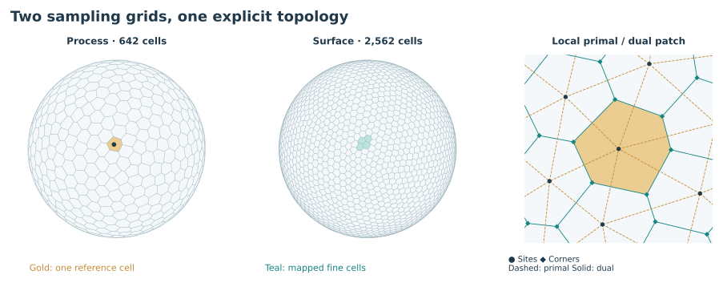

_Figure 1. Actual supported meshes at levels 3 and 4, shown with an orthographic projection. Gold identifies one process cell; teal identifies surface cells assigned to it. Dark sites are vertices of primal triangles. Teal corners are their circumcenters and form the dual cell boundaries._

`grid/build.ts` constructs both grids with the same procedure:

1. Start with the 12 normalized vertices and 20 outward-facing triangles of an icosahedron. At each subdivision, replace a triangle with four triangles. For edge `(a,b)`, compute `m = normalize(p[a] + p[b])`; an unordered-edge cache makes neighboring triangles share that midpoint.
2. Perturb each site within its local tangent plane. With nominal angular spacing `sqrt(4π / cellCount)`, radial displacement is `0.24 × spacing × irregularity × sqrt(random())`, and its direction has a uniform angle. Normalize the displaced vector back onto the sphere. The seed includes the subdivision level.
3. Validate face orientation. Then examine the two triangles sharing each edge. For oriented triangle `(i,j,k)`, compute `n = (p[j]−p[i]) × (p[k]−p[i])`. If the opposite vertex lies outside this outward face by more than the floating-point tolerance, flip the common diagonal and requeue neighboring edges. The predicate uses `dot(n, p[l]−p[i]) > 1e−12 × |n|`.
4. For each legalized triangle, normalize its outward face normal to obtain its spherical circumcenter. This becomes one dual corner. A halfedge walk around each site orders the corners of its polygon; crossing a shared edge gives the neighboring cell.
5. Compute cell area by summing spherical triangles between the site and successive dual corners. For unit vectors `p,a,b`, the triangle's area in steradians is `2 × atan2(abs(p·(a×b)), 1+p·a+a·b+b·p)`. Cell areas sum to `4π`; multiplying by `radius²` gives square metres.
6. Store adjacency and metrics in typed arrays. To locate a direction `q`, start from a known cell and move to any neighbor with a larger `dot(q, site)`. Stop when no neighbor improves it. On the legalized mesh this local walk locates the nearest site without scanning all sites.

The primal triangle mesh is useful for smoothly interpolated surface fields; the dual polygons supply control volumes and discrete categorical cells. River nodes are the dual corners. Thus a cell usually has five or six neighbors, while a river corner has three neighbors. These are different supports within one topology.

The terrain-gradient helper sums neighbor height differences along shared-edge normals, scales by `2 / degree`, and projects onto the local tangent plane. It is a compact gradient estimate; it does not solve a general least-squares matrix at every cell.

### 4.3 Transfer rules

`transfer[i]` maps a surface cell to a process cell. Categorical ownership uses that discrete mapping. Intensive tectonic uplift is sampled with local weighted interpolation.

Restriction accumulates actual child areas. It keeps land height, ocean depth, and land fraction separate, avoiding a fictitious low elevation formed by averaging an ocean trench with a mountain. A barrier maximum is computed by the spatial helper but is not currently an additional input to the climate solver.

For process rain depth `Pj`, surface rainfall uses:

```ts
meanRain[j] = (Pj * processArea[j]) / sumOfMappedSurfaceAreas[j];
Pi = meanRain[j] + limiter[j] * dot(gradient[j], position[i] - childCentroid[j]);
```

The child-area centroid makes the gradient contribution integrate to zero within each parent. A shared limiter bounds reconstructed values by nonnegative neighboring coarse extrema. Multiplying by each child's area preserves the parent's precipitation volume over the mapped footprint. Fine land temperature receives a correction of −0.006 °C per metre of elevation difference from its process land height, and PET is recomputed at that temperature. There is no extra fine-grid orographic rainfall redistribution.

#### Worked example: conserving rain across grids

Suppose a process cell represents 100 km² and receives 100 mm in a season. Its inventory is `100 × 10⁶ m² × 0.1 m = 10 million m³`. Independent surface geometry happens to assign children totaling 110 km² to that process cell. Copying 100 mm to all those children would create 11 million m³.

The prolongation instead uses an area-weighted mean of `100 × 100 / 110 = 90.909… mm` across the mapped children. Individual children vary around that mean with the limited local gradient. Their combined rainfall volume is again 10 million m³. Each process parent's volume is preserved over its assigned footprint, even though the boundary of that footprint is an approximation. Intensive quantities such as temperature do not receive this volume correction.

### 4.4 Units and authoritative fields

| Quantity                        | Meaning and units                                                                                                                             | Support                                                     |
| ------------------------------- | --------------------------------------------------------------------------------------------------------------------------------------------- | ----------------------------------------------------------- |
| Site/corner positions           | Unit-sphere directions.                                                                                                                       | Grid sites and corners.                                     |
| Areas and lengths               | Steradians and radians; physical area is `R² × area`, length is `R × angle`.                                                                  | Cells and shared edges.                                     |
| `height`, `bedrock`, `sediment` | Metres relative to the fixed zero sea-level datum; `height = bedrock + sediment`.                                                             | Surface cells.                                              |
| `seaThreshold`                  | Raw procedural field threshold used to establish zero before terrain shaping. It is not another water level.                                  | Terrain record.                                             |
| Plate motion                    | Prescribed angular vector multiplied by `plateSpeed × 10,000 / radius` for radians/Myr. It is a kinematic input, not a force solution.        | Plate records.                                              |
| Crust history                   | Initial/evolved raw basement and deformation in metres; reference ownership, material mask, inverse rotations, initial datum, and step count. | Process cells and plate matrices.                           |
| Wind/current                    | Tangential velocity, m/s.                                                                                                                     | Process cells, four seasonal samples.                       |
| Transport edge flux             | Signed area flux, m²/s.                                                                                                                       | Shared process edges; scratch state.                        |
| Atmospheric inventory           | Water-equivalent column in metres multiplied by physical area, giving m³.                                                                     | Process-cell transport scratch.                             |
| Stored moisture output          | Water-equivalent column in mm at the end of each seasonal integration.                                                                        | Process cells.                                              |
| Temperature/SST                 | °C.                                                                                                                                           | Seasonal process cells; corrected surface air temperature.  |
| Rain, PET, climate evaporation  | mm per representative season; annual rain/PET sum four seasons.                                                                               | Climate output and surface water fields.                    |
| AET, soil, snow                 | Annual actual ET in mm; final soil and snow-water storage in mm.                                                                              | Surface cells.                                              |
| `runoff`, `channelRunoff`       | Annual mean m³/s; channel runoff is a subset excluding quickflow.                                                                             | Surface cells.                                              |
| `discharge`, `supportFlow`      | Annual mean m³/s of routed water and qualifying channel supply.                                                                               | Surface corners.                                            |
| Catchment area                  | Upstream land area, m².                                                                                                                       | Surface corners.                                            |
| Lake spill/level/depth          | Escape elevation, computed water-surface elevation, and local water depth, in metres.                                                         | Lake records, corners, and surface cells.                   |
| Lake capacity/storage/area      | m³, m³, and m². Capacity is geometric; storage is estimated actual water.                                                                     | Lake records.                                               |
| Lake fluxes                     | Inflow, outflow, evaporation, direct rain, displaced runoff, in m³/s.                                                                         | Lake records.                                               |
| Aridity                         | `PET / max(1 mm, annual rain)`, clamped to 0–6.                                                                                               | Surface cells.                                              |
| Vegetation, bank coverage, ice  | Dimensionless potentials/fractions, generally 0–1.                                                                                            | Surface cells; bank potential also on selected river edges. |

Most rendered scalar fields use Float32. Geometry, cumulative discharge/area, transport inventories, and important accumulations use Float64. IDs and masks use integer arrays.

## 5. Explicit generation pipeline

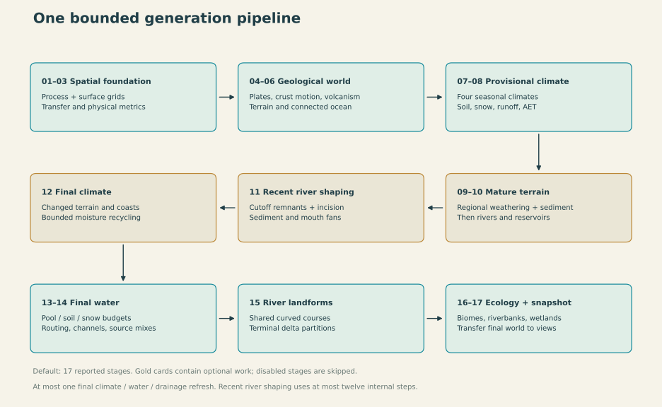

_Figure 2. The environmental pipeline is illustrated here. The v2.10.0 default has 18 named stages, including Minerals & fertility between ecology and publication. Geological weathering precedes the drainage graph used for recent incision. One final climate/water/drainage pass resolves the changed terrain; there is no convergence cycle._

`generateWorld(config, progress)` calls the following stages directly:

1. Simulation grid, Surface grid, Spatial transfer.
2. Plates & tectonics, optional Crust evolution, Terrain & oceans.
3. Seasonal climate and Land water budget.
4. Optional Landscape weathering & sediment; refresh coast classification and land water using the held provisional climate.
5. Rivers & reservoirs on that matured terrain.
6. Optional River landscape evolution: preserve selected cutoff remnants, run bounded incision, and deposit the removed material.
7. Refresh ocean membership and process terrain. If erosion or recycling is enabled, run Final climate and Final water & drainage once.
8. Headwaters & channels, River courses & deltas, Biomes & ecology.
9. Minerals & fertility, then Publish world.

A process-resolution reference ocean stabilizes gyre placement when surface detail changes. Zero tectonic duration omits crust evolution. Zero erosion omits weathering and recent incision; zero erosion and recycling also omit final feedback. Zero fluvial duration retains geological weathering but disables recent incision and bend growth. The geological loop reports elapsed Myr; the recent fluvial interval has a separate control.

The renderer receives only the final snapshot. Provisional arrays are not a second retained world, although temporary overlap and garbage collection still affect peak memory. Stage durations and total elapsed time are recorded; small preparation work between named stages means their sum need not equal total elapsed time exactly.

## 6. Geology and terrain

### 6.1 Plates and inherited geology

Connected frontier growth assigns major, minor, and microplates using soft area targets. Plate topology is connected by construction. Crust continentalness, crust age, and inherited terrain are separate fields rather than properties inferred solely from plate ID.

Relative plate motion at shared edges classifies convergence, divergence, and transform motion. Convergent continental boundaries generate collision belts. Subduction chooses a sinking side and an overriding side; trench and arc effects remain asymmetric. Divergence generates continental rifts or oceanic ridges. Transform boundaries are shown but have no separate fault-incision model.

Five feature families propagate dominant-source envelopes within their plate/crust context. Widths are measured in metres and scaled by `tectonicWidth`. Gaussian decay localizes high relief. Activity is a procedural strength control. Initial ages are synthetic; the evolution pass adds elapsed time to exposed reference crust and initializes young ocean gaps. The separate drift control remains a display-only transform.

#### Algorithm: connected plates and localized boundary effects

`buildGeology` assigns approximately 45% of plate seeds large area weights, the next 35% medium weights, and the rest small weights. Major seed placement samples candidates and favors separation from existing seeds. Each plate receives a random rotation axis and angular-motion vector `ω`.

During frontier growth, choose a plate with a small value of `(currentArea / targetArea) × randomJitter`, select an unclaimed frontier cell, and claim it. Add that cell's unclaimed neighbors to the frontier. Every successful claim touches existing territory, so a plate stays connected. Targets are soft: obstacles and other plates can prevent exact requested areas.

For every edge between different plates, evaluate velocities `vA = ωA × midpoint` and `vB = ωB × midpoint`. Resolve their difference against the shared-edge normal and its tangent:

```text
convergence = −dot(vB − vA, normal)
shear       = abs(dot(vB − vA, cross(midpoint, normal)))

convergence >  0.12  → collision or subduction
convergence < −0.12  → divergence
otherwise, shear > 0.14 → transform
```

Continentalness above 0.53 distinguishes continental crust in this boundary classifier. Two continental sides produce collision sources. Otherwise, continental crust overrides oceanic crust; between two oceanic sides, the older side subducts. The same motion can therefore produce an asymmetric trench and arc instead of two identical mountain ridges.

Each of five feature families propagates through a min-heap. A source starts at cost `−ln(max(strength, 0.001))`; crossing a neighbor adds `edgeDistance / sourceWidth`. Propagation stays within the source's plate and crust category and stops at cost 7. Each cell retains its best source in that family. After recovering distance `d`, its envelope is `v = strength × exp(−(d / width)²)`.

| Feature               | Base width, before `tectonicWidth` | Elevation contribution, before `exposure`               |
| --------------------- | ---------------------------------- | ------------------------------------------------------- |
| Continental collision | 380 km                             | `4700 × v` m                                            |
| Subduction trench     | 170 km                             | `−1700 × v` m                                           |
| Overriding arc        | 240 km                             | `3300 × v × (0.4 + 1.4 × exp(−((d−110 km)/100 km)²))` m |
| Continental rift      | 380 km                             | `−650 × v` m                                            |
| Ocean ridge           | 520 km                             | `850 × v` m                                             |

The winning source per family is a compact envelope approximation, not a sum of every boundary's influence. Positive mechanical families now use their maximum; negative contributions are added. With geological history enabled, arc/ridge construction comes from the accumulated volcanic field, not an additional instantaneous magmatic term. This keeps terrain generation small and places strong relief near identified tectonic features.

#### Algorithm: deterministic continuous terrain noise

The scalar noise primitive hashes the eight corners of a 3D integer lattice and interpolates them. Interpolation uses the quintic fade `f(t) = t³ × (t × (6t−15) + 10)` along each axis. It is smooth value noise, not a Perlin-gradient or simplex implementation.

For a unit-sphere point, three offset noise samples warp its coordinates by up to a 0.22 scale factor. Two crust-noise frequencies, `1.65 / continentScale` and `3.4 / continentScale`, combine with weights 0.8 and 0.2 to form continental shape. Inherited detail combines frequencies 4, 9, 22, and 53 with amplitudes 350, 120, 40, and 12 m. The raw base is `12500 × continentNoise + inheritedDetail`.

Independent seed suffixes isolate plate growth, terrain, crust, and valleys. Sampling this continuous function at more surface sites reveals additional detail without regenerating the process plates. The field does not contain a hidden high-resolution texture or an Earth map.

### 6.2 Plains, mountains, and drainage divides

Domain-warped continuous noise defines the initial continental shape and inherited detail. With positive geological duration, the reconstructed basement in section 6.4 replaces stationary world-coordinate noise as the final terrain source. An area-weighted quantile on the process reference grid sets the raw sea threshold. The `oceanFraction` setting targets the initial raw below-datum fraction; actual connected ocean coverage can differ after plate motion, overlap/gap resolution, component selection, and basin construction. Evolution retains the initial datum instead of resetting sea level to recover an exact ocean percentage.

The raw basement and physical relief now remain separate:

```ts
plains = 950 * -Math.expm1(-Math.max(0, base) / 5500);
valleys = Math.min(140, plains * 0.65) * lowlandRelief * inheritedReliefFactor;
basement = base > 0 ? plains + valleys : base * 0.55;
relief = Math.max(0, uplift) * mountainTexture + Math.min(0, uplift) + volcanic;
elevation = basement + relief;
height = elevation > 0 ? elevation * reliefScale : elevation;
```

An uplifted submarine sample must pay its seabed depth before emerging. The old threshold crossing exposed the whole mountain term and could stack collision/arc families. The new composition avoids that discontinuity without imposing an island-height cap.

`lowlandRelief` retains the independent 100–200 km valley field. Its amplitude weakens with geological maturity:

```text
maturity = durationMyr × erosion × (1 - 0.85 × youth)
inheritedReliefFactor = 0.2 + 0.8 × exp(-maturity / 65 Myr)
```

Youth is a proxy combining active uplift, recent substantial volcanic construction, and high-latitude preservation. This attenuation is terrain construction, not an additional sediment flux or glacial excavation model. Residual detail preserves shared valleys and divides.

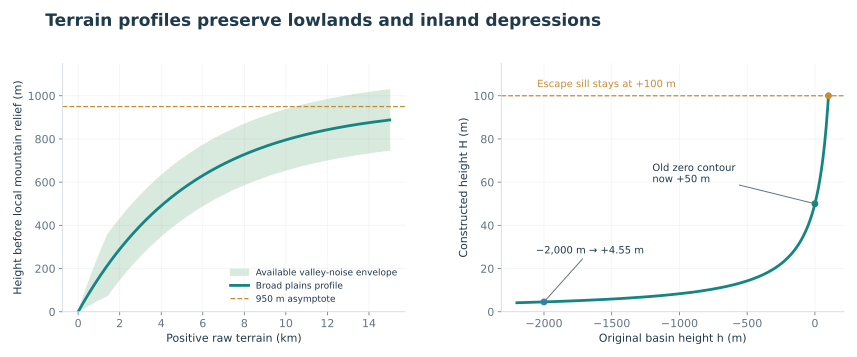

_Figure 3. Left: initial plains profile and maximum valley-noise envelope before maturity attenuation, excluding tectonic/volcanic relief. Right: the basin transformation with an illustrative +100 m escape sill. These formula plots remain the underlying profiles; they are not a cross-section of AETHER-94633._

The lowland curve approaches 950 m and its derivative is `(950 / 5500) × exp(-base / 5500)`. Ocean basement retains its bathymetric profile. Later wave erosion, sediment delivery, and outlet incision alter this constructed surface before final water routing.

### 6.3 Sea level and enclosed continental basins

The largest connected negative-height component is the ocean. Originally, other negative components retained ocean-floor depths and were nevertheless treated as land. That produced the anomalous dry inland terrain in AETHER-43246.

During terrain construction, a temporary height-only priority flood finds each continental depression's lowest escape sill. A connected depression containing negative terrain is reshaped as a whole, including its positive slopes. For original height `h` below a positive spill elevation `s`:

```ts
continentalHeight = (s * s) / (2 * s - h);
```

The result is above zero and below the sill, increases monotonically with the original height, and matches height and slope at the sill. The exceptional zero-height sill gives a sea-level floor. Applying the transformation only to negative cells would create a ridge at the old zero contour; the whole affected depression is therefore transformed together.

This replaces the rejected arbitrary negative-depth cap. It preserves ocean bathymetry, coastlines, surrounding ridges, and ordinary positive basins during this construction step. Bedrock and height are updated together.

This operation shapes initial terrain; it neither adds water nor simulates deposited sediment. The subsequent water budget determines the lake's level and extent. Later erosion remains volume-accounted and can modify these initial elevations. The temporary cell flood is not a second river-routing graph.

The profile can produce very broad, very shallow basins. That is a documented consequence of this terrain preset, not evidence of a simulated geological history or a calibrated lake-depth distribution.

#### Algorithm: reshape the entire affected depression

`continental-basins.ts` operates on cell heights before water is generated:

```text
mark the largest connected negative-height component as ocean
seed a min-heap from land touching that ocean
propagate escape heights: filled[j] = max(originalHeight[j], filled[i])
group connected interior cells below a common escape height

for each group that contains negative terrain:
    s = its escape sill
    for each member with originalHeight h < s:
        height = s > 0 ? s*s / (2*s − h) : 0
        bedrock = height
```

For `s > 0` and `h < s`, the denominator exceeds `s`, so `0 < height < s`. The derivative `s² / (2s−h)²` is positive and equals 1 at the sill. This preserves the ordering of slopes within a group and meets the unchanged surroundings smoothly at the escape elevation.

With `s = 100 m`, an old floor at `−2000 m` becomes `+4.545 m`; the old zero contour becomes `+50 m`; and the sill remains `+100 m`. Reshaping only the negative portion would join +50 m terrain to an unchanged near-zero slope and introduce an artificial divide. That is why positive slopes inside the same depression participate.

No ocean cell receives this transformation. A separate hydrology calculation later decides whether rain and inflow support a lake in the constructed basin. A very shallow positive-depth lake still needs to appear as water, which is the contract described in section 10.3.

### 6.4 Kinematic crust evolution through geological time

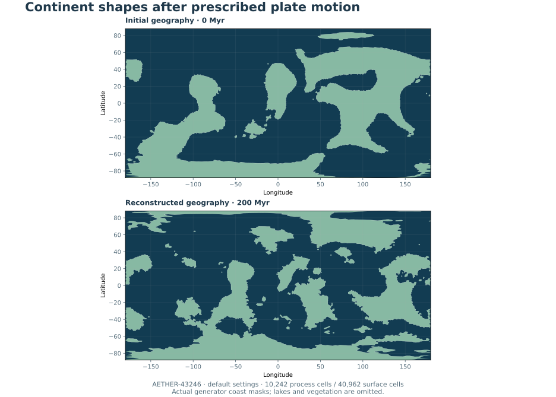

_Figure 9. Actual AETHER-43246 coast masks at default settings, with 10,242 process cells and 40,962 surface cells. This terrain-only comparison shows land and connected ocean, excluding lakes and vegetation. It is a reference configuration, not an exact reproduction of the supplied screenshots._

The preceding generator evaluated continent noise at fixed world coordinates, then added present-boundary relief. Its drift control moved display geometry only. That explains why broad outlines continued to resemble the initial noise even where a mountainous margin was more intricate.

This version adds a bounded **kinematic crust reconstruction** before terrain, climate, and hydrology. Noise defines initial basement. Prescribed finite plate rotations move that basement through a geological interval, overlaps select exposed material, gaps become young ocean floor, and transported deformation carries earlier collision/rift effects into the final terrain.

#### Observable behavior

- Geological duration defaults to 200 Myr. Plate motion defaults to a 3 cm/year scale; actual speed depends on the angular vector and distance from the Euler pole.
- Duration changes generated geography and downstream climate/drainage, independently of the display-only drift preview.
- Duration zero keeps the preceding static generation path. v2.4.1 projects import with defaults for the new controls; use zero duration to retain the static path.
- Initial continents and Inherited deformation are new diagnostic layers. Final-world rivers are omitted from the initial view.
- The initial process-grid sea-level datum is retained. Ocean coverage targets initial geography; the final fraction can change as continental patches overlap or separate.
- Climate, rivers, lakes, and vegetation use the final terrain and their existing budgets. None of those solvers runs inside the geological loop.

#### Algorithm

`src/core/generation/crust-evolution.ts` owns the pass. `updateTectonicRelief` recomputes present boundary features afterward.

1. Retain initial plate ownership, basement, and seeded crust ages on the process grid. Establish the area-weighted initial sea-level quantile.
2. Divide the requested interval into equal steps no longer than 5 Myr or 150 km of maximum prescribed motion. Finite rotations are exact; the step bound limits deformation integration.
3. For every plate/destination pair, inverse-rotate the destination into the plate's initial frame. A cached nearest-cell walk tests whether that plate's reference patch covers the destination.
4. Resolve overlapping patches by buoyancy: continental basement overrides oceanic basement; among continental candidates prefer higher basement, and among oceanic candidates prefer younger material.
5. Assign uncovered destinations to the nearest rotated plate seed and create young ocean floor. Continuous gap cells age in place; raw basement follows `−4200 − 1800 × (1−exp(−age/65))` metres before the existing bathymetric scaling.
6. Backtrace the preceding deformation field with the selected plate's incremental rotation. Relax it with a 90 Myr e-folding time. Overlapping continental patches and relative boundary velocities create signed deformation targets. A nearest-source distance field applies a Gaussian envelope of physical width `220 km × tectonicWidth`; targets are approached on an 18 Myr timescale within that envelope.
7. Store reconstructed basement plus deformation, exposed plate ownership, continentalness, and age. Report elapsed geological time periodically.
8. Recompute present collision, trench, arc, rift, and ridge relief. Sample final basement onto the surface grid, adding a bounded continuous-noise residual in the selected plate's reference coordinates inside coherent interiors. Suppress that residual across ownership/gap boundaries.
9. Apply the existing plains/mountain profiles, classify ocean, construct inland basins, and run climate, land water, drainage, rivers, and ecology.

For unit angular-motion magnitude, 3 cm/year means 30 km/Myr and 6,000 km over 200 Myr along an equatorial path around the Euler axis. Relative surface speeds vary over each plate.

#### Model boundary

Plate axes and speeds are prescribed and do not respond to forces. Initial patches move rigidly. Continents can separate along different initial carriers, but the solver does not create new plate identities or mechanically deform a plate interior.

Overlap resolution is surface clipping plus a deformation proxy. It does **not** permanently consume a subducted patch, weld colliding continents, conserve a lithospheric mass/thickness budget, or reconstruct irreversible subduction. A reference patch can be exposed again after an overlap ends. New gap crust uses a local age approximation rather than a separate material mesh. Initial ages are synthetic.

These limits matter for later mineral provenance. Current outputs describe generated environmental context; they are not validated histories of individual rock parcels. Future irreversible transfer should replace the overlap rule within this module and retain one terrain authority.

Some coasts can remain smooth: a rigid rotation preserves an untouched margin. Wave erosion now runs in the later landscape stage (section 12.1). Deltas, glacial fjords, and changing sea level remain outside the model. Its goal is for continental arrangement and broad deformation to depend on motion through time, without imposing universal jaggedness.

#### Cost and focused verification

The pass uses `O(S × M × P)` cached reference queries plus `S` heap-based distance sweeps: `M` process cells, `P` plates, `S` steps. Fine surface sampling follows once. Added retained fields occupy approximately `19 × M + 72 × P` bytes; the temporary lookup cache uses `4 × M × P` bytes. Heap/object overhead is additional. No sequence of entire worlds is retained.

An AETHER-43246 comparison at default settings, 10,242 process cells, and 40,962 surface cells used 46 steps for 200 Myr. The pass took about 2.7 seconds in this environment. Connected ocean changed from 65.42% to 68.19%; 44.46% of the planet changed land/ocean membership. This is a reference run, not an exact reproduction of the supplied screenshots or a scientific calibration. A preliminary maximum-process-grid check took about 8.3 seconds; runtime depends on settings and hardware.

All ten focused tests pass, including the new finite-motion/reference-crust check and existing water, reservoir, river, basin, vegetation, and shallow-lake contracts. The production build passes. No browser test or full maximum-weather rerun was performed.

An optional terrain-only comparison can be reproduced with:

```sh
node --import tsx scripts/measure-tectonics.ts AETHER-43246 5 6 comparison.json
```

#### References

- [USGS: Understanding plate motions](https://pubs.usgs.gov/gip/dynamic/understanding.html) — physical motion scales.
- [GPlates: finite rotations](https://www.gplates.org/docs/pygplates/pygplates_primer) — spherical motion geometry. This prototype uses neither GPlates datasets nor its full topology/deformation model.

#### Rotation, deformation, and fine sampling formulas

For unit Euler axis `a`, angular speed magnitude `w`, and scaled elapsed angle `θ`, the forward finite rotation is `R(p) = p × cos(θ) + (a × p) × sin(θ) + a × dot(a,p) × (1−cos(θ))`. The reference lookup uses the inverse angle. The implementation stores each rotation as nine Float64 coefficients; it does not accumulate many approximate position updates.

Initial footprint membership is discrete: the nearest reference cell at the inverse-rotated point must belong to the candidate plate. Basement uses local intensive interpolation. Small fragments or passages below the process-grid resolution remain unresolved, and final ownership can contain clipped or disconnected patches. Connected initial frontier growth is not a guarantee of connected final ownership.

The deformation update can be written:

```text
carried = interpolate(previousDeformation, inverseIncrement × position)
          × exp(−dt / 90 Myr)
influence = exp(−(distanceToSource / (220 km × tectonicWidth))²)
deformation = carried
            + (exposure × target − carried)
              × (1−exp(−dt / 18 Myr)) × influence
```

Targets are heuristic metres: continental overlaps contribute 1800 m; boundary targets use `min(2600, 0.07 × closingVelocity)` for convergence or `max(−2800, 0.09 × closingVelocity)` for divergence, with velocity in m/Myr. Multiple targets at a source are averaged. Gaps carry no inherited deformation. The 90 Myr relaxation is geometric denudation, with no sediment-volume ledger; explicit landscape detachment and sediment deposition use their own volume accounting afterward.

Let `I` denote the local process-field interpolator. At a detailed surface point, reconstructed raw basement is `I(evolvedBase) + residual`; current uplift and volcanic construction are added in physical elevation space. In a coherent material interior, `residual = clamp(noise(inverseRotation × point).base − initialDatum − I(materialBase), −900, 900)` metres. The residual is zero where the nearest process cell or its neighborhood crosses a plate/gap boundary. Thus fine detail follows the selected material frame while the evolved field supplies the continental arrangement.

The final world stores this reconstruction state, not all intermediate worlds. A future C3 implementation can port the flat arrays, matrix rotation, local cell walks, and explicit loop directly; it does not require React, three.js, a general solver scheduler, or a mechanical finite-element framework.

### 6.5 Volcanic landmass construction

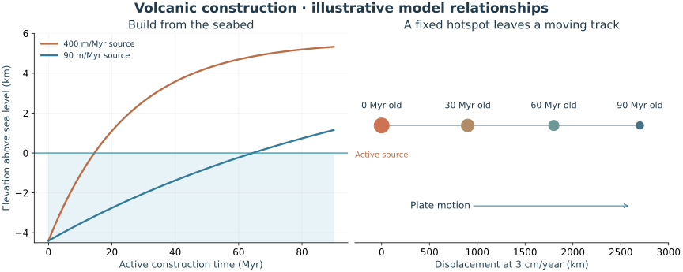

_Figure 10. Left: construction-law curves above a 4.4 km-deep seabed, omitting transport, aging, and later erosion to isolate emergence. Right: the distance–age relation for prescribed motion at 3 cm/year. These are teaching relationships, not an actual world's eruption history._

`volcanism.ts` creates `hotspotCount` stationary mantle-frame sources using a separate seed suffix. Each has a unit position, a finite eruption interval, a 110–200 km influence radius, and an effective construction rate of 220–440 m/Myr. The fixed schedule spans the supported geological interval; it is not regenerated at each step or rescaled to the requested end time.

During each existing crust step, `crust-evolution.ts` transports the previous volcanic relief through the inverse incremental plate rotation. It accepts it only when the nearest source belongs to the current receiving plate. Opened ocean can carry new deposits even though it has no surviving reference basement. Old volcanic relief relaxes by `exp(-dt / 220 Myr)`, a combined empirical loading/aging proxy rather than a conserved crust-volume ledger.

Fault sources are deterministic given the seed, ownership, and prescribed plate velocities:

- Convergence with at least one oceanic side places a source on the overriding side. Continental collision contributes mechanical relief instead of a second arc.
- Divergence supplies decompression sources on both sides, at a lower rate.
- Transform motion alone is not assumed to generate magma.

A heap propagates fault influence over `130 km × tectonicWidth`, constrained to the same plate. Stronger sources dominate overlap rather than accumulating one volcano per boundary edge. Hotspots add Gaussian influence using local chord distance. Sources are integrated with a saturating construction law:

```text
carried = interpolate(previousVolcanic, inverseIncrement × position)
          × exp(-dt / 220 Myr)
rate = volcanicActivity × (faultRate + sum(activeHotspotRates))
newVolcanic = carried + (10,000 m - carried)
                        × (1 - exp(-rate × dt / 10,000 m))
```

`volcanicAge` increments with the carried material and resets where emplacement exceeds 5 m/Myr. Young large deposits resist the separate long-term erosion pass. These arrays describe accumulated construction and a recent-emplacement proxy, not lava stratigraphy, lithology, eruption hazards, or irreversible mineral provenance.

## 7. Seasonal climate and moisture transport

### 7.1 Heating and wind

Four equal-duration representative seasons use latitude, axial tilt, land/ocean seasonal amplitude, and a 6 °C/km lapse rate. Elevation correction on the fine surface prevents an entire coarse cell from inheriting the temperature of its highest terrain. Tundra remains possible on sufficiently cold tropical mountains; latitude alone does not choose a biome.

Seeded atmospheric whorls and a weak zonal background provide a rotating-planet wind preset. Terrain gradients divert uphill flow and reduce speed over high terrain. The field stored in `climate.wind` is also the field used for atmospheric transport and displayed by wind tracers. No atmospheric momentum or pressure system is solved.

Coastal air moderation and current-driven SST anomalies decay over a physical reach of 650 km. This avoids a fixed-cell-hop coastal influence that shrinks with resolution.

#### Algorithm: seasonal thermal and wind presets

Before coastal moderation, the thermal baseline is:

```text
temperatureControl + 14
− 45 × abs(sin(latitude))^2.5
+ sin(seasonPhase) × sin(latitude) × axialTilt × seasonalAmplitude
− 0.006 × max(0, elevation)
```

`seasonalAmplitude` is 0.13 over ocean and 0.7 over land. The sinusoidal seasonal term changes sign between hemispheres. The lapse term applies to elevation above the datum, so negative bathymetry does not heat the ocean floor into the atmosphere.

The wind preset places 35 seeded whorls in five latitude bands, with seven per band. Their radii scale with the circulation control. A weak zonal component, proportional to `−cos(6 × latitude)`, supplies broad alternating flow. Terrain gradients divert uphill motion and elevation damps it; `windStrength` sets the final speed scale. These vectors drive the transport operator below, so the wind animation and moisture direction share one source field.

### 7.2 Shared-edge water transport

Each process edge is visited once. First-order upwind advection moves inventory from its donor cell to its receiver cell. Equal-and-opposite updates preserve total inventory. Explicit eddy diffusion uses:

```ts
conductance = (diffusivity * faceLength) / centerDistance;
exchange = dt * conductance * (columnA - columnB);
```

The time-step limit includes both outward advective flux and diffusive conductance. Its safety factor is 0.65. Atmospheric steps are also capped at one day. This keeps transport stable without silently discarding negative water after an oversized step.

Physical duration, wind speed, diffusivity, and residence time determine moisture reach. A higher cell count no longer means the same small number of moisture hops covers less of a continent.

#### Algorithm: one conservative transport step

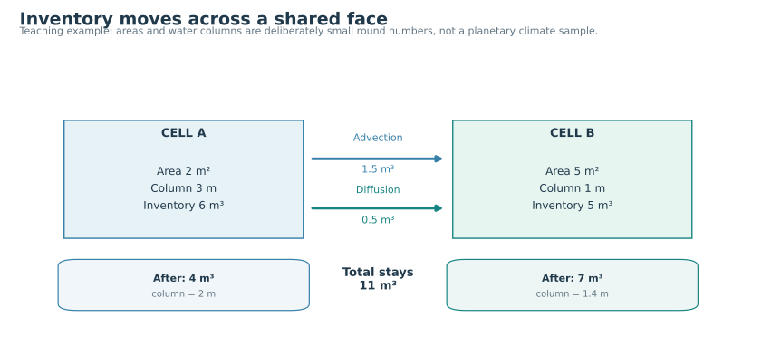

_Figure 4. A deliberately small teaching example. Advection and diffusion move 2 m³ in total from A to B while preserving the combined 11 m³ inventory. Water-column depth and inventory are different quantities._

Let `A[i]` be cell area, `I[i]` its water inventory, and `q[i] = I[i] / A[i]` its water-equivalent column. For the oriented edge `a → b`, compute area flux `F = dot((wind[a]+wind[b])/2, edgeNormal) × faceLength` in m²/s. Diffusive conductance is `C = diffusivity × faceLength / centerDistance`, also in m²/s.

```text
delta.fill(0)
for each shared edge (a, b):
    donor, receiver = F >= 0 ? (a, b) : (b, a)
    moved = dt × abs(F) × I[donor] / A[donor]
    delta[donor] -= moved
    delta[receiver] += moved

    mixed = dt × C × (I[a]/A[a] − I[b]/A[b])
    delta[a] -= mixed
    delta[b] += mixed

for each cell i:
    I[i] += delta[i]
```

Every edge reads the old inventory; changes are applied after the edge loop. Updating the read buffer during traversal would make results depend on edge order and allow water to travel multiple edges within one nominal step.

For each cell, sum its outward advective area flux and every incident diffusive conductance into `out[i]`. Then use `dt = min(maxStep, min_i(0.65 × A[i] / out[i]))`, skipping zero denominators. This bounds the total fraction removed from any donor by transport. The physical integration window is independent of the number of cells, while the number of stable substeps generally grows with resolution.

In Figure 4, `A = [2,5] m²`, `I = [6,5] m³`, `F = 0.5 m²/s`, `C = 0.25 m²/s`, and `dt = 1 s`. Advection moves `1 × 0.5 × 3 = 1.5 m³`; diffusion moves `1 × 0.25 × (3−1) = 0.5 m³`. Inventories become `[4,7] m³`, giving columns `[2,1.4] m`. For A, the stability bound is `0.65 × 2 / (0.5+0.25) = 1.733… s`, so the chosen step fits.

### 7.3 Sources, sinks, and seasonal outputs

Ocean evaporation depends on SST, wind speed, humidity, and the evaporation control. Land moisture supply in the final pass is bounded by the provisional land AET and the recycling fraction. There is no artificial minimum inland humidity.

Precipitation removes moisture from inventory through residence-time loss, stronger equatorial convective tendency, upslope rainout, and removal above empirical saturation capacity. These are reduced-order laws, with constant coefficients prepared outside the integration loop where possible.

Each representative season starts with a 12 mm moisture column, spins up for `max(35 days, 3 × moistureLifetime)`, then samples 30 physical days. Sampled rain and evaporation are scaled to a quarter year. Stored atmospheric moisture is the final column, not accumulated rainfall.

Longer residence, conservative mixing, wind advection, ocean evaporation, and bounded recycling jointly support continental moisture. Raising a rainfall multiplier to hit a desired desert percentage is not part of the architecture.

#### Algorithm: evaporation, rainout, and seasonal sampling

For each season, prepare fixed temperature, wind, terrain, and rainout coefficients, then integrate inventory. Ocean evaporation responds to humidity during the loop. At each substep:

1. Advect and mix the old water inventory with the shared-edge operator.
2. Add evaporation volume `rate × area × dt`. Ocean supply uses SST and wind, reduced as atmospheric inventory approaches its capacity. In the final pass, land supply is restricted provisional AET multiplied by the `recycling` control.
3. Remove an exponentially bounded fraction of moisture exceeding the saturation capacity.
4. Apply the residence/upslope precipitation fraction to the remaining available inventory.
5. Subtract the resulting rain from inventory. During the sampling window only, accumulate rain and evaporation totals.

The implementation's empirical coefficients can be read as:

```text
capacityColumn = 0.013 × exp(0.047 × clamp(T, −35, 45))          [m]
capacity       = area × capacityColumn                       [m³]

oceanPotential = max(0.00025, 0.0026 + 0.00006 × SST)
                 × (0.7 + 0.06 × windSpeed) × evaporationScale [m/day]
humidityFactor = clamp(1 − relativeHumidity/2, 0.08, 1)

dailyRainout = (1 + 0.7 × (1−abs(sin(latitude)))^4) / lifetimeDays
             + orographicStrength × min(0.7, upslopeSpeed × 18)

excessRain = max(0, inventory−capacity) × (1−exp(−dt/day))
rain = excessRain
     + (inventory−excessRain) × (1−exp(−dailyRainout × dt/day))
```

Here `upslopeSpeed` is the nonnegative wind/terrain-gradient contribution used by the model. The coefficients are worldbuilding parameterizations rather than separately solved cloud physics. Exponential removal stays between zero and the water available, including when a chosen residence time would make a linear sink too aggressive.

Each season resets to a 12 mm column, runs its spin-up, and samples the next 30 days. Sampling totals multiply by `season / (30 days)` before conversion to seasonal millimetres. The atmosphere ledger applies to the actual integration window; rescaling the output does not imply the whole modeled year was integrated continuously through four carried-over seasonal states.

## 8. Ocean circulation and temperature

Seeded gyres are selected on the fixed process reference ocean. A prescribed streamfunction at dual corners defines the authoritative shared-edge flux:

```ts
edgeFlux = streamfunction[endCorner] - streamfunction[startCorner];
```

Coastal corner values are zero and land interfaces carry no ocean flow. Oriented differences telescope around cells, producing near-zero discrete divergence. Displayed current vectors are reconstructed from these fluxes. The model does not add an unrelated wind vector after solving the transport field.

SST is transported as area multiplied by temperature over 180 days, with relaxation toward the seasonal thermal baseline on a 70-day timescale. The final SST has a −1.8 °C floor. SST affects evaporation and coastal air temperature, linking currents to climate through actual transported temperature rather than local current direction alone.

This is a prescribed surface-circulation and thermal model. It does not simulate deep circulation, salinity, tides, or lake circulation. Fine straits absent from the process ocean are also absent from its transport graph.

### 8.1 Algorithm: a conservative ocean flux from a streamfunction

The corner streamfunction `ψ` is a weighted sum of seeded gyres, scaled by radius and `currentStrength`. A coastal fade weakens it near land, and a corner touching land receives exactly zero. Flux on a shared edge is a difference of its endpoint values, using a consistent orientation.

For a schematic cell whose cyclic corner values are `[0,3,1,0] m²/s`, the four outward-oriented differences are `[+3,−2,−1,0] m²/s`. Their sum is zero. This telescoping cancellation holds regardless of the cell's area. Using the same edge value with opposite signs in its two incident cells preserves the shared flux; a land boundary has no through-flow.

For display, divide each edge's flux by its physical face length, sum its normal contributions around the cell, scale by `2 / degree`, and project tangentially. The resulting vector is an approximate reconstruction for interpolation and visualization. Heat transport still uses the authoritative edge flux directly.

Initialize `heat[i] = area[i] × baselineTemperature[i]`. Advect that signed quantity with the same upwind operator, using its stable step capped at five days. After each step, relax cell temperature toward its baseline:

```text
temperature = heat / area
temperature += (baseline − temperature) × (1−exp(−dt/(70 days)))
heat = area × temperature
```

After 180 days, apply the −1.8 °C floor. Transport redistributes the scalar conservatively; relaxation and the floor intentionally exchange heat with the prescribed baseline. A coastal SST anomaly contributes to air temperature with a factor `0.6 × exp(−coastDistance / 650 km)`, alongside seasonal land/ocean moderation. These temperatures then affect evaporation and rainfall.

## 9. Land water and runoff

Every non-ocean surface cell has a soil bucket and snow-water storage. The same four seasons repeat for four initialization years; only the fourth contributes annual flux totals. This is a bounded initialization, not a converged ice-sheet or groundwater simulation.

For each season, precipitation can accumulate as snow, temperature permits bounded snowmelt, and liquid water splits into direct quickflow and infiltration. Actual ET is limited by available soil water. Water beyond soil capacity overflows, and 8% of remaining soil water drains during the season. All these fluxes are deducted from their available storage.

Annual source distinctions and seasonal runoff are retained:

| Field               | Contents                                                                                        | Consumers                                          |
| ------------------- | ----------------------------------------------------------------------------------------------- | -------------------------------------------------- |
| `runoff`            | Quickflow + soil overflow + slow soil drainage.                                                 | Full discharge, reservoirs, erosion, water ledger. |
| `channelRunoff`     | Soil overflow + slow drainage; a subset of `runoff`.                                            | Headwater qualification and riverbank supply.      |
| `seasonalRunoff[4]` | Total runoff volume divided by one season, in m³/s. Its four-value mean equals annual `runoff`. | Seasonal river routing and floodplain potential.   |

The distinction reduces the excessive network of continuously drawn small blue rivers while preserving the water carried by storm drainage. It does not remove storm water from the hydrological model.

Annual AET is restricted to the process grid and reused as the bounded land source in the optional final climate pass. That source is based on the provisional budget; the application does not iterate atmosphere and land to simultaneous equilibrium.

### 9.1 Algorithm: the seasonal soil and snow bucket

Fine-cell PET is `max(0, T+5) × (0.075 + 0.0015 × windSpeed) × 365.25/4` millimetres per season. With soil capacity `C`, infiltration fraction `f`, and stored snow and soil from the preceding season, the update is:

```text
if T < 0:
    snow += precipitation
    liquidRain = 0
else:
    liquidRain = precipitation

melt = min(snow, max(0, T) × 12)
snow -= melt
liquid = liquidRain + melt
quickflow = liquid × (1−f)
available = soil + liquid − quickflow

AET = min(available, PET)
available -= AET
overflow = max(0, available−C)
available -= overflow
baseflow = available × 0.08
soil = available−baseflow

runoff = quickflow + overflow + baseflow
channelRunoff = overflow + baseflow
```

In a warm-season teaching example, begin with 60 mm of soil water and no snow. Let rain be 100 mm, PET 80 mm, infiltration 0.85, and capacity 140 mm. Quickflow is 15 mm. Available water is 145 mm; AET uses 80 mm and leaves 65 mm, with no overflow. Baseflow takes 5.2 mm, leaving 59.8 mm of soil water. Total runoff is 20.2 mm, of which 5.2 mm supports channel initiation.

The ledger closes: `60 + 100 = 59.8 + 80 + 20.2 mm`. After collecting the fourth initialization year's four seasons, convert runoff depth to annual mean discharge with `annualMillimetres × 0.001 × area / yearSeconds`. A 100 km² cell producing that 20.2 mm as an annual total would contribute about 0.0640 m³/s. The seasonal bucket and annual flow are deliberately distinct representations.

### 9.2 Water pathways and cutoff pools

The soil loop also carries a melt-water fraction through infiltration, AET, and soil overflow. Annual `meltRunoff` counts rapid snowmelt delivery; `baseflowRunoff` counts the existing slow soil release. These are disjoint delivery pathways: water that melted earlier and later drains from soil is classified as slow release, not counted twice. Remaining runoff is the rapid rainfall pathway. There is no new water source or multiplier.

`saturatedSeasons` counts representative seasons whose pre-baseflow soil storage reaches 85% of capacity. It supports habitat classification, not a groundwater-table solution.

Each preserved cutoff has one shallow pool bucket. Its physical footprint replaces the same fraction of its host cell's soil bucket. Let `p` be pond fraction, `H` pond water depth, and `D = 1.5 m` capacity:

```text
available = H + liquidRain + snowmelt
pondET = min(available, PET)
pondOverflow = max(0, available - pondET - D)
Hnext = available - pondET - pondOverflow
cellRunoff = (1-p) × soilRunoff + p × pondOverflow
cellAET = (1-p) × soilAET + p × pondET
cellStorage = (1-p) × soilStorage + p × Hnext + snowStorage
```

Lengths are converted to the common millimetre convention inside the soil loop. Four repeated years initialize both buckets; only final-year seasonal depths are retained. Overflow joins existing cell runoff and receiver routing. A pool that dries remains an abandoned-channel scar. Direct river flood recharge, infiltration through a pond bed, and peat or sediment infill histories are not simulated. Rain and melt alone can maintain these relict pools; their existence is not proof of perennial water.

## 10. Authoritative drainage and reservoirs

### 10.1 Corner routing

A surface corner touches three cells. Its terrain height is their mean. Each cell divides its runoff and contributing area equally among its incident corners. This accounts for cell degree while preserving totals.

Ocean-touching corners seed a priority flood. The flood supplies escape heights and a visitation order. Each non-outlet corner chooses a steep downhill receiver consistent with that order, with a flood-parent fallback for flats/depressions. The result is an acyclic corner graph. One global low outlet is the explicit all-land fallback, although the supported configuration normally supplies an ocean.

`drainage.receiver` is authoritative. The model supports many tributaries merging into one channel. Interior channels retain one downstream receiver. Terminal delta branches now subdivide the final delivery into the same receiving lake or ocean; they do not introduce a second interior routing graph. Geometric depression detection has a small numerical depth tolerance; this is distinct from how already-computed standing water is classified and displayed.

#### Algorithm: Priority-Flood and downhill receivers

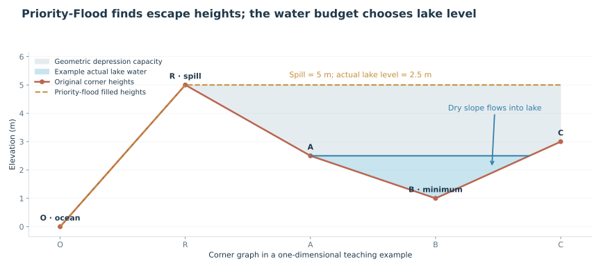

_Figure 5. In this one-dimensional teaching graph, the ocean is reachable only over the 5 m sill. Interior filled heights are therefore 5 m. An example actual water level of 2.5 m leaves a closed lake and dry slopes; the filled surface is not the visible lake surface._

After scattering cell runoff to corners, initialize a min-heap with ocean-touching corners at filled height zero. Mark them visited on insertion. Repeatedly pop the smallest filled height, assign its rank in the flood order, and visit unseen corner neighbors:

```text
while heap has entries:
    i = pop smallest filled height
    rank[i] = next rank
    for each unseen neighbor j:
        filled[j] = max(cornerHeight[j], filled[i])
        floodParent[j] = i
        mark j seen; push j with filled[j]
```

The first visit records the lowest available escape level. Each parent precedes its child in the flood order. When choosing initial receivers, inspect neighbors with lower rank and prefer the largest positive `heightDrop / edgeLength`. If none descends, retain the flood parent as a provisional link. Rank decreases along that initial graph, preventing cycles even on flats.

The example in Figure 5 produces filled heights `[0,5,5,5,5]` from original heights `[0,5,2.5,1,3]`. A reverse flood-order sweep accumulates upstream runoff without repeated downstream walks. Patches deeper than 0.1 m under the filled surface, with filled levels agreeing within 0.05 m across adjacent candidates, become reservoir candidates.

The fallback link through a depression describes its escape geometry; it must not become a visible river flowing uphill from a dry floor to a sill. Once reservoirs are balanced, wet corners terminate in their water body, real spills receive actual outflow, and dry interiors are routed toward their local wet destination. Local refinement resolves separate minima where the original large candidate would have stranded channels.

### 10.2 Lakes: capacity is not water

Flooded patches identify reservoir candidates. A sorted height/area curve supplies an annual equilibrium initializer, followed by four seasonal storage updates using actual liquid rain and snowmelt. The seasonal result supplies level, area, storage, evaporation, and outflow. Geometric capacity is the volume available up to the spill elevation; it must not be drawn as though it were the actual stored water.

Where water covers a sample, direct lake rain and lake evaporation replace its provisional land-runoff contribution. A partially wet terminal sample makes the equilibrium ledger continuous. A closed lake has zero outflow; a spilling lake injects its computed excess into the downstream graph. Dry interior channels still descend to their own wet terminal water body.

For closed candidates with stranded local minima, `resolveNestedLakes` builds a local saddle merge tree. Neighboring basins join at their lowest saddle. Settled lake states are retained, and additional inflow propagates only additional spill. This is the change that removed exponential recomputation in deep pond chains. It remains a local basin merge calculation with seasonal balances, not a historical filling simulation or a full global depression-hierarchy framework.

Final lake IDs are associated with corners; surface `lakeDepth` derives from actual water levels and terrain. The routing high-water level supports channel endpoints; four season-end area/level/storage samples drive coverage and inspection.

#### Algorithm: initialize a reservoir on a sorted height/area curve

The following annual initializer is retained from earlier releases. `seasonal-reservoir.ts` subsequently integrates four representative quarters with four substeps each. At each substep, wet-area precipitation is **rain plus released snowmelt**, wet-area evaporation is limited by available liquid water, and only water above capacity spills. A bracketed, bounded search initializes annual storage. Every quarter records its exact change in storage, including any unresolved initialization drift. The implementation and its limits are detailed in [v2.12.0](history/revisions/2.12.0.md).

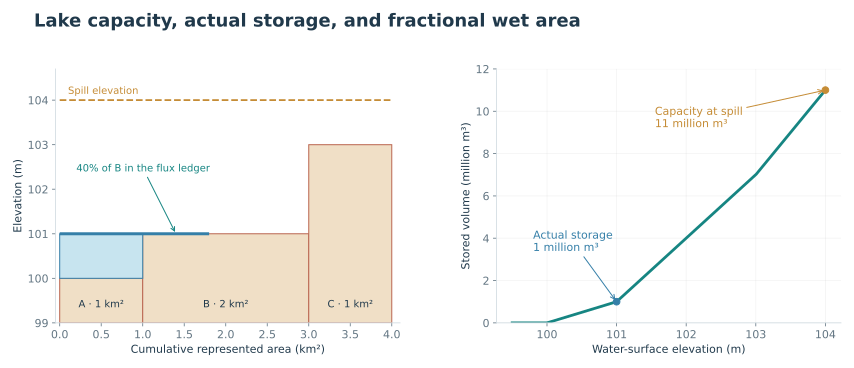

_Figure 6. Teaching samples A, B, and C represent 1, 2, and 1 km² at elevations 100, 101, and 103 m. The horizontal coordinate is cumulative represented area, not map distance. The water budget supports level 101 m and a fractional terminal contribution from B; capacity to the 104 m sill is much larger._

`balanceLake` takes each member's height, contributing area, provisional land runoff, direct rainfall, lake evaporation, and the candidate's incoming flow. Sort members by terrain height. Starting at the lowest sample, tentatively add each sample's area to the wet area and replace its land contribution with lake fluxes:

```text
net = incomingFlow
for sample in ascending height:
    before = net
    include its area and area × height
    net += directRain − lakeEvaporation − displacedLandRunoff

    if net <= 0:
        fraction = before / max(1e−20, before−net)
        retain only that fraction of this sample's area and fluxes
        level = sample.height
        outflow = 0; stop

if every sample was included with positive net:
    level = spillHeight
    outflow = net
```

With included fractions `f[k]`, estimated storage is `max(0, Σ(f[k] × area[k]) × level − Σ(f[k] × area[k] × height[k]))`. Capacity is independently `Σ(area[k] × max(0, spill−height[k]))`. The fractional terminal sample interpolates the flux ledger at its sampled elevation; it does not invent an extra subcell elevation profile.

For Figure 6, use these deliberately simple rates:

| Sample | Area  | Height | Direct rain | Lake evaporation | Displaced land runoff | Net debit when wet |
| ------ | ----- | ------ | ----------- | ---------------- | --------------------- | ------------------ |
| A      | 1 km² | 100 m  | 0.010 m³/s  | 0.030 m³/s       | 0.010 m³/s            | 0.030 m³/s         |
| B      | 2 km² | 101 m  | 0.020 m³/s  | 0.060 m³/s       | 0.010 m³/s            | 0.050 m³/s         |
| C      | 1 km² | 103 m  | 0.010 m³/s  | 0.025 m³/s       | 0.005 m³/s            | 0.020 m³/s         |

Incoming flow of 0.050 m³/s leaves 0.020 after wetting A. Fully wetting B would leave −0.030, so only `0.020 / (0.020−(−0.030)) = 0.4` of B is included. Wet area is 1.8 km²; level is 101 m; outflow is zero. Direct rain becomes 0.018, evaporation 0.054, and displaced runoff 0.014 m³/s. The ledger is `0.050 + 0.018 − 0.014 = 0.054 m³/s`.

Storage is `1 km² × 1 m = 1 million m³`; B's included fraction sits at the chosen level and contributes zero depth. Capacity to the sill is `1 km² × 4 m + 2 km² × 3 m + 1 km² × 1 m = 11 million m³`. Drawing the capacity would overstate actual water by a factor of eleven in this example.

#### Algorithm: nested ponds without repeated subtree solving

A large depression can contain several local minima separated by lower internal saddles. If a closed candidate leaves disconnected dry interiors, `nested-lakes.ts` refines that region:

1. Find local downhill paths, using the existing ordering to resolve flats, and assign corners to local minima.
2. Build candidate joins between neighboring minima. A shared edge's saddle elevation is the larger of its endpoint heights.
3. Sort these joins by saddle elevation. Union-find joins the minima into a local merge tree, from low saddles to high saddles.
4. Settle each child lake at its next saddle. A child that remains closed retains its own level and zero outflow. A spilling child passes only its excess to the connected branch.
5. When extra inflow arrives, update the already settled state and propagate only the increase in outflow. When both branches spill, balance the combined parent basin. Stored leaf intervals help find which descendant should receive an added inflow.
6. Emit final lake records and repair dry interior receivers, wet terminations, and real spill links.

The performance fix is the retained state in step 5. Restarting a whole descendant solve whenever an upstream pond spills can repeatedly revisit the same deep chain. The present code keeps the result and forwards the delta. It still uses local recursive tree logic and sorts local samples; it is not a claim that every nested configuration has constant or strictly linear cost.

### 10.3 Explicit shorelines on flat basin floors

The fractional wet area is authoritative. Positive center depth alone does not classify an entire cell as water. Geological sediment infill can create many equal-height samples; the annual balance can support a large wet area at that sampled height while its numerical storage depth is zero. Treating `level == height` as a routing sink but requiring `level > cellHeight` in the renderer hid entire water bodies in AETHER-0003.

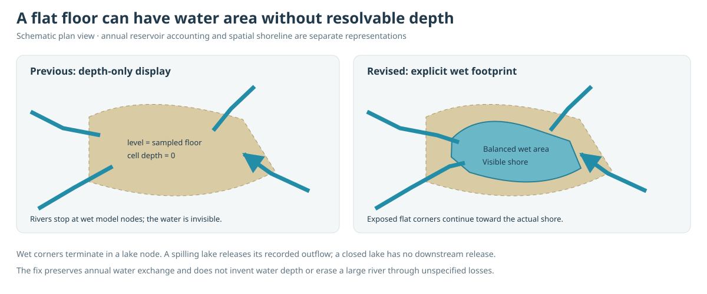

_Figure 12. Schematic plan view. The wet area comes from the reservoir ledger. Its spatial footprint grows from existing low water or the strongest inlet, and exposed flat corners route toward that footprint. Blue lines never disappear at an arbitrary dry point on the terrace._

`resolveLakeSurfaces` runs after reservoir balancing:

1. Collect each lake's corners at or below its level. Samples strictly below the level are fully wet. A spilling lake occupies every included sample to its sill.
2. For a closed lake, subtract those lower samples' area from the balanced wet area. Grow the remainder across the equal-height terrace using a neighbor queue. Start from existing wet samples, or the largest incoming-flow sample if the entire floor is level. The last sample may have a fractional wet area.
3. Record `lakeFraction[c]` between 0 and 1. No storage depth is invented. On equal-height ground, this is a connected spatial realization of the lumped height/area estimate, not a new local evaporation solve.
4. Run a multi-source neighbor queue from wet corners across exposed equal-height members. Assign each exposed corner a receiver toward the shore. These links have zero elevation drop and decreasing distance to water; higher dry paths retain their descending receivers. Restore real spill edges.
5. Re-accumulate runoff once through a temporary lake-collapsed directed graph. Lake nodes emit their recorded annual outflow; closed lakes emit zero. This preserves the existing annual lake/ocean budget after changing flat-ground paths.
6. Rasterize each recorded seasonal area from low ground upward. Equal-height samples share any unresolved terminal fraction, avoiding a second numerical depth threshold. Average incident shares into `seasonalLakeCoverage[quarter][cell]`; their four-value mean is `lakeCoverage[cell]`. Only fully wet cells have a Lake regional class. Mixed cells retain their land habitat and area-weighted fertility.

The renderer keeps one lake representation on the existing planet surface. Natural, Shaded relief, Ink atlas, and water/habitat diagnostic colors blend the selected season's wet fraction with the exposed land. Ocean boundaries remain crisp. `isLakeCell` marks only fully wet inland cells; it is not the color mask. The fertility diagnostic shows its already area-weighted score directly. Geometry uses the routing high-water surface; seasonal changes update coverage and tint without rebuilding terrain relief.

There is no separate lake overlay mesh. In particular, `lakeFraction[c]` is never converted into a standalone blue triangle. The failed v2.9.1 revision removed the cell mask but retained those corner patches; it therefore hid the wanted continuous lakes and left the artifacts. Application v2.9.2 restores the cell representation and deletes that patch renderer.

River display endpoints inside a wet drainage corner move toward its incident lake cells, using the same visible water mask. Ocean mouths retain a short extension across the interpolated coast. The authoritative receiver graph, lake level, area and water budget stay unchanged.

This is a cell-scale shoreline approximation, not resolved bathymetry. Small fractional patches below the dominant-cell threshold have no independent polygon; the inspector retains their physical coverage. Positive depth still raises surface vertices to water level. When estimated mean depth is below 1 cm, the inspector reports that depth is below mesh resolution. Globe and Flat map share the selected layer's water mask.

### 10.4a Lake naming convention

| Modeled surface area | Atlas label |
| -------------------- | ----------- |
| Below 10,000 km²     | Lake        |
| 10,000–99,999 km²    | Great lake  |
| At least 100,000 km² | Inland sea  |

These are worldbuilding labels, not universal hydrological boundaries. Salinity is not inferred from size, and the model does not yet transport salt. Closed versus spilling remains a separate hydrological property. The inspector shows the water body's ID, area, level, inflow, outflow, and whether the selected land belongs to its basin rather than its wet surface.

### 10.4 Water ledgers

| Ledger                  | Relationship                                                                                                     |
| ----------------------- | ---------------------------------------------------------------------------------------------------------------- |
| Atmosphere integration  | Initial inventory + evaporation sources − precipitation sinks = final inventory.                                 |
| Land season             | Initial soil/snow + precipitation = final soil/snow + AET + runoff.                                              |
| Individual lake quarter | Inflow + liquid precipitation − displaced runoff − evaporation − outflow = change in storage / quarter duration. |
| Global drainage         | `runoffTotal = oceanDischarge + lakeExchange`.                                                                   |
| Erosion                 | Removed material volume = deposited volume + named unresolved sediment export into receiving water.              |

`lakeExchange` is a net exchange relative to provisional land runoff. It is not retained storage and can be negative if direct lake rain supplies net additional water. Lake storage is a stock. Annual lake fluxes are quarter means; any remaining annual storage drift is retained in the ledger.

These are ledgers for the represented subsystems. Lake evaporation is not separately fed back into atmospheric transport, and the final atmosphere/land pass is not a fully closed global hydrological equilibrium.

## 11. Rivers as connected systems

### 11.1 Headwaters and continuation

A channel can begin once both its upstream land area and qualifying water supply meet the configured thresholds. Defaults are 8,000 km² and 1 m³/s. Qualifying supply excludes direct quickflow, while real reservoir outflow can continue a channel downstream. Supply is bounded by actual routed discharge.

Once established, a river follows existing receivers across drier terrain and joins other tributaries. It stops at a closed water body or reaches an ocean outlet. No channel is joined to another by crossing an uphill divide merely to produce a more connected-looking map. Independent coastal mouths remain legitimate independent systems.

The lowland valley field improves the underlying drainage geometry so coastal flow has more shared valleys. Channel initiation thresholds determine which paths become rivers; the display threshold subsequently determines which of those rivers are drawn.

### 11.2 Lake-aware accumulation and metadata

Selection temporarily represents wet reservoir corners with a lake node. Real spills connect that node to its downstream outlet. A topological accumulation carries land area and supply across this graph. It is derived from the authoritative drainage state and discarded after selection, rather than retained as another competing routing model.

`Rivers` retains:

| Field                  | Meaning                                                                                  |
| ---------------------- | ---------------------------------------------------------------------------------------- |
| `channel`              | Selected corner-to-receiver channel mask.                                                |
| `headwater`            | Starts of selected channel paths.                                                        |
| `catchmentArea`        | Accumulated upstream land area, including connected upstream reservoirs.                 |
| `supportFlow`          | Qualifying supply, bounded by actual discharge.                                          |
| `system`               | Shared terminal ocean-mouth corner or closed-lake node; connected through actual spills. |
| `streamOrder`          | Strahler order on selected channels; zero off-channel.                                   |
| `seasonalDischarge[4]` | Estimated quarter-mean flows; their mean matches authoritative annual discharge.         |

Headwaters begin at order 1. Equal-order tributaries raise downstream order; an incoming smaller tributary does not raise the larger order. A reverse topological pass assigns terminal system identity.

The inspector displays system ID and stream order. River-basin colors use shared terminal systems, selecting each surface cell's largest-discharge corner as its representative. Cells crossing divides are necessarily summarized by that display choice. The legacy `Drainage.basin` array remains available, but the layer uses `Rivers.system` for connections through lakes.

System IDs identify a generated snapshot. They are not persistent names for use across different seeds, resolutions, or algorithm versions. Annual supply and stream order do not establish perennial flow, navigability, water quality, or settlement suitability by themselves.

#### Algorithm: select channels on a lake-aware directed graph

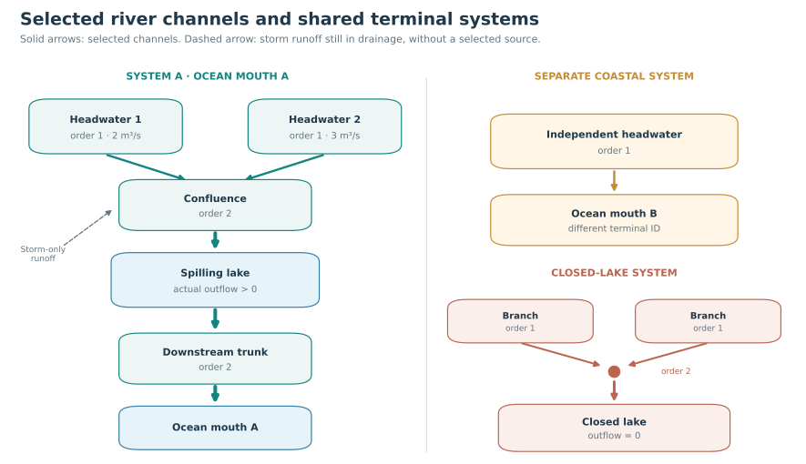

_Figure 7. Schematic graph, not a geographic map. Selected tributaries share a terminal ID through a spilling lake. A separate coastal mouth remains another system. Two branches entering a closed lake share its terminal lake ID. Dashed storm runoff still exists in drainage, but does not qualify as a selected headwater by itself._

`rivers.ts` first derives a temporary graph with one node per corner plus one virtual node per lake. A wet corner points to its lake node; a lake node points downstream only if the lake's computed outflow is positive. Dry corners follow the authoritative receiver. Virtual nodes express connectivity across water without drawing river lines across the lake surface.

Scatter upstream area and `channelRunoff` into corner nodes. Count incoming edges and place all zero-indegree nodes in a queue. Kahn's topological traversal processes each node only after its upstream contributions arrive:

```text
for node in upstream-to-downstream topological order:
    supply = min(accumulatedSupply, actualDischarge)
    if node is a lake node:
        supply = lake.actualOutflow

    qualifies = area >= sourceAreaKm2 × 1e6
                and supply >= sourceFlow
    active = hasActiveUpstream or qualifies
    propagate accumulated area and supply downstream
    propagate active state and stream order only if active and supply > 0
```

The real implementation also accumulates stream order in this pass and restores the physical spill-corner segment from a spilling virtual lake. Only segments matching `drainage.receiver` become retained corner channels. The temporary graph is discarded once area, supply, channel selection, stream order, and terminal IDs have been extracted.

With the default thresholds, sources with 9,000 km² and 2 m³/s, and 10,000 km² and 3 m³/s, can each qualify. An upstream drainage line carrying storm runoff but less than 1 m³/s of qualifying supply cannot initiate a selected river, even if its annual total discharge is visually tempting. A previously selected trunk can continue through a dry downstream cell because support comes from its connected upstream catchment.

#### Algorithm: Strahler order and shared terminal identity

Track the maximum incoming active order and whether that maximum occurred more than once. A headwater begins at 1. At a junction, use the maximum order unless it occurs at least twice; in that case use maximum plus 1. Thus `(1,1) → 2`, `(2,1) → 2`, and `(2,2,1) → 3`. Three first-order tributaries still produce order 2, not sequential increments to order 3.

After the forward traversal, iterate the same node order backward. A node with no outgoing edge identifies itself as a terminal; otherwise copy its downstream node's terminal ID. This gives all connected branches one ID through actual spilling lakes. Independent ocean mouths do not receive a common ID merely because both eventually reach the same ocean.

`streamOrder = 0` marks off-channel locations. Terminal identities are corner IDs or temporary lake-node IDs retained as integer labels, not stable geographical names. A civilization layer can group settlements by these systems within a snapshot; persistence across regenerated terrain would require a separate matching policy.

### 11.3 Seasonal discharge and reservoir buffering

The existing soil/snow loop retains each quarter's runoff rate using `runoffDepth × 0.001 × area / seasonSeconds`. These four rates are scattered and accumulated alongside catchment supply in the same Kahn traversal; there is no second weather simulation.

Virtual lakes emit their recorded `seasonal.outflow` from the storage calculation, replacing the former residence-time attenuation formula. The four releases average to the authoritative annual lake outflow. The existing final channel normalization reconciles routed Float32 quarters with annual corner discharge, and spill-corner values come from the lake release. No extra weather solve is added.

Reservoir quarters conserve liquid water explicitly. Footprint and stage are sampled at season ends; fluxes are integrated over the four substeps. A lake can remain liquid under an ice tint, while unmelted snowfall stays in the existing snow store. The annual routing graph is retained for all seasons, so hydraulic travel time, changing drainage connectivity, daily floods and exact subcell shore positions remain unresolved. Surface ribbons keep annual widths and use seasonal flow for activity.

The generator currently has no channel infiltration or evaporation sink. A selected substantial river must reach a visible modeled water body or an ocean mouth. Real losing rivers exist, but invoking them does not justify erasing a large modeled flow at a dry endpoint. A future loss model must debit a volume, reduce downstream discharge, and identify the resulting terminal habitat.

### 11.4 Source pathways and seasonal regimes

`selectRivers` propagates four annual delivery tracers alongside the existing four seasonal discharge fields through its temporary corner/lake DAG:

| Pathway                     | Existing budget term                                 | Meaning and limit                                                          |
| --------------------------- | ---------------------------------------------------- | -------------------------------------------------------------------------- |
| Rainfall runoff             | Total runoff minus rapid melt and slow soil release. | Direct/storm rainfall and rain-derived overflow.                           |
| Snowmelt                    | Melt-tagged quickflow and soil overflow.             | Seasonal snow storage and melt; no glacier ice-flow model.                 |
| Spring / baseflow potential | Slow soil release.                                   | A proxy for sustained subsurface supply; no mapped aquifer or spring vent. |
| Lake outflow                | The balanced reservoir's actual release.             | Replaces its incoming pathway labels after storage and evaporation.        |

At confluences, add pathway volumes. At a spilling lake, set the outgoing pathway to lake release; its already-computed storage damping determines seasonal timing. Normalize the four annual fields to sum to one where flow exists. A pathway needs at least 55% to supply the primary label; otherwise the reach is Mixed. A qualifying headwater in a local wetland can receive a Wetland headwater context label without changing its numeric mixture.

For four seasonal discharges, let `q̄` be the mean. Minimum below `0.05q̄` gives Intermittent potential. Otherwise minimum below `0.3q̄` or maximum above `2q̄` gives Seasonal; other positive-flow reaches receive Perennial potential. Four representative seasons cannot establish daily reliability or whether a channel is completely dry. Labels describe calculated flow; they never force runoff or seasonality.

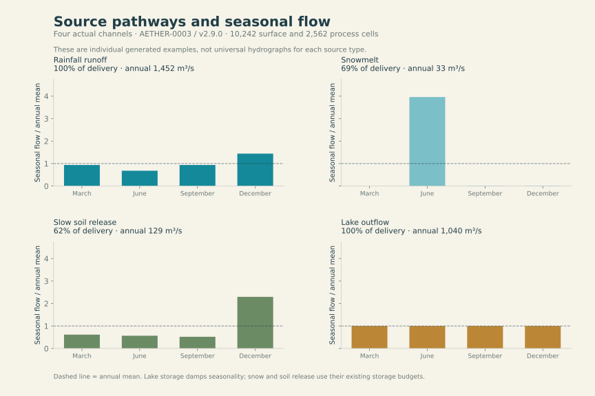

_Figure 14. Actual v2.9.0 AETHER-0003 channels at 10,242 surface / 2,562 process cells. Each is the strongest example of its named pathway among selected reaches above 20 m³/s. These are four individual examples, not universal source-type hydrographs. Relative seasonal flow is normalized by the reach's annual discharge._

### 11.5 Migration, bends, and abandoned channels

`river-courses.ts` keeps every live reach's start and end at the authoritative drainage corners. It constructs intermediate points in the local tangent plane. Available bank space comes from the existing physical floodplain calculation on both sides, limited by land area, sediment, river slope, bank rise, and nearby standing water.

For physical reach length `L`, available half-space `W`, recent duration `T` in Myr, and a seeded variation `v` in `[0,1]`:

```text
mobility = bankMobility / (1 + (riverSlope / 0.002)^2)
growth = (1 - exp(-T/0.4)) × clamp(mobility × (0.35 + 0.65v), 0, 1.3)
A = min(0.65W, 0.22L, 20 km) × min(1, growth)
B = min(L × (v > 0.72 ? 0.19 : 0.10), 3.5A) × min(1, growth)
x(t) = Lt + B sin(4πt)
y(t) = sign(v - 0.5) × A sin(2πt)
```

Reaches below 100 m³/s receive no bend amplitude. Sixteen segments approximate an appreciably curved reach. Test nonadjacent segments for actual intersections; splice out an intersecting lobe and preserve it as a potential abandoned loop. At most two cutoffs are possible per reach. Endpoint positions remain exact. This is a bounded kinematic approximation, not a bank erosion PDE or a reconstructed channel history. Longer time allows growth only where bank space and slope permit it.

Before incision, qualifying provisional reaches above 300 m³/s can preserve one cutoff per surface cell. A seeded 35% retention choice represents unresolved loss of old scars; it is not an estimated cutoff survival probability. Removing the intersection endpoints leaves an open horseshoe with plugged necks. Its physical full width is `clamp(8√Q, 40, 900) m`; footprint is capped at 3% of the host cell and must exceed 20,000 m². The pond enters the land-water budget described in section 9.2.

Final routing is rebuilt after terrain changes, then live courses are constructed on that final graph. A preserved old course need not match the final river precisely. `Rivers.courses` stores only selected reaches, using packed points, offsets, original corner IDs, and sinuosity. Water strips and vegetation banks read this same path; the renderer does not invent a separate wavy river. Incision acts on cell-average terrain, while bends and remnant pools are subcell landforms. Their exact banks are not cut into the coarse elevation mesh.

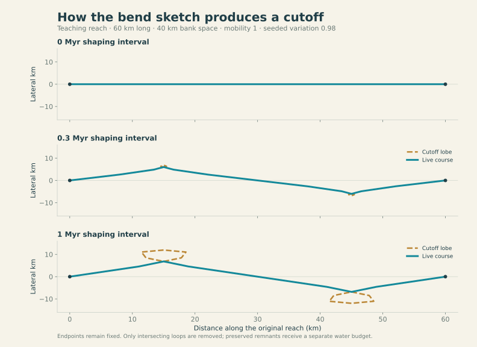

_Figure 13. Direct output of `evolveBend` for a teaching reach, holding length, space, mobility, and seeded variation fixed. Dashed loops are removed from the live course. The duration is an assumed recent landscape interval; it is not a date assigned to an actual river._

### 11.6 Sediment-supported deltas

The erosion pass transports excavated volume and deposits some in local mouth fans (section 12.1). Final channels can form a delta when they carry at least 250 m³/s, reach a resolved lake or ocean, have slope at most 0.006, and have at least ten million cubic metres of nearby recorded mouth sediment. These numerical thresholds are worldbuilding parameters, not a geomorphic classification standard.

`deltas.ts` searches a bounded wet neighborhood: at most 24 processed corners and 60 km reach. Two or three candidate branches remain in the same receiving body. An interior branch crossing land more than 35 m above receiving water is rejected. Lake branches end inside an explicit wet patch; ocean branches extend into an ocean cell. A fan with fewer than two valid branches is not labeled a delta.

Two branches divide discharge 65%/35%; three divide it 55%/25%/20%. For each season and annual mean, `sum(Qbranch) = Qtrunk`. These branch records remain in generated data, but application v2.9.3 no longer draws their lines. The renderer keeps one trunk mouth and shades adjoining delta cells. The water solver still delivers the original total to its existing receiving body. These terminal fans do not model delta-lobe switching, tidal circulation, distributary hydraulics, or a braided interior network. Nearby deposit volumes can overlap between fan records and must not be summed as an independent global sediment budget.

## 12. Erosion, biomes, and vegetation

### 12.1 Landscape erosion and basin aging

Recent fluvial shaping uses the provisional receiver graph after regional weathering. The graph and discharge stay fixed during a bounded interval; final terrain then receives one new climate and hydrology pass. The separate `fluvialDuration` is 1 Myr by default and supports 0–5 Myr. It is not the 200 Myr plate interval, nor the age of an identified river.

#### Algorithm: implicit incision and sediment bookkeeping

Construct an upstream-to-downstream topological order once. Use `min(12, max(1, ceil(4T)))` steps for positive duration `T`. At each step, reconstruct corner heights from incident terrain cells. Standing lake corners supply a fixed provisional water-level constraint. Traverse downstream-first so an upstream reach can respond to its receiver's lowered height without very small explicit timesteps:

```text
response = 0.6 m/year × erosionStrength × (Q / 1000 m³/s)^0.45 × stepYears / L
drop = max(0, cornerHeight - max(0, loweredReceiverHeight))
lowering = min(250 m, drop × response / (1 + response))
```

Only routed reaches above 20 m³/s and outside standing lake water contribute. The coefficient is an uncalibrated response speed, not a promised erosion rate. Lowering requests are averaged onto incident cells by their corner degree. Each land cell is bounded above the 1 m datum floor; existing sediment is removed before bedrock. Record the actual Float32 height change times physical area, not the requested amount, as excavated volume. `fluvialIncision` is gross cell-average lowering before subsequent deposition.

For a teaching reach with `Q=1000 m³/s`, `L=10 km`, erosion 0.35, and a 0.25 Myr step, the dimensionless response is 5.25. A 100 m available drop requests 84 m lowering. Actual cell lowering is reduced by incident-cell averaging and the datum floor. This intentionally strong regional shaping coefficient is not a measured river incision rate. Canyon-like relief is limited by mesh resolution; subcell canyon walls and cross-sections are not solved.

After incision, distribute each cell's removed volume equally to its corners and route it downstream once. A land reach retains a fraction `0.035 / (1 + (slope/0.001)^2)` as local sediment. Remaining volume travels along the receiver. At the first wet lake corner or terminal ocean corner, inspect only incident cells and their immediate neighbors for a mouth fan.

Eligible fan cells lie from 350 m below to 3 m above receiving water. Shallow cells receive greater weight, `1 / (20 + depth)`. A lake initially retains 85% of arriving material; an ocean retains `0.7 / (1 + 0.5 × waveErosion)`. Actual deposition is bounded by delivered volume and room below water level plus 3 m. This can build low mouth land; wave strength represents reduced retention, not a resolved wave simulation. Remaining sediment enters the receiving water as named unresolved export.

Every edit preserves `height = bedrock + sediment` within floating-point precision. Excavated volume equals local/mouth deposition plus unresolved export. `deltaSediment` records mouth deposit thickness; it does not independently create land or water. Rendered visibility never controls excavation or routing.

#### Integrated weathering and coast evolution

`landscape.ts` runs before recent fluvial shaping and reuses the provisional four-season climate, restricting the surface to the process grid. It does not run weather for every geological step or reconstruct past climate. Rock resistance is a seeded material-frame field at a physical scale around 180 km.

Rain and slope weathering use effective diffusivities of 12–60 million m²/Myr before erosion, rock-resistance, and age modifiers. These are regional detachment coefficients, not measured small-slope soil diffusivities. Wind adds much weaker deflation where precipitation is small relative to evaporative demand. Rain-dependent background weathering acts on exposed relief.

For a cell `i`, slope detachment sums downhill contributions:

```text
rate_i = sum_j[D_i × (sharedEdgeLength / centreDistance)
                  × max(height_i - height_j, 0)] / area_i
```

Coastal edges use a wave term controlled by wind speed, rock resistance, and Coastal erosion. The lower reference is a -30 m abrasion platform, not the abyssal seabed. A cell must become ocean-connected before it exposes the next shoreline. This makes old headlands and narrow coastal ground retreat even within a plate interior. The current proxy uses wind speed, not a resolved wave spectrum, tides, or directional fetch model.

The explicit timestep is bounded by `0.35 × cellArea / summedConductance`. Time and widths are physical; increasing surface detail does not multiply the number of coarse landscape steps. The final correction is interpolated to fine land cells. Removed loose sediment is consumed before bedrock, and detached volume is computed using actual fine-cell areas. Enclosed interiors are prevented from eroding below the datum.

#### Infill and outlet incision

Two complementary mechanisms are required. The first full-resolution trial showed that infill alone left too much lake area; adding a lake display threshold would have reintroduced the previously fixed disappearing-water problem.

`sediment.ts` uses a temporary cell priority flood solely to deliver geological sediment. It is not a second river or water receiver forest. Connected depressions with a common escape height accumulate upstream detached material. A sorted height/area curve raises the floor from the bottom upward, limited by available material and the escape sill. Lake persistence controls the effective fraction retained as basin infill; the remainder represents bypass/unresolved downstream sediment export. Excess sediment is accounted for as export.

`outlet-erosion.ts` uses `floodCorners`, the same geometric routine used by `drainage.ts`. For each flooded patch it finds the floor and escape anchor. A climate-, resistance-, duration-, and persistence-dependent incision budget determines how far its sill may lower. A shallow basin can get a complete escape; a deeper basin can retain a reduced water-storage depression.

Before editing, it follows a complete parent path to lower ground or the ocean. The path must fit a 750 km length bound and the allowed cut depth, including the actual incident-cell elevations. It cuts all three incident cells where needed so the reconstructed corner surface genuinely opens. A tiny descending grade avoids replacing a lake with an exactly flat channel. Rejected paths leave the basin unchanged. Excavated volume is accounted for as unresolved downstream sediment export; grain classes are not modeled, and this geological outlet-excavation export does not feed the separate recent fluvial mouth fans.

Final `routeWater` recomputes heights, priority flood, receivers, reservoirs, discharge, headwaters, and river-system metadata from the changed terrain. This preserves real river destinations and avoids treating an erosion-only path as authoritative water routing.

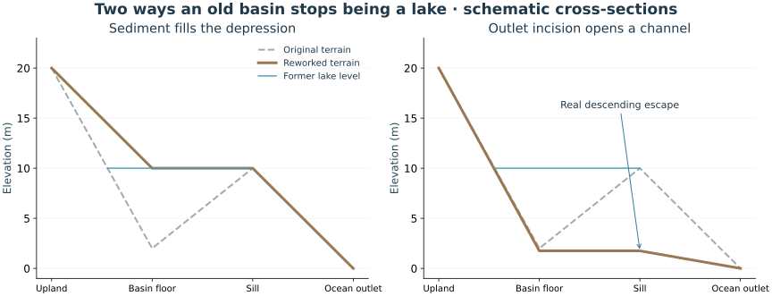

_Figure 11. Schematic cross-sections isolate sediment infill and sill incision. Infill requires delivered material; incision requires a complete affordable escape path. The final corner water solver decides whether either modified basin still contains water._

### 12.2 Regional biomes

The classifier uses annual and seasonal temperature, precipitation, PET/aridity, snow and soil water. Riverbank habitats are classified separately. It supports ocean, ice sheet, tundra, boreal forest, temperate forest, grassland, desert, savanna, tropical forest, rainforest, Mediterranean vegetation, wetland, and lake.

Water and ice conditions are considered before ordinary land biomes. Tundra uses the warmest representative season, allowing alpine tundra while avoiding classification from annual cold alone. Desert follows either aridity above 5 or a temperature- and seasonality-dependent dry-climate boundary. It is not based on one global absolute rainfall cutoff. The latter test precedes savanna assignment and approximates monthly Köppen-style reasoning with four seasons.

Seasonal cold, annual moisture, and summer warmth distinguish boreal and temperate vegetation. Year-round warmth allows tropical classes; rainforest additionally requires substantial rain in the driest season. The Mediterranean rule requires a meaningful seasonal thermal contrast and a warm dry season. Wetlands remain a coarse soil/bank-access heuristic.

There is no enforced global biome quota. The model is not calibrated to reproduce Earth's exact forest, desert, or tundra percentages.

#### Algorithm: ordered biome classification

The following table is evaluated top to bottom. `warm` and `cold` are the warmest and coldest representative seasonal temperatures; `T` is annual mean temperature; `P` is annual rain in mm; `a` is PET/rain. `Pwarm`, `Pcold`, and `Pdriest` refer to individual representative-season rainfall totals in mm, not monthly totals.

| Priority | Condition                                                                           | Result                                                                                                                               |
| -------- | ----------------------------------------------------------------------------------- | ------------------------------------------------------------------------------------------------------------------------------------ |
| 1        | Ocean mask                                                                          | Ocean; cold oceans receive a separate ice fraction.                                                                                  |
| 2        | Positive actual lake depth                                                          | Lake.                                                                                                                                |
| 3        | `warm < 1` and snow storage `> 70 mm`                                               | Ice sheet.                                                                                                                           |
| 4        | `warm < 10`                                                                         | Tundra.                                                                                                                              |
| 5        | `a > 5`                                                                             | Desert.                                                                                                                              |
| 6        | `T < 6` or (`cold < −3` and `warm < 22`)                                            | Boreal forest if `a < 1.65` and `P > 250`; otherwise grassland.                                                                      |
| 7        | `cold < 15`, `warm−cold > 7`, `warm > 18`, `Pwarm < 0.4 × Pcold`, and `Pcold > 100` | Mediterranean vegetation.                                                                                                            |
| 8        | `cold >= 18`                                                                        | Rainforest if `P > 1500`, `Pdriest >= 180`, and `a < 0.9`; otherwise tropical forest if `P > 700` and `a < 1.25`; otherwise savanna. |
| 9        | Remaining land                                                                      | Temperate forest if `a < 1.35` and `P > 300`; otherwise grassland.                                                                   |

The old whole-cell wetland override is removed. Seasonal floodplain wetlands are local bank habitats, so a small wet corridor does not relabel an entire regional desert or forest cell.

This order matters. A cold high mountain can be tundra at low latitude because the warm-season test precedes aridity. A dry but cool plain can remain grassland when PET is modest. Savanna and desert remain different categories, and a green river corridor need not change the regional category of the surrounding cell.

#### Seasonal desert boundary

The old sole desert condition, `PET / rain > 5`, missed warm dry environments under the simplified PET estimate. The classifier now also applies a Köppen-style seasonal dry-climate boundary before savanna selection:

```text
seasonalOffset = warm-half share >= 0.70 ? 280 mm
               : warm-half share <= 0.30 ?   0 mm
               :                          140 mm
desertRainBoundary = max(0, 20 × annualTemperature + seasonalOffset) / 2
```

The warm-half estimate combines the warmest representative season with half of each neighboring season. Polar/ice rules still precede this test; the existing very-high-aridity condition remains sufficient. This is a four-season ecological approximation, not full monthly Köppen-Geiger classification. It does not alter rainfall to achieve a biome quota, nor does it remove riverbank vegetation.

### 12.3 Background cover, alluvial corridors, and seasonal floodplains

Regional vegetation still follows fulfilled evaporative demand and the warmest season:

```text
background = (1 − exp(−3 × clamp(AET / max(1, PET))))
             × clamp((warmestSeason − 1) / 14)
```

A climate desert remains a desert; neither bank proximity nor a visual ribbon changes its regional rain. Separate local habitats describe riparian meadow, riparian woodland, and floodplain wetland. This also lets riverbanks be denser than already-green surrounding land.

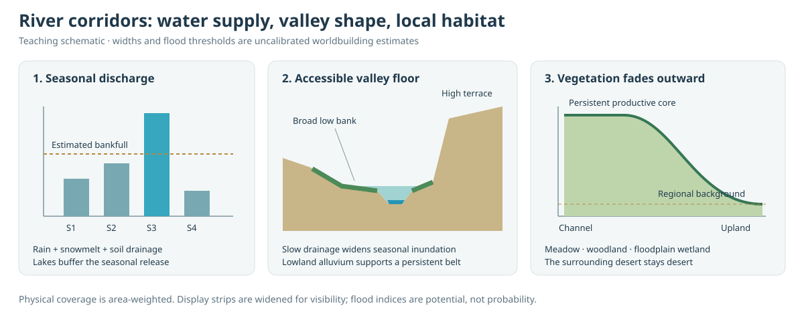

_Figure 8. Teaching schematic of the implemented dependencies. Large rivers can sustain a broad alluvial habitat belt between floods. Seasonal excess and drainage time limit inundation, while steep terraces constrain both widths. Vegetation enhancement fades into the regional background. This is not a calibrated flood forecast._

#### Algorithm: persistent alluvial habitat

For each selected reach, let `L` be physical length, `Q` annual discharge, `S` qualifying supply, `r = max(0, upstreamHeight − downstreamHeight) / L` its longitudinal slope, and `E` the Floodplain extent control (default 1, range 0.5–2). On each bank, `sediment` is the modeled deposited thickness:

```text
major = clamp(log10(1 + S / 20) / 2)
lowland = 1 / (1 + (r / 0.0015)²)
alluvium = clamp(ln(1 + max(0, sediment)) / ln(51))
nearBankWidth = clamp(200 + 60 × sqrt(S), 200, 4000)      [m]
alluvialWidth = E × min(30000, nearBankWidth
  + 350 × sqrt(S) × major × lowland × (0.7 + 0.3 × alluvium))
accessHeight = 2 + major × lowland × (10 + 6 × alluvium)  [m]
```

Large, low-gradient rivers receive broader habitat than small streams or steep channels. Deposited sediment modestly increases its potential reach; a resolved cell with zero sediment does not automatically lose alluvial access because the generator does not retain a complete alluvial history. `accessHeight` is an accessible terrace range used for habitat, not a floodwater depth. The coefficients are heuristic landscape scales, not measurements fitted to a particular river.

#### Algorithm: seasonal inundation and confinement

Use the four seasonal discharge estimates `q[s]` to calculate water above an estimated bankfull threshold:

```text
bankfull = max(1.2 × Q, 1.5 × S, 1)                      [m³/s]
excess[s] = max(0, q[s] − bankfull)                      [m³/s]
peak = max(excess)
drainageSpeed = clamp(0.04 + 3 × sqrt(r), 0.05, 0.75)    [m/s]
residence = clamp(L / drainageSpeed, 1 hour, 14 days)    [s]
floodVolume = 0.15 × peak × residence                   [m³]
spreadDepth = 0.3 / E                                  [m]
volumeWidth = min(25000 × E, floodVolume / (2 × L × spreadDepth))
stage = min(6, 0.5 + 0.06 × sqrt(peak))                  [m]
```

Floodplain drainage is slower in gentle valleys than the earlier fixed 1 m/s channel transit. The bounded residence and 15% fraction estimate a potential footprint without repeatedly assigning the whole season’s water to every reach. The extent control spreads the same estimated volume more shallowly; it adds no water. These calculations do not withdraw discharge or evolve actual flood storage.

For each bank separately, estimate distance to the cell center as `D = max(1, cellArea / (2L))` and cross-bank slope as `b = max(0, cellHeight − meanChannelHeight) / D`. Then:

```text
slope = max(0.00001, b)
floodReach = min(0.8 × D, volumeWidth, stage / slope)
habitatReach = min(alluvialWidth, accessHeight / slope)
bankWidth = min(0.8 × D, max(habitatReach, floodReach))
floodShare = min(bankWidth, floodReach) / bankWidth
seasonalOverbank[s] = floodShare × excess[s] / peak
```

Use zero seasonal overbank potential when `peak == 0` or the bank’s selected seasonal temperature is at or below freezing. A large river can still have a productive alluvial belt in seasons without flooding. Ocean, lake-dominated cells, and permanent ice have no bank vegetation. High banks narrow accessible habitat instead of eliminating vegetation immediately beside the channel. The extent control cannot bypass these terrain limits.

This remains a two-bank, subcell representation. It does not search across several cells for an entire floodplain or route water over an intervening ridge. The resolved-space bound can constrain very broad plains as surface resolution increases.

#### Algorithm: localized vegetation and habitat

At the channel edge, bank potential is the greater of background cover and `clamp((warmest−1)/14) × (0.75 + 0.24 × (1−exp(−S/5)))`. Thus available river water can raise dryland cover and also increase canopy potential in fertile regions. A bank whose warmest season is below 10°C or potential below 0.65 is meadow; otherwise it is woodland. Where at least two sampled seasons exceed bankfull, flood share exceeds 0.6, and stored soil water exceeds 100 mm, its local category is floodplain wetland. These thresholds are habitat heuristics, not species or succession models.

Each bank contributes `L × bankWidth / cellArea` to local coverage. Overlapping reach fractions are summed and capped at one. The renderer retains a productive core over the first 30% of width, then fades using `1−smoothstep(0.3,1,distanceAcrossBank)`. The mean of this profile is `(1 + 0.3) / 2 = 0.65`; ecology uses the same lateral enhancement:

```text
cellVegetation = background
  + max(0, averageBankPotential − background) × cappedBankFraction × 0.65
```

`Floodplains` stores sparse selected-corner records with two widths, vegetation potentials, habitat IDs, and four seasonal overbank indices per reach. Cell `riparianFraction`, `riparian`, `riverHabitat`, and `floodplainFraction` summarize local habitat for inspection and future settlement rules. Regional `biome` remains separate. Rendering exaggerates physical bank width by 2.5 alongside the already exaggerated river, but reports coverage using physical widths.

No atmospheric humidity increment, nutrient concentration, crop yield, additional AET, or irrigation water is invented. Water access, deposited sediment, and flood reach are habitat proxies. Explicit sediment nutrient delivery, lateral groundwater, water withdrawals, and daily flood chronology remain future extensions requiring additional budgets. Modern Mesopotamian greenness includes both natural marshes and irrigated farming; this pass represents natural habitat potential, not the agricultural footprint.

### 12.4 Marshes, swamps, fens, and bogs

`wetlands.ts` classifies local habitat potential after regional biomes and riverbanks. Ocean, permanent ice, fully resolved lake beds, and land without a thawed representative season are excluded. A flatness factor `1/(1+(slope/0.003)^2)` limits the influence of soil saturation and adjacent lake water. Humidity uses annual rain/PET; saturation uses the retained count of wet soil seasons.

The local fraction is the maximum of 85% of flood-accessible area, nearby lake-shore influence, humid saturated flat ground, and low delta deposition with water access. Fractions below 2.5% are omitted and the retained fraction is capped at 85%. Classification follows this order:

| Habitat | Implemented conditions                                                                                  | Interpretation                                                  |
| ------- | ------------------------------------------------------------------------------------------------------- | --------------------------------------------------------------- |
| Bog     | Strong humid saturation, temperature below 16°C, little river/shore/delta access.                       | Isolated rain-fed peatland potential.                           |
| Fen     | Temperature below 14°C, at least two saturated seasons, river access and substantial slow soil release. | Mineral-water peatland potential using a subsurface-flow proxy. |
| Swamp   | Temperature above 12°C, high vegetation potential, at least three saturated seasons.                    | Potential woody wetland.                                        |
| Marsh   | Other qualifying shallow wet ground.                                                                    | Potential herbaceous wetland.                                   |

Peat accumulation, acidity, nutrient chemistry, salinity, and tree succession are not simulated. A Bog or Fen label therefore identifies favorable model conditions rather than proving those missing properties. Bogs are not a default category for every riverbank.

Fresh deposited delta flats receive an additional bounded river-access credit: 2% of supported annual flow, shared among nearby deposited land cells and compared with local PET demand. It can support at most 45% local coverage and lift vegetation toward 0.8 within that fraction. As with existing bank vegetation, this is an access-potential calculation, not a new water withdrawal, evaporation flux, or rainfall source. Regional biome IDs remain unchanged; natural and biome views reveal local wetland cover within them.

## 13. Visualization and editor behavior

### 13.1 Geometry and natural surface

Natural and continuous scalar layers share an indexed primal surface. Plate, biome, and drainage categories use lazily allocated dual-cell fans with constant cell colors. Layer and season changes update attributes/colors; a new world or changed display relief rebuilds surface geometry. Overlay controls rebuild their affected overlay group.

Natural-world shading consumes terrain/land-water/vegetation/canopy and temperature/aridity/ice/snow vec4 attributes, a wetland kind/fraction/incision vec3, a premultiplied delta-tint vec4, and one soft riverbank texture. Seamless seeded three-dimensional noise adds pigment variation and small normal changes per fragment. Mountain and canopy detail are gated by generated elevation and vegetation. Pixel-footprint filtering fades unresolved detail to reduce shimmering.

Noise does not move coastlines, raise mountains, add climate cells, or choose biomes. A narrow antialiased transition sharpens the interpolated water boundary. Ocean shelves, lake color, and snow/ice come from water and climate fields. Ocean bathymetry is primarily a color signal; displayed radius clamps submerged terrain to the water surface. Visual height exaggeration is separate from physical terrain height.

#### Algorithm: continuous surface detail without more simulation cells

For natural and continuous layers, one vertex per surface site carries generated scalar fields. Indexed primal triangles interpolate those attributes across their faces. Categorical layers instead use dual-cell fans whose vertices share a cell's constant color, preserving ownership boundaries. The categorical geometry is allocated on first use.

The packed attributes are `(height, landMask, vegetation, forestFlag)`, `(temperature, aridity, ice, snow)`, `(wetlandKind, wetlandFraction, fluvialIncision)`, and premultiplied delta color/coverage. Both ocean and cell-classified lakes set `landMask = 0`. Positive lake depth raises displayed vertices to water level. Within a triangle, interpolation supports a continuous surface signal; it does not create a new simulated catchment or biome cell.

The fragment shader evaluates seeded 3D value noise from the unit-sphere direction. This procedural pigment has no longitude seam. The separate bank texture uses a wrapped longitude atlas described below. Broad pigment variation and progressively finer bands around frequencies 38, 220, and 1150 modify color and small normal detail. Screen-space derivatives estimate pixel footprint and fade bands that are too fine to resolve.

Generated vegetation gates canopy detail; elevation and climate gate rock and snow signals. This distinction lets the default globe look detailed while diagnostic views remain faithful to their fields. Increasing texture frequency cannot fix an incorrect water budget, and display relief does not alter the terrain used by routing.

### 13.1a Artistic overview styles

**Map style** selects Natural, Shaded relief, or Ink atlas for the overview in both projections. Shaded relief adds a height-preserving oblique map projection and cartographic slope lighting. Ink atlas adds paper pigments, inked shores, and seeded mountain/forest symbols. Both reuse the natural view’s water, climate, and habitat fields; scientific layer palettes remain independent. See section 21 and the [rendering algorithms](history/revisions/2.11.0.md).

### 13.2 Layers

| Group    | Layer                 | Authoritative source                                                                                    |
| -------- | --------------------- | ------------------------------------------------------------------------------------------------------- |
| Overview | Natural world         | Terrain, cell lake depth/coverage, vegetation, textured river habitats, seasonal temperature, snow/ice. |
| Geology  | Initial continents    | Starting raw basement relative to the initial datum; the inspector remains final-world data.            |
| Geology  | Inherited deformation | Carried collision uplift and rift subsidence from geological steps.                                     |
| Geology  | Volcanic construction | Accumulated volcanic relief before final landscape erosion.                                             |
| Geology  | Erosion & deposition  | Net fine-surface height change from the landscape stage.                                                |
| Geology  | Elevation             | Surface terrain height relative to zero.                                                                |
| Geology  | Tectonic plates       | Process plate ownership mapped to surface cells.                                                        |
| Geology  | Continental crust     | Continentalness field.                                                                                  |
| Geology  | Crust age             | Procedural age field.                                                                                   |
| Geology  | Tectonic relief       | Propagated uplift field.                                                                                |
| Geology  | Sediment              | Deposited sediment thickness.                                                                           |
| Climate  | Wind                  | Seasonal wind vectors and speed.                                                                        |
| Climate  | Ocean currents        | Vectors reconstructed from ocean edge flux.                                                             |
| Climate  | Ocean temperature     | Advected/relaxed SST.                                                                                   |
| Climate  | Air temperature       | Corrected surface temperature.                                                                          |
| Climate  | Precipitation         | Surface seasonal or annual precipitation.                                                               |
| Climate  | Atmospheric moisture  | Process moisture column.                                                                                |
| Climate  | Aridity               | Surface PET/rain, shown across the full 0–6 range.                                                      |
| Water    | River basins          | Shared terminal river system, with selected channel ribbons.                                            |
| Water    | Lakes & inland seas   | Cell lake depth/coverage and channel ribbons.                                                           |
| Water    | River sources         | Dominant delivery pathways on selected channels and their four-part mixture in inspection.              |
| Water    | River landforms       | Gross incision, deposited mouth sediment, live courses, cutoff scars/pools, and delta mouth cells.      |
| Ecology  | Marshes & peatlands   | Local marsh, swamp, fen, and bog class/coverage.                                                        |
| Water    | Floodplains           | Persistent alluvial habitat and selected-season overbank potential; annual view shows peak potential.   |
| Ecology  | Biomes                | Discrete biome classification.                                                                          |
| Ecology  | Vegetation            | Background and bank-supported vegetation potential.                                                     |
| Ecology  | Snow & ice            | Snow storage and ice indicators.                                                                        |

Annual precipitation sums four seasons. Annual temperature averages them. Annual particle flow uses the average vector; the speed palette uses mean seasonal speed. A reversing seasonal flow can consequently have a weak annual trajectory despite substantial seasonal speeds.

### 13.3 Animated flow

Wind and ocean tracers interpolate the selected process field locally, project it onto the sphere's tangent plane, and advance along normalized steps. Cached nearest-cell walks avoid global scans. Ocean trails check resolved surface coasts and reset at blocked paths; respawning clears history so no long jump is drawn.

A bounded pool contains 300–2,400 tracers with 22 history points per tracer, drawn in one dynamic line batch. Animation is deliberately time-compressed and is not a forecast clock.

River strips follow packed curved courses whose endpoints are the selected corner receivers. Width is a bounded square-root function of annual discharge. Shared distance-to-terminal coordinates make downstream pulses meet at confluences. Seasonal temperature greys and quiets frozen channels; segments that never thaw at their endpoints are omitted from the surface-river overlay. Annual width remains unchanged for comparison; routed seasonal relative discharge also controls ribbon activity.

Blended riverbank texture appears in natural, vegetation, biome, wetland and floodplain views even when river water lines are hidden. The river-basin and lake views show channel water explicitly. Animation and planet rotation can be paused independently; reduced-motion preferences start flow animation paused.

#### Algorithm: animated vector-field tracers

`FlowParticles.ts` uses a fixed simulation tick of 1/20 s and a bounded history per tracer:

1. Find the nearest process cell using the tracer's cached cell as the starting point. Interpolate that cell and its neighbors with weights `1 / max(1e−7, 1−dot(site, position))`.
2. Select a season's vector, or average the four vectors for annual display. Remove its radial component: `vTangent = v − dot(v, position) × position`.
3. Advance with `positionNext = normalize(position + vTangent × step)`, where `step = min(dt × timeScale / radius, 0.006 / speed)` for a moving tracer. The second bound limits angular travel per tick.
4. For ocean tracers, probe four positions along the step against the resolved surface ocean, including the destination. Reject blocked movement and respawn. Reset the whole history on respawn so distant points are never connected by a false streak.
5. Store the new point in a 22-point history and update one dynamic line buffer for the pool. Tracers also respawn after their bounded lifetime.

The wind time scale is 140,000 and the ocean scale 5,000,000 before the user's animation-speed control. Those factors make motion visible; the animation is not real elapsed meteorological time. The displayed vectors derive from the simulated seasonal fields even though the tracers themselves are presentation state.

#### Algorithm: river ribbons with downstream phase

`RiverStrips.ts` first computes distance-to-terminal along the receiver graph with memoized downstream walks. Each visited edge contributes once to a cached path length, avoiding a new full downstream traversal for every visible segment.

Application v2.9.3 builds connected river ribbons rather than separately twisting every reach into a shared cross-section. The old curvature clamp made widths alternate between broad and pinched samples, and joining independently rotated sides could fold the two triangles of a quad across one another.

1. Select visible channels using the existing discharge threshold and thaw rule. At each node, record the strongest visible incoming reach. That reach continues into the outgoing trunk; other tributaries end on its centerline with their own width and orientation.
2. Walk each visible headwater through these dominant continuations. Every selected reach belongs to one main/tributary path. Shared receiver nodes become one sample in that path; all paths are batched into one render mesh rather than one draw call per river.
3. Obtain the existing curved course and display shoreline anchors. A lake or ocean approach uses a direct line between its anchors, avoiding backtracking through old interior samples after moving an endpoint into water. Coincident samples are merged instead of emitting zero-length spans.
4. Since v2.11.1, `RiverCurve` rounds each dry reach using the neighboring main-channel guides, then retains the resulting curve to a geographic error bound of `0.0005 × reachChordLength`. Physical bend detail is added to the cubic baseline and tapered only near the exact junction endpoints. Water and bank pigment share these samples. Display width no longer controls curve simplification; the preceding width-dependent rule was erasing almost all bends at maximum width. See [the detailed correction and images](history/revisions/2.11.1.md).
5. For a span from unit directions `a` to `b`, use one perpendicular `n = normalize(a × b)` at both ends. Offset each endpoint by its own half-width along `±n`, then drape it onto the displayed surface. These rectangular/trapezoidal spans have no independently rotating left/right cross-sections to create bow ties.
6. Reuse the preceding endpoint pair on straight continuations. At bends, connect the adjoining pairs with small center-based bevel triangles. Bevels stay within the local river half-width; there is no extended miter and no per-sample width pinch. Collinear filler triangles are omitted. A tributary meets the main ribbon at the shared receiver position instead of being twisted to the main ribbon's tangent.
7. Interpolate phase from `−distanceToTerminal[c]` to `−distanceToTerminal[receiver[c]]` along each reach. This makes the endpoint phase agree exactly at confluences, including when the displayed mouth is extended. Preserve seasonal activity and source attributes in the assembled ribbon.

`RiverGeometry` owns course lookup, main-channel context, bank-side lookup and shoreline anchoring. `RiverCurve` owns common curve sampling; `RiverRibbon` owns span/bevel tessellation. The generator receiver graph and physical river widths/flows are unchanged.

`WaterSurface` normalizes each water vertex direction, finds its nearest cell with a cached graph walk, and ray-intersects that cell's incident displayed faces. A small unit-globe lift keeps river water (0.000075) and cutoff pools (0.00008) above the surface. No lake, bank or delta-island shell exists. The level flat map uses the same directions and ordered depth offsets without height sampling. Shaded relief uses the projected terrain height interpolation introduced in v2.11.0.

Water and bank texture derive from the same anchored course. The water glyph and soft bank texture use identical shared curve samples, independent of the displayed water width. Lake anchors lie within incident cell-classified water. Downstream phase uses the generator's shared path lengths; terminal display extensions neither create a new reach nor change the flow budget.

```text
displayHalfWidth = widthScale × clamp(0.00017 × sqrt(discharge/20),
                                     0.000035, 0.003)
along = mix(−distanceToTerminal[a], −distanceToTerminal[b], t)
phase = fract(along × 70 − animationTime × 0.7 + abs(across) × 0.12)
```

Widths and downstream distances use the renderer's unit-globe coordinate convention, not the ecological bank width in metres. A shaped cosine pulse of `phase` provides directional movement. Since downstream path distance is shared at a confluence, incoming strips reach it at the same phase instead of restarting their animation at each edge.

Width still comes from annual discharge. Seasonal activity is thaw fraction times clamped seasonal/annual discharge. Lake endpoints meet their cell-based water surface; short ocean-mouth extensions cross the interpolated coastal edge. Delta mouths retain a single trunk ribbon; the stored branch polylines are not rendered. The River sources layer colors ribbons by the calculated source label. Cutoff pools use separate static horseshoe strips, colored as water, ice, or dry scar from seasonal depth/temperature; they never carry downstream pulses. Their visible width is exaggerated fivefold while storage uses physical footprint. Width and animation do not create water or alter the receiver graph.

#### Algorithm: blended bank texture

`RiverbankTexture.ts` paints one RGBA atlas from the selected, curved channel courses. It replaces all raised green bank geometry.

1. Allocate 4,096 × 2,048 texels for worlds above 100,000 cells, otherwise 2,048 × 1,024. The atlas is shared by Globe and Flat map materials. Base storage is 32 MiB at the larger size; GPU mipmaps add about one-third, and transient buffers are not included in `World.bytes`.
2. For each channel, resolve its two physical bank records into left/right flow-relative sides. Convert metre widths to angular distance. Add the ordinary water display half-width so the bank remains visible beside the exaggerated blue ribbon. A minimum 1.1-texel radius provides a small filtering skirt; it is not extra physical habitat.
3. Project successive course points to longitude/latitude texels. Unwrap each short segment across the dateline. Multiply horizontal distance by the cosine of mean segment latitude; clamp that factor at 0.025 near the poles. Rasterize only the segment's expanded bounding box.
4. Compute the clamped nearest point along the segment. The signed cross product chooses the bank side. Let `u = distance / bankWidth` and `f = clamp((u−0.18)/0.82)`. Coverage is `(220/255) × (1−f²×(3−2f))` for `u < 1`, otherwise zero. Round segment caps overlap through bends, joins and ends; there are no mesh corners to stretch.
5. Keep the strongest coverage when reaches overlap. Do not add opacities at confluences. Pigment comes from bank habitat, vegetation potential, selected-season flood potential and temperature. Annual view uses peak flood potential and annual temperature.
6. Premultiply pigment by coverage before uploading. Linear filtering and mipmaps then soften edges without introducing black fringes. In the fragment shader, sample by normalized sphere direction and composite as `land × (1−alpha) + premultipliedBankRGB`. The land mask prevents banks from painting over lake/ocean water.

Natural shading applies snow after bank color. The same texture is injected into the cell-color materials for Biomes, Vegetation, Floodplains and Marshes & peatlands. Map clipping composes with that material hook. Other scientific layers disable the texture. A new world or season rebuilds the atlas; orbiting, zooming and animation reuse it. Projection changes rebuild display resources, not weather or hydrology. This is a bounded display texture: very narrow banks are softened to its resolution, and physical fractions remain authoritative for future settlements.

#### Algorithm: seasonal delta cells

For each generated delta, collect land cells incident to its mouth corner and receiving corner. Exclude ocean and lake cells, rank the candidates by deposited delta sediment, and shade at most two adjacent cells. If the resolved mouth exposes only one suitable cell, shade that one. Overlapping mouths reuse cells.

The first cell mixes muddy/vegetated pigment with 30% shallow-water blue; the second uses 48% blue. Green contribution follows vegetation potential, warmth and selected-season rainfall relative to annual rainfall. Cold conditions shift the mixed tint toward ice. Natural view interpolates the premultiplied tint into its surface material with fine pigment variation; categorical views shade the whole cell.

No distributary line, fan, ellipse or island mesh is drawn. The ordinary river still reaches the receiving body. The two-cell treatment is representative display color, not newly generated land area, islands, additional sediment or altered reservoir displacement. The core's delta and branch records remain available for later hydraulic/settlement work.

### 13.4 Interaction

The restored World Forge layout places layers on the left, the globe or map in the middle, and inspection/parameters on the right. Narrow screens use drawers. The header holds seed, surface resolution, season, generation, and project import/export.

The globe provides orbit, zoom, reset, rotation, a dashed polar axis, and a camera-relative N/S indicator. Flat map instead provides bounded pan, orthographic zoom, fit-to-world reset, and a north-up indicator. The Globe/Flat map selector keeps the active layer, season, world, and selected cell. Cell picking uses a ray/sphere hit followed by nearest-cell lookup. The inspector reports location, terrain/climate, annual channel flow, catchment area, system/order, vegetation, bank coverage, plate, and reservoir information.

**Land & water → Floodplain extent** scales alluvial habitat and seasonal spread from 0.5–2×, within terrain limits. It applies when generating the next world; it is separate from river strip display width.

The globe-only plate drift preview rotates present-day categorical plate geometry. It can create gaps and overlaps, does not evolve crust or climate, and disables picking while displaced. It is not the future civilization/history clock.

### 13.5 Flat map and landmass contours

The **Flat map** mode uses an equirectangular / Plate Carrée projection on a plane. For a spherical direction, calculate `longitude = atan2(z, x)` and `latitude = atan2(y, hypot(x, z))`. Map coordinates are these angles in radians, with the frame `[-π, π] × [-π/2, π/2]`. The orthographic camera fits this rectangle and allows pan/zoom without changing the selected fields. This projection stretches polar regions; comparisons of area should use spherical cell areas, not map pixels. See the [PROJ projection description](https://proj.org/en/stable/operations/projections/eqc.html).

All 29 layers reuse their existing data. Indexed primal triangles carry smooth fields and the natural material; indexed dual fans keep categorical cell colors. The natural material retains a separate spherical position attribute for its geographic noise and uses a flat-facing normal in map mode. The base map remains vector geometry. Local riverbank pigment uses a raster texture, and Ink atlas adds an instanced symbol atlas. Projection introduces no extra simulation or spatial index.

#### Algorithm: cut the spherical mesh into a rectangle

1. Project each original vertex. Leave ordinary triangles indexed to those vertices.
2. When a triangle crosses ±180°, unwrap its longitudes into one local interval. Replace that face with its unwrapped copy and, where needed, an opposite-edge copy. Clip the material outside the map rectangle. This keeps local triangles from spanning the entire map.
3. At a pole, a spherical sector maps to a quad whose top/bottom edge has the sector's longitude extent. If jitter places the pole inside a triangle, interpolate the polar attributes from that triangle's vertices and divide it into three sectors. This closes the polar cap instead of leaving a hole.
4. Retain source indices and weights for the added seam/pole vertices. After a palette or seasonal update, refresh those attributes from the original vertices. Ordinary vertices keep their original source indices.
5. For map picking, intersect the camera ray with the plane and reject points outside the frame. Invert to `(cos(latitude) cos(longitude), sin(latitude), cos(latitude) sin(longitude))` and use the existing nearest-cell walk. Project the selected cell's outline with the same map transform.

Mesh preparation is linear in the displayed triangles. Only seam and polar faces gain vertices. Changing layout disposes the previous layout's display resources; there is still only one generated snapshot. The larger categorical mesh remains lazy and memory-intensive at the highest resolution.

#### Algorithm: keep animation on the authoritative sphere

Tracers continue to sample, advect, and retain their history on the sphere. Only the final displayed line segments are projected. Each segment has storage for at most two pieces. A dateline crossing ends at one map edge and resumes at the other at the interpolated crossing latitude; a regular segment uses a degenerate second piece. No particle follows a false path across the center of the map. Map mode doubles this bounded line output capacity, not the particle pool or spherical lookup count.

River ribbons use the static mesh projection. Bank pigment samples the same spherical texture direction in either layout. Their downstream-distance UV coordinates and seasonal activity survive seam duplication, preserving existing pulse direction and confluence phase. Neither discharge nor channel selection changes with layout.

The **Coastlines** toggle draws shared dual edges where adjacent cells have different ocean-mask values. It shows present-day ocean-connected coastlines across every layer, including the initial-continent comparison; it does not classify land with another height threshold or add inland lake contours. Natural shading interpolates its land mask, so a cell-edge outline can differ slightly from that shader's smooth transition. The coastline group is independent of river/particle geometry, so its toggle does not rebuild those overlays.

Terrain exaggeration, globe rotation, and the kinematic plate drift preview remain available on the globe. Projection and coastline visibility are session-local display settings. The rectangular map has a fixed central meridian and is not infinitely tiled.

## 14. Generation controls and display controls

Generation controls are stored in `WorldConfig` and validated using the same definitions that populate the UI. They take effect on Generate world or project import.

| Key                  |       Default | Supported range / meaning                                      |
| -------------------- | ------------: | -------------------------------------------------------------- |
| `depositFrequency`   |             1 | 0–4×; physical-area mineral occurrence rate.                   |
| `depositAmount`      |             1 | 0.1–4×; quantity per deposit, independent of location.         |
| `seed`               | `AETHER-2408` | Nonblank string, at most 100 characters.                       |
| `surfaceLevel`       |             5 | Integer 3–9.                                                   |
| `processLevel`       |             5 | Integer 3–7, no greater than surface level.                    |
| `irregularity`       |          0.65 | 0–1; bounded site jitter.                                      |
| `oceanFraction`      |          0.66 | 0.20–0.85; raw below-datum target.                             |
| `continentScale`     |             1 | 0.5–1.7; larger values broaden continents.                     |
| `reliefScale`        |             1 | 0.4–1.8; positive terrain scale.                               |
| `radius`             |   6,371,000 m | 3,000,000–12,000,000 m; UI displays kilometres.                |
| `plates`             |            18 | Integer 6–32.                                                  |
| `exposure`           |             1 | 0–2; tectonic activity strength.                               |
| `tectonicDuration`   |       200 Myr | 0–300 Myr; zero selects the static terrain path.               |
| `plateSpeed`         |       3 cm/yr | 0–8 cm/yr; scale of prescribed angular motion.                 |
| `tectonicWidth`      |             1 | 0.4–1.8; feature-width multiplier.                             |
| `erosion`            |          0.35 | 0–1; landscape detachment and river incision strength.         |
| `volcanicActivity`   |             1 | 0–2; geological volcanic emplacement rate.                     |
| `hotspotCount`       |             8 | Integer 0–24; independent intraplate sources.                  |
| `waveErosion`        |             1 | 0–2; coastal wave detachment multiplier.                       |
| `windErosion`        |             1 | 0–2; dry-ground deflation multiplier.                          |
| `lakePersistence`    |          0.35 | 0–1; greater preservation during infill and outlet incision.   |
| `temperature`        |         15 °C | −5–30 °C; baseline before latitude and elevation.              |
| `obliquity`          |         23.4° | 0–40°; seasonal forcing.                                       |
| `windStrength`       |           1.8 | 0.5–3; actual advection-speed multiplier.                      |
| `circulationScale`   |             1 | 0.6–1.5; wind-whorl extent.                                    |
| `currentStrength`    |             1 | 0–3; ocean flux strength.                                      |
| `evaporationScale`   |           1.5 | 0.5–2; ocean moisture-source multiplier.                       |
| `moistureLifetime`   |       18 days | 6–30 days.                                                     |
| `moistureMixing`     |  800,000 m²/s | 0–1,600,000 m²/s.                                              |
| `orographicStrength` |           0.8 | 0–2; upslope rainout strength.                                 |
| `recycling`          |          0.65 | 0–1; fraction of provisional land AET returned.                |
| `soilCapacity`       |        140 mm | 20–300 mm.                                                     |
| `infiltration`       |          0.85 | 0.5–1; liquid-water fraction entering soil.                    |
| `riverSourceArea`    |     8,000 km² | 1,000–30,000 km².                                              |
| `riverSourceFlow`    |        1 m³/s | 0.1–20 m³/s.                                                   |
| `floodplainExtent`   |             1 | 0.5–2; natural alluvial habitat extent.                        |
| `fluvialDuration`    |         1 Myr | 0–5 Myr; recent shaping interval, requires erosion above zero. |
| `bankMobility`       |             1 | 0–2; bend migration within available valley space.             |

Display controls apply immediately and do not alter generated water or terrain: layer, season, globe/map projection, camera, rotation, coastline/cell/plate lines, river visibility, strip width, flow-trail count, animation speed, and terrain exaggeration. The default river display threshold is 20 m³/s; its UI range is 1–300 m³/s. This threshold filters already-selected channels and is independent of the headwater supply threshold.

## 15. Performance and verification

### 15.1 Where time and memory go

The expensive repeated work is seasonal transport on the process grid. Explicit diffusion requires smaller steps as process cells become smaller. Raising only surface detail avoids that climate-grid increase, although surface geometry, hydrology, memory, and rendering still become more expensive.

| Work                                           | Cost character                                                                                                                                        |
| ---------------------------------------------- | ----------------------------------------------------------------------------------------------------------------------------------------------------- |
| Grid construction                              | Approximately linear construction plus accepted/revisited legalization work; no universal linear worst-case claim.                                    |
| Plate growth and tectonic propagation          | Bounded plate/feature families, adjacency walks, and heap propagation on the process grid.                                                            |
| Geological evolution                           | `S × M × P` cached reference queries plus process-grid source propagation and up to 24 hotspot evaluations per cell; one final fine-surface sampling. |
| Landscape aging                                | Stable explicit process-grid steps, local interpolation to the surface, and two temporary surface floods for sediment and outlet erosion.             |
| Surface sampling and transfers                 | Linear in surface cells for fixed local sampling work.                                                                                                |
| Climate                                        | Four seasonal integrations per climate pass; time-step count depends on physical horizon, advection, and mixing stability.                            |
| Continental basin shaping and primary drainage | Heap-based priority floods, roughly O(N log N).                                                                                                       |
| Reservoir refinement                           | Local sorting and saddle-tree balance; retained settled state avoids repeated subtree restart.                                                        |
| Recent fluvial evolution                       | One topological order; at most twelve linear steps, then one sediment pass with bounded mouth neighborhoods.                                          |
| Channel metadata                               | Linear passes over the temporary corner/lake graph, including four source tracers.                                                                    |
| Courses and deltas                             | Up to sixteen bend segments and two cutoffs per reach; bounded wet-neighborhood delta search.                                                         |
| Ecology                                        | Linear cell/selected-edge work.                                                                                                                       |
| Flow animation                                 | Bounded tracer count, trail length, and local graph walks.                                                                                            |

The reported `World.bytes` counts unique retained typed-array buffers. It excludes temporary construction structures, JavaScript objects, garbage-collection overlap, render buffers, and GPU copies. Lazy dual-cell geometry makes categorical views especially memory-intensive at maximum surface detail.

The retained AETHER-43246 run at 655,362 surface cells and 40,962 process cells completed in about 134.6 seconds under v2.4.0 and retained 439,132,968 typed-array bytes, about 418.8 MiB. These are observations from one environment, not browser speed or memory guarantees. The v2.4.1 fix changed ecology/shading classification and was verified by replaying those consumers on the retained hydrology; no second weather run was needed.

Progress is reported between stages, so a long climate stage can remain at the same displayed stage while doing valid work. It is not an iteration-by-iteration progress estimate.

### 15.2 Focused evidence and regression policy

The sixteen generation/core tests cover connected flat-floor shorelines, preserved inflow after shoreline routing, zero-depth lake geometry in both layouts, buffered seasonal releases, and local bank habitats. They additionally cover volcanic emergence, source schedules, coastal retreat, sediment balance, and actual outlet incision; they include finite plate motion/reference retention and cover unequal-area transport, physical mixing reach, one generated-world contract check, supported tributaries and bank access, continental basin slopes/sills, dryland vegetation, shallow-lake classification/render attributes, a perched-pond spill, and a deep pond-chain performance regression. Three projection tests additionally cover map coordinates/cell picking, full map coverage on regular and jittered grids (including poles and the cut), refreshed copied attributes, and dateline flow segments. The display-only v2.7 update needed no new full-world generation. The v2.8 update reproduces the supplied AETHER-0003 configuration before and after the changes; it does not run a broad seed sweep.

They check meaningful relationships: conservation, valid tributary merging, closed-lake termination, positive constructed basin floors, moisture-supported cover, and agreement between standing water and its consumers. Build/type checks verify integration. There is no large random-seed sweep, universal biome target, broad screenshot suite, or machine-specific runtime assertion.

The following AETHER-43246 findings describe the earlier v2.4 investigations, before the new default geological evolution. The reported dry cells at roughly −1,404 m and −2,008 m became +4.59 m and +3.31 m. The measured unbranched coastal-system count fell from 632 to 402. That coastal sample uses channels at least 20 m³/s within 500 km of a coast, with ocean outlets between 60°S and 60°N; it is not a count of every visible blue line.

The shallow-lake regression confirmed all 729 resolved wet cells were previously excluded by the two-metre cutoff. The two largest inspected incoming rivers, approximately 5,158 and 2,632 m³/s, now terminate amid cells classified and shaded as water. These are field/attribute checks, not a claim of browser screenshot comparison.

#### AETHER-94633: exact supplied configuration

| Measure                      |    v2.5.0 |   v2.6.0 |
| ---------------------------- | --------: | -------: |
| Reservoir records            |  3,126.00 | 1,938.00 |
| Lake coverage (% non-ocean)  |     17.01 |    10.95 |
| Desert (% non-ocean)         |      0.11 |     7.44 |
| Savanna (% non-ocean)        |     16.82 |    14.76 |
| Highest peak (m)             | 14,085.13 | 9,457.77 |
| Observed generation time (s) |    148.56 |   161.72 |

Both runs used the supplied 655,362-cell surface, 40,962-cell process grid, 200 Myr, 4 cm/year motion, and erosion 0.7. The new controls used their defaults. One intermediate full-resolution trial showed that infill alone was insufficient; outlet incision and attenuation of old inherited relief were added to address the remaining cause. This is an observed improvement, not a claim of Earth-like lake proportions.

The final landscape stage took 1.96 seconds and crust evolution with volcanic construction took 13.68 seconds in this environment. The two climate passes took about 132.8 seconds combined. Timing varies by machine and run; the new geology is additional work, not a claimed performance optimization. Fourteen focused tests and the application build passed. The exact-world water residuals remained near floating-point roundoff and no non-ocean cell remained below the datum.

The remaining lakes are regionally concentrated:

| Absolute latitude | Lake cover within non-ocean area |
| ----------------- | -------------------------------: |
| 0–30°             |                             4.9% |
| 30–55°            |                            13.4% |
| 55–90°            |                            18.7% |

The overall lake fraction remains generous, especially at cold latitudes. This pass reduces it without forcing a global target or suppressing real standing water.

`landscape-comparison.png` in the bundle maps the actual before/after biome fields at identical geographic coordinates. It is an offline data plot, not a browser screenshot.

#### AETHER-0003: exact supplied configuration, v2.8.0

The supplied definition uses 655,362 surface cells and 40,962 process cells. Both complete generations used the same settings and seed.

| Observation                                  |      Before |                     Revised |
| -------------------------------------------- | ----------: | --------------------------: |
| Complete generation time, one run (s)        |      106.37 |                      105.86 |
| Retained typed-buffer bytes                  | 442,861,686 |                 487,585,738 |
| Selected river edges                         |      39,280 |                      39,363 |
| Ocean mouths                                 |         853 |                         853 |
| River entries into standing water            |         521 |                         520 |
| Lake entries invisible to cell-depth display |          56 | 0 (explicit wet footprints) |
| Selected paths ending on dry ground          |           0 |                           0 |

The largest previously hidden entry carries 11,765.55 m³/s into lake ID 1240 (displayed as Inland sea 1241). Its annual wet area is approximately 1,318,454 km², and its level is 256.438 m. Most samples share that exact height, so a strict cell-depth test concealed the water even though the annual balance consumed the inflow. Its revised mouth terminates at a fully wet footprint sample. The slightly changed edge/entry counts follow the exposed terrace to its explicit shore.

The sum of revised ocean terminal discharges differs from the original annual ocean ledger by 2.33×10⁻¹⁰ m³/s. Maximum relative seasonal-mean error across selected channels is 5.77×10⁻⁸. The two climate passes still dominate runtime; these single-run timings are observations, not a performance guarantee.

Physical riverbank corridors occupy approximately 1,149,645 km², or 0.72% of non-ocean area. Potentially flood-accessible corridor area is about 39,789 km². Local bank records include 58,781 woodland sides, 12,740 meadow sides, and five wetland sides; these are reach-side counts, not numbers of distinct ecological regions. Both riverbank widths and habitat indices remain simplified estimates.

#### AETHER-0003: alluvial habitat adjustment, v2.8.1

The ecology pass was rerun from the retained v2.8.0 world, holding terrain, climate, river supply, and routing fixed. Physical median half-width for reaches with supply at least 1,000 m³/s increased from 2.92 km to 13.20 km. For supply below 10 m³/s it changed from 312 m to 326 m. Corridor area increased from 0.72% to 1.97% of non-ocean area, and potentially flood-accessible area from 39,789 km² to 470,572 km². No regional biome labels changed.

The ecology rerun took 207 ms in this environment. No additional weather pass or retained field arrays were introduced. Three focused checks cover the ordinary-world contract, connected dry-valley banks, and width behavior for large lowland versus small/confined rivers. The measurements illustrate this seed and parameter choice; they do not calibrate an Earth-wide floodplain fraction. See `docs/REVISION_2.8.1.md` for the comparison and limits.

#### AETHER-0003: v2.9.0 river features

A complete reference generation using the supplied seed at 10,242 surface cells and 2,562 process cells took 1.63 seconds in this environment. It produced 17 preserved cutoff remnants, two delta fans, and all four local wetland classes. The illustration hydrographs come from this run. These reduced resolutions differ from the supplied maximum-detail configuration.

One targeted large-world check loaded the retained v2.8.0 AETHER-0003 snapshot at 655,362 surface / 40,962 process cells. It held climate fixed, applied only the new fluvial processes, and reran land water, drainage, and ecology. This was not a complete v2.9.0 generation or an exact full-world before/after climate comparison.

| Added work on retained world | Observed time |
| ---------------------------- | ------------: |
| Cutoff seeding               |       0.083 s |
| Incision and sediment        |       0.384 s |
| Live course construction     |       0.240 s |
| Delta branches               |       0.055 s |
| Ecology, including wetlands  |       0.219 s |

The targeted run produced 1,908 cutoff remnants, of which 644 held water in at least one sampled season, and 428 delta fans. Local wetland coverage totaled 2.33% of non-ocean area; this is coverage-weighted area, not the fraction of cells with any wetland. Retained typed arrays totaled 529,887,638 bytes, excluding render/GPU buffers and temporary work. Land-water and drainage residuals were approximately 8.7×10⁻⁹ mm and 1.1×10⁻⁸ m³/s respectively. These are single-run observations, not calibrated frequencies, runtime guarantees, or claims of physical validation.

All 22 focused tests passed, including the existing conservation/routing checks, a zero-duration and sediment-accounting regression, geometric cutoffs with preserved live endpoints, source mixtures, delta flow shares, and finite river/bank/oxbow geometry in both layouts. No additional climate pass was introduced.

#### AETHER-0004: superseded rendering revision v2.9.1

The following are historical construction checks. User review rejected this presentation; these checks did not establish visual correctness. See the v2.9.2 correction below.

The supplied v2.9.0 definition was regenerated once at its original 655,362 / 40,962-cell resolutions; generation took 105.8 seconds in this environment. Both selected screenshot cells were present with the recorded lake coverage (five-sixths of each cell). No generator code or configuration was changed.

On this retained world, revised globe mesh construction took 0.239 s for lakes, 2.694 s for banks, 0.821 s for rivers, and 0.043 s for delta tiles. Flat-map construction took 0.186, 3.010, 0.449, and 0.017 s respectively. The 391 existing delta fans produced 1,431 representative islands. These are mesh-construction observations, not browser frame-rate or GPU measurements. Bank geometry contains about two million vertices at this detail; GPU copies and transient buffers remain outside `World.bytes`.

All 23 focused checks passed. The new join regression verifies matching incoming/outgoing water and bank cross-sections in both layouts. The shallow-lake check also verifies that patch vertices stay inside their parent surface face with only a small positive offset. The full supplied world's generated overlay coordinates were finite in both layouts. Browser visual testing was not performed; the diagnosis used the supplied screenshots and geometry checks.

#### AETHER-0004: rendering correction v2.9.2

The retained generated snapshot was reused without a weather rerun. Cell 303,085 in the supplied screenshot has 2.209 m of lake depth and one-third corner coverage; the restored cell mask displays it as lake. Cell 501,379 has zero sampled depth and five-sixths coverage, so it also remains visible water. In total, 19,976 inland cells satisfy the shared lake classification. The 391 generated delta records select 688 unique mouth cells, with at most two per record and no separate island geometry.

The 4,096 × 2,048 bank texture took 0.754 seconds to bake for the selected season in this environment. Its base RGBA buffer occupies 33,554,432 bytes; this replaces the former roughly two-million-vertex bank mesh. This is a single CPU construction observation, not browser latency or GPU frame-rate measurement.

All 22 focused checks passed, including shallow/zero-depth surface water, connected river water joins, soft bank alpha and seasonal pigment, bounded delta cell counts, water budgets and projection topology. A retained-world material check verified that map clipping preserves the bank shader hook. No browser visual test was performed; the supplied images guided removal of the rejected overlay paths.

#### AETHER-0004: connected river rendering v2.9.3

The circled v2.9.2 screenshot was matched to the retained AETHER-0004 snapshot. The previous water geometry contained 710,764 vertices and 25,952 folded quads (opposite triangle winding inside one quad). One selected reach alternated between a half-width of 0.000745 unit radii and 0.0000437 at its pinched endpoint. These are renderer defects, not changes to the river discharge or lake state.

Using the same annual view, threshold 20 m³/s, width 1× and relief 10×, the new renderer produces 3,159 main/tributary ribbons with 195,161 vertices and 152,336 triangles. All triangles in the globe water mesh had consistent nonzero winding in the focused check: zero reversed and zero degenerate triangles. Construction took 0.721 seconds in this environment, without re-running weather. This is a CPU construction observation, not a browser frame-rate or visual-validation claim.

All 23 focused checks passed, including connected index topology for a two-reach ribbon and constant-width, non-folding spans through a tight bend. Existing lake visibility, bank texture, projection and generation invariants remain covered. Browser visual testing was not performed. Bevel joins and display-width simplification approximate a wide stroke; tributaries overlap the trunk at confluences rather than requiring a full planar union of the branched network.

## 16. Future civilizations and history

This section describes the next architectural boundary, not implemented features. The new kinematic crust fields provide additional present-world context, but their overlap clipping and synthetic initial ages do not yet support strong claims about irreversible mineral provenance.

The environmental `World` should remain the input to a separate history state. The first settlement model can read terrain, climate, water bodies, selected river systems, and bank access without changing the generator's receiver graph or using display width as physical evidence.

| Existing input                                      | Possible settlement use                                                            | Missing before stronger claims                                                |
| --------------------------------------------------- | ---------------------------------------------------------------------------------- | ----------------------------------------------------------------------------- |
| `Rivers.system`                                     | Group sites along connected river systems and real lake spills.                    | Persistent identities across regeneration.                                    |
| Stream order and catchment area                     | Distinguish small branches from established trunks.                                | Channel depth, width, and navigability model.                                 |
| Annual/seasonal discharge and support flow          | Coarse freshwater access and seasonal contrast.                                    | Daily reliability, channel losses, salinity, water quality.                   |
| Lake level, area, storage, and outflow              | Shore access and terminal/shared-basin context.                                    | Daily lake levels, measured salinity, water-use response.                     |
| Source mixture and seasonal regime                  | Separate melt timing, rainfall dependence, slow release, and lake-buffered supply. | Actual aquifers, glacier mass balance, daily flow reliability.                |
| Wetland class/fraction and cutoff water depth       | Identify local wet ground, peatland potential, and seasonal pools.                 | Peat chemistry, disease, resources, drainage costs.                           |
| Mouth deposits and delta branches                   | Candidate lowland delta settlement context.                                        | Salinity, storm surge, avulsion, navigability, channel engineering.           |
| Bank fraction, local habitat and overbank potential | Identify accessible corridors and seasonal flood exposure.                         | Nutrient budgets, crop yields, daily flood depth, actual irrigation demand.   |
| Terrain and climate                                 | Basic slope, elevation, cold, heat, and rainfall constraints.                      | Travel costs, resources, disease, ecological succession, societal adaptation. |

A small next implementation would add a separate civilization seed and time-indexed state, derive candidate settlement sites from these inputs, and connect sites using explicit travel costs. Scores should expose their component factors rather than imply that one annual discharge number predicts a successful city.

If history later includes dams, extraction, canals, irrigation, or changed land cover, those actions need explicit water-budget and routing updates. A decorative river overlay or green bank strip must not silently become a hydraulic intervention. Annual snapshots also need a new persistence contract before they can represent historical continuity.

## 17. Changes incorporated from the original plan

| Revision                          | Architectural result                                                                                                                                                                                                            |
| --------------------------------- | ------------------------------------------------------------------------------------------------------------------------------------------------------------------------------------------------------------------------------- |
| Initial TypeScript implementation | CPU core, hand-written legalized spherical grids, fixed process/surface domains, corner drainage, seasonal fields, one worker, three.js globe, inspectable layers.                                                              |
| v2.1                              | Physical atmospheric mixing and residence, bounded moisture recycling, connected runoff support, animated flow/rivers, restored editor layout and controls.                                                                     |
| v2.2                              | Broad lowlands, localized tectonic relief, surface lapse correction, seasonal biome/river behavior, local nested-pond refinement.                                                                                               |
| v2.2.1                            | Settled reservoir states and incremental spill propagation replace exponential subtree restart.                                                                                                                                 |
| Rendering update v2.2.2           | Corrected river shader and added continuous procedural natural-world shading; generator identity stayed v2.2.1.                                                                                                                 |
| v2.3                              | Supported headwaters, distinction between storm runoff and channel supply, physical bank access, visible riverbank vegetation.                                                                                                  |
| v2.3.1                            | Revised aridity classification, AET/growing-season vegetation, removal of duplicate aridity penalties in shading.                                                                                                               |
| v2.4.0                            | Lowland valleys/divides, above-sea-level continental basin construction, river-system IDs and Strahler order.                                                                                                                   |
| v2.4.1                            | Actual positive lake depth consistently drives natural shading, lake biomes, and underwater bank exclusion.                                                                                                                     |
| v2.5.0                            | Default 200 Myr kinematic crust evolution, physical motion controls, carried deformation, initial/deformation overlays, and a final terrain source in moving material coordinates.                                              |
| v2.6.0                            | Fault/hotspot construction, continuous seabed emergence, mature inherited relief, rain/wind/wave weathering, sediment infill, real outlet incision, seasonal desert classification, five controls, and two diagnostic layers.   |
| Application v2.7.0                | Flat map with pan/zoom/picking, projected animated overlays, and independent coastline contours; generator identity remains v2.6.0.                                                                                             |
| v2.8.0                            | Explicit flat-basin shorelines and connected river mouths, size-based water labels, seasonal discharge, volume/slope-limited local habitats, separate banks in both layouts, Floodplains layer, and destination inspection.     |
| v2.8.1                            | Broader persistent alluvial habitat for major lowland rivers, slower floodplain drainage, shared vegetation fade, and Floodplain extent control.                                                                                |
| v2.9.0                            | Recent river incision and sediment fans; shared curved courses, geometric cutoffs and budgeted pools; four water pathways and seasonal regimes; local wetland classes; terminal delta partitions; three views and two controls. |
| Application v2.9.1 (superseded)   | Shared joins and small offsets, but its triangle-only lake representation and island/strip overlays failed user visual review.                                                                                                  |
| Application v2.9.2                | Restore cell-based lakes; delete triangle patches, green bank meshes, delta lines and island meshes; blend bank texture and shade up to two seasonal delta cells. Generator identity remains v2.9.0.                            |
| Application v2.9.3                | Connect main/tributary ribbons using rectangular spans and bevels; remove width pinches and folded quads; simplify sub-width bends and anchored mouth approaches. Generator identity remains v2.9.0.                            |
| v2.10.0                           | Process-stable mineral/gem deposits, finite abstract amounts, annual fertility with local corridor inspection, two resource views, controls, and recipe metadata.                                                               |
| Application v2.9.4                | Descriptive names, expanded control flow, readable shaders, focused mesh builders, shared worker types, and documented code conventions. Numerical and rendering-buffer comparison results are unchanged.                       |

The original proposed native module layout, staged C3 port, and general future regeneration rules are not descriptions of the shipped runtime. The implementation currently performs complete worker jobs and uses direct TypeScript modules. C3 remains the intended native target; this TypeScript application is the working prototype.

## 18. Explicit limits

The current system does not simulate mantle convection, plate-force dynamics, pressure-driven weather, three-dimensional oceans, salinity, tides, aquifers, resolved river/distributary hydraulics, delta avulsion and tides, evolving sediment classes, glacier flow, vegetation succession, settlements, or historical events. There is no calibrated guarantee of Earth-like biome proportions, river density, lake depths, or geological chronology.

The main retained approximations include prescribed rigid plate paths, reversible overlap clipping, local gap-crust aging, non-conservative deformation proxies, process-resolution footprint membership, fixed-source probabilistic volcanism, provisional-climate landscape aging, empirical high-latitude preservation, four representative seasons; empirical PET/rainout/evaporation; conservative limited rainfall reconstruction; one feedback pass; four-quarter reservoirs with bounded initialization; one downstream receiver per river node; a basin profile that can produce very shallow lakes; and bank vegetation expressed as potential rather than a coupled water withdrawal.

These limits define the current model boundary. Improvements should address an observed problem in the owning subsystem, preserve its units and ledgers, and keep visualization tied to the resulting fields.

### Reading the algorithm guarantees

| Relationship          | What is enforced                                                                                             | What it does not establish                                                                                      |
| --------------------- | ------------------------------------------------------------------------------------------------------------ | --------------------------------------------------------------------------------------------------------------- |
| Geological evolution  | Prescribed finite rotations, explicit overlap/gap selection, and carried deformation before final terrain.   | Irreversible subduction, collision welding, lithospheric mass conservation, or realistic detail on every coast. |
| Shared-edge transport | Equal-and-opposite inventory exchange and a bounded explicit step.                                           | Realistic cloud formation or absence of numerical diffusion.                                                    |
| Rain transfer         | A process parent's rainfall volume is preserved over its mapped surface footprint.                           | Exact agreement of independent grid boundaries.                                                                 |
| Drainage              | One interior receiver and explicit lake terminations/spills; terminal delta shares sum to original delivery. | Interior braiding, distributary water levels, avulsion, or seasonal flood hydraulics.                           |
| Reservoirs            | Seasonal flux/stock ledgers, wet areas, and distinct capacity/storage/level.                                 | Historical filling, changing seasonal connectivity, chemistry or exact subcell shorelines.                      |
| River selection       | Sources need area and non-storm supply; selected paths follow routing.                                       | Guaranteed perennial or navigable water.                                                                        |
| Vegetation            | Soil-supported background plus bounded bank, wetland, and delta access potential.                            | Crop yields, ecological succession, or a second water withdrawal.                                               |
| Rendering             | Water and flow graphics consume generated fields.                                                            | New physical detail at the scale of procedural pigment noise.                                                   |

These contracts explain which subsystem to change when extending the generator. A history simulation should consume their outputs with their stated meanings, then add the missing state needed for its own claims.

## 19. Evidence basis

This revision was reconciled against the current `src/core`, `src/app`, and `src/render` code at the source revision above; the supplied original architecture; the repository's implementation/revision notes; and the retained AETHER-25711/AETHER-43246 investigations. Where earlier narrative notes differed from code, the current code governs this document.

The source is included under `source/` in `worldbuilding_architecture_illustrated.zip`. Its `docs/REVISION_2.1.md` through `docs/REVISION_2.10.0.md` contain the change-specific observations. The architecture describes the implemented algorithms and marks future civilization work separately; it makes no new scientific-validation claim from those single-world comparisons.

This edition covers application v2.9.4 and generator v2.9.0, and includes the new crust-evolution algorithm and an actual initial/final coast comparison. The two new construction/basin figures are teaching relationships. The mesh figure is exported from `buildGrid` and `buildTransfer`; curve figures evaluate the formulas documented above. Other figures are explicit teaching diagrams. All illustration assets are included alongside this document and embedded in the offline HTML edition.

The volcanic and coastal mechanisms are informed by [USGS hotspot explanations](https://pubs.usgs.gov/gip/dynamic/hotspots.html) and [USGS coastal erosion](https://www.usgs.gov/node/26771). The added seasonal desert criterion is an adaptation of the [Chalmers Climate Dynamics Group's classification description](https://hanschen.org/koppen). These references motivate the mechanisms; the generator's coefficients and simplifications remain explicitly empirical.

The v2.8 river-loss distinction and riparian habitat motivation are grounded in [USGS losing-stream guidance](https://www.usgs.gov/media/images/illustration-a-losing-stream), [NPS aridland riparian monitoring](https://www.nps.gov/articles/000/ncpn_fremont-river-monitoring-at-capitol-reef-21.htm), and [NPS flow–vegetation relationships](https://www.nps.gov/articles/ncpn_flowandveg.htm). The numerical floodplain parameters remain explicitly uncalibrated prototype assumptions. [NOAA's Great Lakes description](https://www.noaa.gov/general-counsel/gc-international-section/great-lakes) also illustrates why large size does not imply salt water.

The broader alluvial habitat in v2.8.1 is motivated by [USGS valley geomorphology](https://pubs.usgs.gov/sir/2010/5016/section5.html) and [NASA’s Mesopotamian marsh observations](https://science.nasa.gov/earth/earth-observatory/world-of-change/mesopotamia-marshes/). NASA distinguishes natural marsh recovery and irrigated farmland; the generator currently models neither irrigation nor calibrated river-specific habitat widths.

The new river mechanisms are motivated by [NPS meander formation and cutoffs](https://www.nps.gov/articles/meandering-stream.htm), [USGS oxbow observations](https://eros.usgs.gov/earthshots/oxbow-lakes), and [NPS Grand Canyon geology](https://www.nps.gov/grca/learn/nature/grca-geology.htm). They support erosion, deposition, and cutoff relationships; they do not validate the model's sine-curve construction or response-speed coefficient.

Source pathways follow the distinction between [USGS snowmelt runoff](https://www.usgs.gov/water-science-school/science/snowmelt-runoff-and-water-cycle) and [USGS baseflow contributions](https://www.usgs.gov/publications/baseflow-and-snowmelt-sustained-streamflow-upper-colorado-river-basin-1986-2020). [EPA wetland classes](https://www.epa.gov/wetlands/classification-and-types-wetlands) motivate separate marsh, swamp, fen, and bog habitat labels. The implementation does not resolve the aquifers, peat, or water chemistry needed to establish those categories in the field.

Delta deposition and branch partitioning are informed by [WHOI coastal rivers and deltas](https://www.whoi.edu/ocean-learning-hub/ocean-topics/how-the-ocean-works/coastal-science/rivers-estuaries-deltas/) and [USGS distributary flow and sediment transport](https://www.usgs.gov/publications/mechanics-flow-and-sediment-transport-delta-distributary-channels). The fixed branch shares, thresholds, and local fan geometry remain declared worldbuilding assumptions.

## 20. Minerals, gemstones, and fertility

Application/generator v2.10.0 adds one stage after final ecology. `World.resources` retains the resource recipe, sparse deposit records, and a Float32 fertility array. The environmental fields remain unchanged.

Primary placement uses area-weighted process geology and the retained process reference coast. Coherent eligibility follows selected retained crust through `referencePoint()`. Separate family and attribute streams preserve existing types when a new family is added and preserve anchors when amount settings change. Surface mapping is a derived display association, including when an anchor becomes submerged.

Fertility combines sediment, freshwater access, rainfall adequacy and established volcanic ground, with existing-context limitations. It evaluates regional and local corridor potential separately and forms the cell mean with physical coverage, the existing lateral bank fade, and zero potential over water fractions. The inspector calls the same evaluator used by generation.

The Resources group contains Minerals & gemstones and Fertility. Mineral markers have independent amount sizes and physical extent outlines, while the fertility ramp bypasses habitat-only recoloring. Project export records the recipe; old 2.9.0 files receive defaults on regeneration.

See [v2.10.0 algorithms, controls, checks, and limits](history/revisions/2.10.0.md) for the complete implementation description. Finite deposits and fertility are initial endowment; purity, mining, crop production, irrigation, and historical depletion remain outside this release.

## 21. Artistic maps

Application v2.11.0 adds two overview styles in both Globe and Flat map. Style switching uses the current world and leaves generator v2.10.0 data intact. Shaded relief converts displayed height into northward shear and depth on the map; Ink atlas uses the same land/water mask with inked shores, paper tones, and an instanced symbol sheet.

Seasonal snow, vegetation, rivers, bank washes, and delta pigments remain tied to their existing fields. Symbols use stable geographic anchors and a separate seeded sampling stream. Map seam copies interpolate relief consistently, waterways use terrain height interpolation, and raised-map picking resolves the visible terrain back to spherical cells.

See [v2.11.0 algorithms, four scene-check images, and limitations](history/revisions/2.11.0.md). The styles are illustrations of the generated snapshot; relief exaggeration, symbols, and hatching are presentation choices rather than new physical detail.

### 21.1 River curve visibility correction

Application v2.11.1 removes width-dependent river simplification and rounds routing-grid joins with shared main-channel guides. Increasing river strip width preserves the centerline, and bank pigment follows it. The generator, physical sinuosity, and water budgets stay unchanged. See [the curve construction, precision handling, focused evidence, and before/after images](history/revisions/2.11.1.md).

### 21.3 Shared seasonal water in v2.12.0

All three styles use the same seasonal fractional water coverage as ecology and fertility. Lake inspection shows selected-season storage, level, area and outflow, with a throughflow-based freshwater-suitability description. The four prioritized AETHER-0004 recommendations, measured comparison, algorithms and remaining limits are documented in [v2.12.0](history/revisions/2.12.0.md). The optional multi-reach river migration proposal is deferred; the existing shared display curves remain in use.

### 21.4 Generation performance and resolution in v2.13.0

Terrain now supports subdivision 9 (2,621,442 cells); climate and plates support subdivision 7 (163,842 cells). Both defaults remain level 5. Shared-edge transport precomputes each direction's rate from flux, diffusivity and donor area, then applies one equal-and-opposite exchange per edge. The CFL bound, model durations, four seasons and two climate passes are retained. Seasonal coast distances and gradients are reused within each climate call, and the atmosphere exchange kernel is separate from setup so JavaScript can optimize its repeated loop. Mesh coordinates and triangles are allocated directly as typed arrays.

See [v2.13.0 performance measurements](history/revisions/2.13.0.md) for AETHER-0004 comparisons, numerical differences, the maximum-detail check and memory limitations.

### 21.5 Ink atlas hierarchy and shoreline refinement in v2.13.1

Mountain symbols scale with elevation, with larger zoom caps for higher peaks. A bounded seeded candidate set favors high and locally prominent terrain; a spherical spatial hash prevents crowding across the dateline and poles. Hills require a local slope and use reduced candidate density. The immutable world's selected symbols are cached across season and layout changes.

Ink shore distance is derived separately from ocean and seasonal lake coverage, with screen-space derivatives giving a consistent pen width in both layouts. A fine main outline, paper rim and two faint water-side contours replace the old broad edge and broken band. Water coverage and geography retain their existing values. See [the detailed rendering update](history/revisions/2.13.1.md) for algorithms, comparisons and limitations.

### 21.6 Mountain range continuity in v2.13.2

Mountain-to-mountain spacing uses a fixed unit-sphere chord distance of 0.028, independent of drawing width. Peaks still scale with elevation, but larger drawings no longer clear a larger gap along the range. Mixed symbol pairs retain width-based spacing, including sparse hills. Geographic eligibility, seeded sampling, cached selections, and shoreline rendering are unchanged. See [the comparison and limitations](history/revisions/2.13.2.md).
