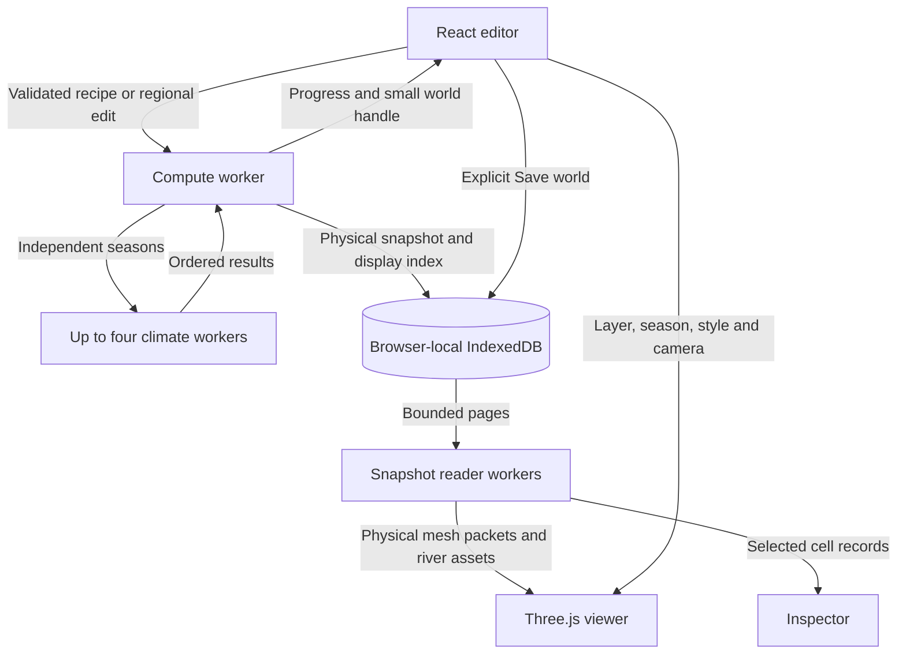

# Current architecture

World Forge is a browser application with a deterministic CPU generator and a
Three.js viewer. React manages the editor; generation and snapshot queries run in
Web Workers. The static Vite shell has no server simulation or application API.
Application and generator versions are **2.28.0**.

## Runtime boundaries

`src/core` owns geometry, generation, storage contracts and data queries. It imports
neither React nor Three.js and can run in Node. `src/app` owns editor state,
recipes, library interactions and worker lifetime. `src/render` presents the same
physical world in both layouts. Display settings do not mutate simulation fields.

`src/main.tsx` mounts the editor. Vite bundles generation, seasonal climate and
snapshot-reader module workers. Seasonal concurrency is a runtime choice outside
the recipe; ordered assembly preserves serial/parallel results. Cancellation
terminates owned workers and stale job IDs cannot replace a newer world.

## Spatial model and units

`Grid` in `src/core/model.ts` is an irregular spherical mesh derived from an
icosphere. Cells, corners and shared edges use distinct index spaces. Coordinates
are packed typed arrays; cell adjacency uses offsets. Positions lie on the unit
sphere and areas are solid angles. Physical metrics incorporate planet radius.

| Grid    | Main responsibilities                                                    |
| ------- | ------------------------------------------------------------------------ |
| Process | Plates, crust evolution, circulation, climate and primary deposits       |
| Surface | Adaptive terrain, soil water, drainage, ecology, fertility and rendering |

`world.transfer[surfaceCell]` identifies its process cell. Conservative operators
use geometric overlap areas when transferring extensive quantities. Smooth scalar
reconstruction and categorical ownership have different contracts. Matching grid
resolutions may share buffers.

Heights are metres, temperature is degrees Celsius, water flow is cubic metres per
second, and salt inventory is kilograms. Lake and river concentration is reported
in g/L, numerically equivalent to kg/m³. Annual and seasonal water fields remain
explicitly distinct.

## Generation and physical refinement

`generateWorld` in `src/core/pipeline.ts` owns the bounded sequence:

1. Validate configuration and resolved plans; build process and initial surface grids.
2. Evolve prescribed crust history and construct terrain, oceans and volcanic sources.
3. When adaptive detail is enabled, use pilot water/features to resolve the initial
   mesh and sample that retained geological history.
4. Solve seasonal climate, land water and drainage. Evolve the recent landscape in
   requested time batches, moving river, hillslope, wind and coastal material.
5. Optionally remesh evolved terrain between batches, conserving loose sediment
   and transferring existing histories. Refresh drainage as terrain changes.
6. Complete bounded climate/water feedback, then run requested final feature passes.
   Local features and lake districts can request smaller cells; protected quiet-land
   interiors can relinquish cells within independent deletion and error budgets.
7. Rebuild final channels, courses and deltas. Solve lake salts once for the explicit
   salt accumulation interval and evaluate local saline-water exposure.
8. Classify ecology, generate deposits and fertility, and record conservation,
   timing, mesh and memory diagnostics.

`src/core/regional-refinement.ts` refines an existing complete physical snapshot
under retained climate forcing. It rebuilds water routing and derived fields but
does not repeat geological, erosion or salt time. Existing terrain floors, river
courses, sediment and geographic salt inventories survive remapping. The new mesh
can resolve different water-body ownership, so a refinement can redistribute one
retained salt inventory across lakes or exposed ground without duplicating mass.

The final feature interface is extensible through `grid/feature-refinement.ts`.
Regional lake scoring uses physical neighborhoods; coarsening protects waterways,
coasts, wetlands and important terrain. Resolved insertion/deletion plans record
mesh and configuration signatures and support deterministic recipe replay. Manual
regional edits do not trigger another automatic global refinement pass.

## Water, salt and resources

The corner receiver graph and lake nodes are authoritative for drainage. Rainfall
runoff, snowmelt, slow soil release and lake release feed connected channels and
seasonal discharge. Reservoir ledgers distinguish inflow, direct rain, evaporation,
outflow and changing storage. Fractional coverage supplies common water masks to
rendering, ecology and fertility.

`generation/salinity.ts` integrates a representative annual well-mixed lake budget.
Catchment runoff supplies dissolved salt; direct precipitation is fresh. Outflow
exports salt downstream and evaporation removes only water. Salt above the generic
solubility cap remains on the bed, survives drying and can dissolve on refilling.
The salt clock advances once after final generation topology, independently of
reservoir initialization loops and refinement passes. Optional inherited marine
salts are an explicit scenario, not an inference from oceanic crust or a simulated
marine history.

Sparse geographic parcels retain resolved salt inventory through later mesh
changes. Soil salinity is a local porewater-contact estimate on shores, exposed
beds and saline river/flood footprints, not a separate groundwater chemistry
solver. It reduces affected land's fertility and ordinary vegetation. Fresh
inflowing channels keep their own water quality; climatic biome and rain/PET
aridity remain separate from salt stress.

Mineral/gem deposits use geological associations on the process grid. Stable
identity and independent frequency/amount controls keep surface-only refinement
from rerolling primary deposits. Fertility combines sediment, water quality,
climate, volcanism, habitat and salinity; cell-average and river-corridor potential
remain distinct.

## Snapshot ownership and manual saving

`src/core/storage` serializes a complete graph with exact typed-array bits, shared
buffers and object aliases into immutable paged browser snapshots. Manifest
publication follows successful data and index writes. Generation initially writes
an unlisted draft; **Save world** promotes it to the library without copying or
restoring every physical field. Failed/cancelled edits do not replace the previous
visible world. Draft cleanup does not remove a concurrently promoted save.

The page holds a small world handle, reader client, display buffers and selected
inspection data. Compute workers restore the full state only for generation or
physical operations. Viewing uses bounded reader caches and prepared indexes;
this does not make the global physical solver out of core.

`WorldDataClient` separates terrain/inspection, overlays and river preparation.
Obsolete requests are rejected or their worker lane is terminated. Recipe JSON
contains configuration and resolved edit plans; a saved snapshot retains the
computed physical state. The local library is origin-specific browser storage,
subject to browser quota and retention, not a cross-device backup.

## Fixed rendering and bounded extra detail

`PagedWorldView.tsx` is the active viewer. Despite the name, terrain rendering uses
the fixed saved physical mesh. Paging describes data access, not camera-dependent
replacement of the simulation mesh. `FixedSurface` reuses unchanged immutable
attributes and indices between representations and shares materials. Visibility
checks discard hidden globe batches. `TerrainBatchRenderer` uses multi-draw when
available and ordinary draw calls otherwise.

Scalar fields interpolate on saved triangles. Categorical layers simplify only
redundant interiors while preserving category/water boundaries. Tectonic plates
use a smooth globe or flat map; river basins, sources, biomes and wetlands retain
terrain relief and protect slopes. Geometry remains stable across camera motion.

A retained river asset owns connected courses and the bank atlas across scene
changes, releasing consumed bank payloads. Grid edges remain available at all
zooms, use darker/thicker land strokes, and retain geographic culling and relief.
Wind/current paths use physical distance along sampled vector fields; moving
faded pulses and retained phase support pause, speed and layer changes.

Optional visual zoom detail reconstructs bounded interior terrain shape from
saved heights and slopes while leaving parent edges, water and river corridors
fixed. It adds no physical cells, climate detail or simulation history. Zooming
out releases the extra geometry.

Fantasy styles use a smooth globe or flat map with geographic mountain ranges and
forest canopy. Heightmap displays unshaded elevation across the world's minimum
and maximum, including ocean floors and lakebeds. The original elevations remain
available for inspection in every style.

## Identity, performance and limits

`src/core/project.ts` validates recipes and supplies explicit defaults for older
versions. Snapshot compatibility preserves legacy fields; missing salinity remains
unknown until regeneration. Exact replay requires compatible generator identity,
seed streams, resolved plans and arithmetic order. Timings are observations,
not deterministic world data.

Generation and fixed physical display costs grow with surface count. Climate
resolution also controls the stable transport time step. Quality presets and
measurement scripts expose those costs; no fixed full-world graphics-memory
bound is claimed. `world.bytes` counts retained unique buffers, excluding temporary
arrays, JavaScript objects, renderer copies and driver allocations.

Plate motion is prescribed; slow soil release is a spring proxy. Salinity uses
annual averages and generic solubility, not seasonal ion chemistry or groundwater
transport. Glacier flow, ecological succession and civilizations remain outside
the model. The [illustrated reference](algorithms.md) and
[revision archive](history/README.md) distinguish historical algorithms and
measurements from current contracts.
