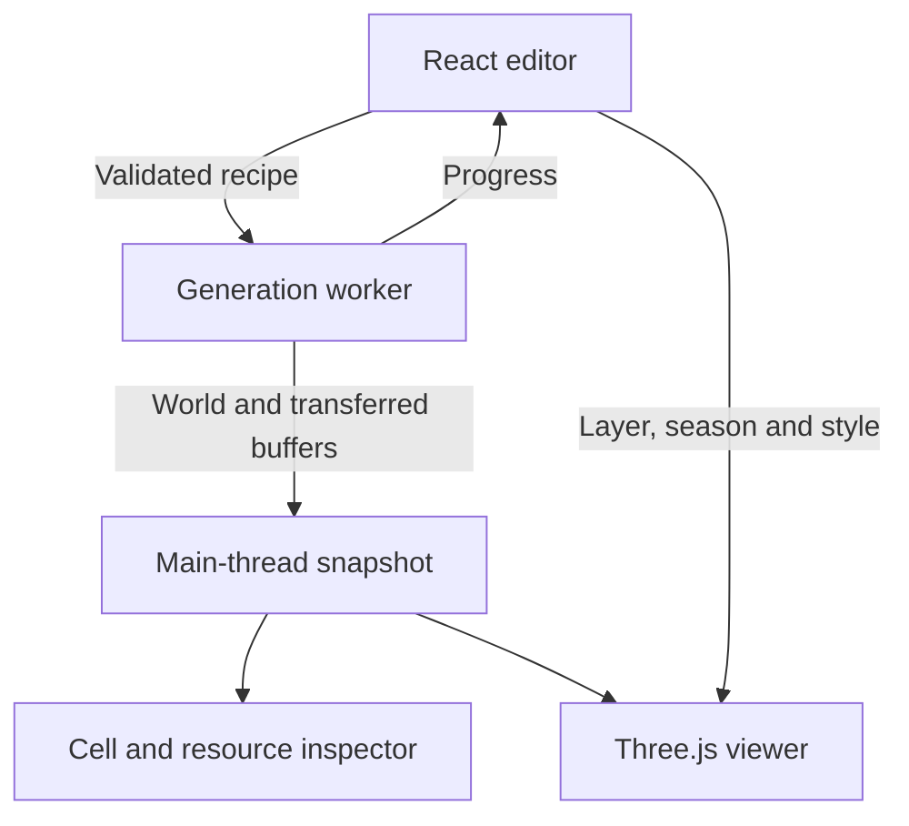

# Current architecture

World Forge is a browser application with a deterministic CPU generator and a
Three.js viewer. React manages the editor; a Web Worker executes one generation
job at a time. The static Vite shell has no server simulation or database.

Application **2.13.2** uses generator **2.13.0**. The standalone cleanup changes
packaging and maintenance structure while retaining the numerical model.

## Runtime boundaries

`src/core` owns geometry, world data and generation. It imports neither React
nor Three.js and can run in Node. `src/app` owns editor state, project files and
worker lifecycle. `src/render` presents the same generated fields in both layouts.
Display settings do not mutate the generated world.

`src/main.tsx` mounts the editor. Vite bundles `src/app/generator.worker.ts` as a
separate module worker. Only the eight used UI primitives remain in
`src/components/ui/`.

## Spatial model and units

`Grid` in `src/core/model.ts` is an irregular spherical mesh derived from an
icosphere. Cells, corners and shared edges use distinct index spaces. Coordinates
are packed typed arrays; cell adjacency uses offsets. Positions lie on the unit
sphere and areas are solid angles. Physical metrics incorporate planet radius.

| Grid    | Main responsibilities                                              |
| ------- | ------------------------------------------------------------------ |
| Process | Plates, crust evolution, circulation, climate and primary deposits |
| Surface | Terrain, soil water, drainage, ecology, fertility and rendering    |

`world.transfer[surfaceCell]` identifies its process cell. Restriction uses area
weights; interpolation distinguishes extensive quantities from intensive fields.
Matching resolutions can share grid buffers.

Heights are metres, temperatures are degrees Celsius, and river discharge is
cubic metres per second. The model documents annual versus seasonal water fields.
Keep units and support locations explicit when adding data.

## Generation order

`generateWorld` in `src/core/pipeline.ts` owns the sequence:

1. Validate the recipe; construct the grids and transfer map.
2. Build plates and geology; evolve crust for the geological interval.
3. Construct terrain and oceans, retaining a process-grid ocean reference.
4. Solve provisional seasonal climate, then soil water and snow.
5. When enabled, weather the landscape and move sediment; update water fields.
6. Route water through corners and reservoirs. When enabled, seed cutoff remnants
   and erode the river landscape.
7. If erosion or recycling requires feedback, recompute climate, land water and
   drainage once using changed terrain and bounded recycled evaporation.
8. Select connected channels and construct courses and delta data.
9. Classify ecology; generate mineral deposits and fertility.
10. Record diagnostics and collect unique buffers for publication.

The coupled passes are bounded. Weather is not rerun at each geological step,
and all systems are not iterated to joint convergence.

## Water and resources

The corner receiver graph and reservoir state are authoritative for drainage.
Rainfall runoff, snowmelt, slow soil release and lake outflow feed source mixtures
and seasonal discharge. Reservoirs retain seasonal storage, coverage and outflow,
with storage change included in their ledgers.

Shared lake-state functions supply fractional coverage and freshwater suitability
to rendering, ecology and fertility. River geometry follows selected connected
reaches; its smoothed curves and display width represent the routed network.
Floodplains and wetlands can occupy fractions of a cell and differ from its
regional biome. Delta branches divide the existing flow in the model; the current
surface view represents delta cells with seasonal shading.

Mineral and gemstone deposits use geological associations on the process grid.
Stable identity and independent frequency/amount controls keep surface-only
refinement from rerolling primary deposits. Fertility combines existing sediment,
water, climate, volcanic and ecological signals. Cell-average fertility and local
river-corridor potential remain distinct.

## Ownership and rendering

The worker owns a mutable generation job and transfers each distinct buffer once
on completion. Cancellation or regeneration terminates the worker; job IDs reject
stale completed results. No persistent simulation worker remains after publication.

The main thread owns the snapshot and GPU resources. `WorldView.tsx` manages
interaction, camera and scene lifecycle; `WorldMeshes.ts` assembles surfaces and
overlays. Specialized modules handle waterways, coasts, resources, particles and
map styles. Natural, relief and ink views share geography and seasonal fields.

Dispose of GPU resources and event handlers when replacing a view. Reuse scratch
vectors and arrays in frame loops; keep display-only changes out of generation.

## Identity, performance and limits

Project JSON contains a seed, validated settings and generator/resource recipe
metadata. `src/core/project.ts` supplies explicit defaults for legacy recipes.
Exact reproduction requires compatible generator identity, seeded streams and
iteration/arithmetic order. Timings describe the run and are not deterministic data.

Prepared transport coefficients, shared spatial fields, typed arrays and bounded
climate feedback reduce CPU work. Subdivision roughly quadruples cell counts;
climate detail also affects the stable transport time step. Defaults remain 5/5,
with optional terrain level 9 and process level 7.

`world.bytes` counts retained unique buffers, excluding temporary arrays,
JavaScript objects and GPU copies. WebGL renders the result; it does not run
the physical generation passes.

Plate motion is prescribed. Slow soil release is a spring proxy. Glacier flow,
exact channel hydraulics, full mineral chemistry, ecological succession and
civilizations remain outside the model. The [illustrated reference](algorithms.md)
and [history](history/README.md) record assumptions and measured limitations.
