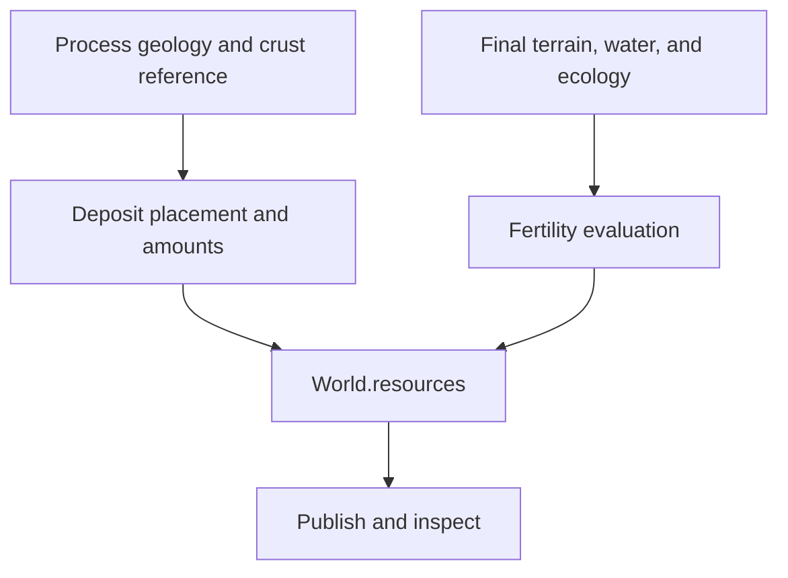

# World Forge — Minerals and Fertility Prototype Integration

**Status:** Implementation proposal; application source and deployment unchanged.  
**Date:** 2026-09-08.  
**Reviewed baseline:** Application 2.9.4, generator 2.9.0, source revision `edb5ac85f11a281f5bc23bc0a7f989b583c5b75b`.  
**Design basis:** `world_forge_minerals_and_fertility_architecture.md`. The recovered `worldbuilding_architecture_illustrated(1).zip` matches that document's recorded revision.

Implement this extension in the TypeScript prototype first. Keep its data and calculation functions portable to C3. The prototype can establish useful geography, quantities, and fertility behavior before any downstream mining or settlement rules need them.

## 1. Recommended integration

Add one **Minerals & fertility** stage immediately after `classifyEcology` and before `Publish world` in `src/core/pipeline.ts`. It contains two ordinary calculations: generate the deposit catalogue, then evaluate surface fertility.



The observable requirements are:

- Each deposit has a resource type, geographic anchor, extent, finite amount, and formation explanation. It owns its quantity once, even when several display cells intersect its extent.
- With process inputs and resource settings fixed, changing only surface subdivision preserves deposit IDs, anchors, extents, and amounts. Surface association and fertility can change as the detailed environment changes.
- Adding an enabled resource family leaves existing families' generation streams unchanged.
- Fertility remains within 0–100. Standing-water and permanent-ice cells receive zero land potential. Local river benefits remain limited to their physical footprint.
- Generation and inspection use the same fertility evaluation rules.
- Resource generation reads environmental arrays without changing terrain, climate, water budgets, drainage, ecology, or the accepted water geometry.
- Camera movement, layer changes, and season selection do not regenerate deposits or change their amounts.

These requirements do not depend on an economy, mineral purity, crop model, or detailed geological chronology.

## 2. What the current code already provides

| Verified source | Integration use | Detail that matters |
| --- | --- | --- |
| `pipeline.ts`: `processGrid`, `surfaceGrid`, `transfer` | Separate primary resource placement from detailed fertility | Fine surface inputs also influence later climate and erosion, so merely aggregating them back to the process grid would not guarantee stable deposits. |
| `pipeline.ts`: `referenceOceanMask` | A process-only land/ocean eligibility mask | It is already generated directly on the process grid after crust evolution and before landscape weathering. Reuse the in-scope value; it is not currently retained in `World`. |
| `Geology.continental`, `.uplift`, `.volcanism` | Broad continental, deformation, and magmatic context | These are procedural environmental signals, not composition or mineral inventories. |
| `Geology.boundary` | Nearby convergence, divergence, or shear context | This array is indexed by **process edges**, not cells. Obtain a cell's incident edge IDs through the process grid. |
| `CrustHistory` and `referencePoint()` | Coherent inherited eligibility that follows selected crust | The helper already maps a position through the selected plate's inverse rotation. `material` distinguishes retained reference crust from opened ocean. |
| `Terrain.sediment`, `.deltaSediment` | Deposited-ground benefit and mouth context | Mouth sediment is contextual information about the recorded deposition; do not add both thicknesses as independent fertility inputs. |
| `LandWater.rain`, `.pet`, seasonal temperatures, `.saturatedSeasons` | Moisture adequacy, growing conditions, and saturation limits | Annual rain/PET are already available. Use seasonal temperatures for short growing seasons rather than assuming annual temperature tells the whole story. |
| `Ecology.riparianFraction`, `.floodplainFraction`, `Floodplains.width` | Physical corridor coverage | Widths are metres per bank. Persistent banks and seasonal flood coverage overlap. |
| `Rivers.supportFlow`, `.seasonalDischarge` | Local freshwater support | They describe modeled supply, not a new withdrawal or proof of daily reliability. |
| `Drainage.lakeDepth`, `.lakeCoverage`, `.lakes` | Water exclusions and local shore access | Match the accepted shallow-water classification. Depth alone misses some visible lakes. |
| `collectWorldBuffers()` and the worker completion message | Transfer the added fertility buffer | The collector recursively finds typed arrays. Ordinary deposit objects are structured-cloned and are not counted as typed-buffer memory. |

The important information gaps are composition, ancient mineralization settings, exact mineral-forming episodes, salinity, and soil-development history. Small, explicitly procedural presets cover the first release's needs; these gaps do not establish a need for another simulation.

## 3. Minimal data and calculation boundaries

Proposed TypeScript contracts, not existing or compiled APIs:

```ts
type ResourceType = 'copper' | 'tin' | 'iron' | 'gold' | 'corundum';

type FormationCause =
  | 'magmatic-hydrothermal'
  | 'selected-intrusive'
  | 'deformation-associated'
  | 'inherited-sedimentary'
  | 'selected-volcanic';

interface Deposit {
  id: string; // Identity within this environmental baseline and resource recipe.
  resourceType: ResourceType;
  anchor: [number, number, number]; // Unit-sphere position.
  extentKm: number; // Approximate footprint radius; not marker size.
  amount: number; // Abstract units of this resource.
  formationCause: FormationCause;
}

interface Resources {
  recipe: string;
  deposits: Deposit[];
  fertility: Float32Array; // One representative score per surface cell.
}

interface DepositEnvironment {
  process: Grid;
  geology: Geology;
  referenceOceanMask: Uint8Array;
  seed: string;
  radius: number; // Metres.
}

interface ResourceSettings {
  depositFrequency: number;
  depositAmount: number;
}

function generateDeposits(
  environment: DepositEnvironment,
  settings: ResourceSettings,
): Deposit[];
```

Add `resources: Resources` to `World`. `corundum` is a proposed internal family displayed as **Ruby / sapphire**. Keeping one gemstone family initially avoids implying that the existing geology distinguishes their specific formation conditions.

Keep the deposit input deliberately limited to process data, seed, radius, and resource settings. It should not accept the final surface terrain or climate. This makes the resolution requirement an explicit function boundary.

For fertility, use `buildFertility(environment, preset)` plus `evaluateFertilityCell(environment, cellIndex, preset)`. The environment borrows the surface grid, process mapping, geology, terrain, water, drainage, rivers, and ecology. The evaluator returns the cell score and the information needed to explain it: contributors, limitations, regional potential, and local corridor potential. Only the score array is retained by default.

## 4. Deposit placement

### Starting palette and presets

| Resource | Starting placement rule | Intended distribution |
| --- | --- | --- |
| Iron | Coherent inherited continental sedimentary preset | Relatively widespread eligible regions, with gaps; independent of present volcanic boundaries |
| Copper | Selected magmatic/hydrothermal context, with fracture compatibility | Regional clusters associated with suitable volcanic or tectonic settings |
| Tin | Rare intrusive-compatible preset within continental magmatic context | Fewer separated clusters; a volcano alone is insufficient |
| Gold | Selected magmatic/hydrothermal and deformation-associated settings | Sparse clusters with more than one permitted cause |
| Ruby / sapphire | Selected deformation-associated or volcanic-compatible presets | Rare gemstone occurrences using the same deposit structure |

These are the attached design's broad worldbuilding associations. Their eligibility thresholds, relative occurrence rates, and amount ranges are tuning parameters, not geological measurements. Do not require every world or continent to contain every resource.

Where more than one cause is eligible, choose among its weights and retain the chosen cause. That explanation must correspond to the actual placement rule.

### Sampling sequence

1. Evaluate one resource's suitability on the process grid. Combine its broad environmental context with a seeded, spatially coherent eligibility mask where composition or ancient history is missing.
2. For inherited masks on retained crust, use `referencePoint(crust.inverse, geology.plate[processCell], x, y, z)`. When no crust history exists, use the current position. Opened ocean does not inherit an ancient continental preset merely because an inverse coordinate can be calculated there.
3. Apply the process-only reference ocean mask for the initial land-oriented palette.
4. Weight each process cell by physical area: `weight = suitability * areaSteradians * (radiusMetres / 1000) ** 2`.
5. Compute expected regional anchors from total weighted area and a per-resource rate per million eligible square kilometres. Seeded stochastic rounding is sufficient for the initial count; there is no need for a deposit trial on each surface cell.
6. Build a cumulative-weight array and select anchors by binary search. Place a few deposits around each anchor using physical spherical offsets in kilometres. Recheck their process-level eligibility with a bounded number of local attempts; unsuitable candidates can be skipped.
7. Sample each deposit's amount once from a bounded per-type range, using a separate amount stream. Sample extent independently. Neither value comes from the number of intersected display cells.
8. Associate the resulting positions with surface cells only for drawing and inspection.

Reuse existing noise, seeded random, spherical math, nearest-cell lookup, and reference-coordinate helpers. Reuse scratch weights between resource types. A separate persistent district catalogue or generic weighted-sampling framework is unnecessary.

Use separate seed namespaces for each family and purpose, for example `seed/resources/copper/placement-v1` and `seed/resources/copper/amount-v1`. Do not seed from the serialized `WorldConfig`, which includes surface detail. Do not salt all families with a global palette version merely because a gemstone was added; retain per-family generation revisions and record the combined recipe as metadata.

### Coastlines and the stability tradeoff

The process reference coast can differ from the final eroded surface or a detailed lake. Preserve a deposit's geographic anchor and amount if its surface lookup becomes submerged; report that surface association honestly. Do not silently delete it, move it onto nearby land, or resample its amount.

The initial placement is therefore land-oriented at the process reference scale, not a guarantee that every deposit is currently exposed on dry ground. Enforcing final-surface dry-land placement would weaken the requested surface-refinement guarantee. Neither choice establishes mine accessibility, which remains deferred.

### Formation triggers

For this release, a formation cause explains a retrospective placement rule. It does not assert a dated eruption, intrusion, or metamorphic event.

Later geological episodes can create additional deposits through an explicit episode-scoped operation. Frequency must be tied to the episode or physical duration/activity, not to how many numerical integration steps execute. Erosion can expose material; optional secondary deposits would transfer an amount from a source rather than duplicate it. Ordinary civilization time and map redraws do not create new veins.

## 5. Fertility evaluation

Start with the attached document's four contributors and combination rule:

```text
S = capped sediment benefit, 0–1
W = local freshwater access, 0–1
R = rainfall adequacy relative to evaporative demand, 0–1
V = established volcanic-ground benefit, 0–1

ground = clamp01(0.35 + 0.40*S + 0.25*V)
water = 1 - (1-R)*(1-W)
potential = 100 * ground * water * suitability
```

Keep the numerical weights provisional. The 0.35 ground baseline means ordinary adequately watered ground without a sediment or volcanic bonus starts around 35/100 before limitations. That is a consequence of the sketch, not evidence that the land is agronomically poor.

| Contributor or limiter | Initial evaluation |
| --- | --- |
| Sediment | Apply a saturating response to nonnegative `Terrain.sediment`; use delta/floodplain context to identify relevant alluvial surroundings. Do not add `deltaSediment` again or infer sediment chemistry. |
| Rain | Use annual `rain / max(pet, smallPositiveValue)` with a bounded response that reaches a plateau. Cold conditions have their own limiter. |
| River water | Use supported reaches bordering the cell and their physical bank coverage. Obtain supply from `supportFlow`, not from the rendered green color or vegetation score. |
| Inland shores | Use a small local shoreline footprint limited by physical reach and terrain rise. Derive it from modeled lake water and the existing local graph; nearby ocean receives no freshwater credit. Inland water is assumed fresh for this preview. |
| Volcanism | Grant a modest benefit where construction is established and compatible with current cover. Suppress the immediate benefit and apply a fresh-cover limitation for substantial recent emplacement. Missing history supplies no inferred volcanic-soil benefit. |
| Growing conditions | Use the existing seasonal temperatures and permanent-ice classification. Reduce potential for strongly cold or steep terrain. |
| Persistent wetness | Apply a modest coverage-aware limitation to repeatedly saturated land. A bog is not an automatic freshwater or alluvium bonus. |

`volcanicAge` is a coarse recent-emplacement proxy. The current code resets it when a construction-rate threshold is crossed; it is not a retained eruption catalogue or a soil age. Reusing it supports a tunable age/cover response, not an exact soil-maturation date.

### Preserve the fertile corridor

Evaluate surrounding land and the local accessible corridor separately, then mix their **scores** by physical coverage:

```text
cellScore = (1 - corridorFraction) * regionalScore
          + corridorFraction * meanCorridorScore
```

This avoids placing cell-averaged water and sediment enhancements into a nonlinear rule that cannot distinguish a narrow productive strip from its dry surroundings.

Use `riparianFraction` as the persistent river footprint. Treat `floodplainFraction` as overlapping seasonal coverage, not extra area to add. Where river and eligible shore summaries overlap, a capped maximum is a sufficient shared-envelope approximation for the first release; it is not an exact polygon union. Do not add generic wetland coverage as a new river-access fraction.

The source already uses a lateral bank fade with a mean enhancement factor in `floodplains.ts`. Reuse that profile if fertility fades across the corridor: distinguish channel-side peak potential from the mean used in the cell score. A modest terrain-derived corridor limiter should reflect the existing accessible bank setting; applying the entire enclosing mountain cell's slope again would suppress narrow valley bottoms twice.

For illustration, a cell with regional potential 4, **mean** corridor potential 72, and corridor coverage 10% has a representative score of **10.8**, while the inspector can still report the productive local corridor. These are hypothetical values, not an output from a generated world.

Match the accepted whole-cell water predicate: ocean, or `lakeDepth > 0`, or `lakeCoverage >= 0.5`. Permanent-ice cells are also excluded. On remaining land cells with unresolved partial lake coverage, the wet fraction contributes zero to the representative score. Keep this calculation in the core; do not import the renderer's three.js-dependent `SurfaceHabitats.ts` into generation.

Fertility is initially an annual/general potential. Selecting a season can change the surrounding existing presentation, but does not replace this single array with seasonal crop yields.

## 6. Views, inspection, and controls

Add two layer entries:

- **Minerals & gemstones:** resource selector, sparse markers, explicit amounts and causes, and a selected deposit's extent outline. Size markers with a fixed per-resource amount legend; geographic extent is a separate measurement. Start with markers, leaving amount rasterization optional.
- **Fertility — general land potential:** fixed 0–100 scale, cell score, regional and local corridor potential, corridor coverage, four contributors, and the main limitations.

The existing pointer handler selects terrain cells. Add deposit hit selection before its terrain fallback, with stable deposit IDs. Render markers in batches using the existing globe/map coordinate conventions; a marker that straddles the map seam must still select the same record. Avoid one React element or scene object per deposit when a shared marker buffer suffices.

The fertility layer should use its score directly in `sampleCellColor`. Handle water explicitly, and keep it out of the habitat-only delta recoloring and decorative riverbank tint: otherwise a delta or green bank could display a color unrelated to the numerical legend. The existing natural view remains the environmental presentation.

Start with two numeric generation controls, **Deposit frequency** and **Deposit amount**, defaulting to 1. Keep their per-resource baseline presets in code. Fertility coefficients can initially stay in a named preset while the first map is evaluated, avoiding a large panel of uncalibrated sliders.

Use the existing explicit Generate action initially; layer/filter changes are immediate view operations. Resource-only recalculation is a possible follow-up if tuning repeatedly incurs unacceptable weather-generation time. The current worker transfers the completed snapshot and terminates, so a cheap retained-worker recalculation path does not already exist. Do not imply that it does, or introduce a general partial-pipeline scheduler as part of this feature.

## 7. Source changes

Paths below are relative to the recovered `source/` directory. New names are proposals.

| File | Concrete change |
| --- | --- |
| `src/core/model.ts` | Add deposit/resource types, `World.resources`, the two numeric controls/defaults, and the new `Layer` members. |
| `src/core/resource-presets.ts` — new | Small resource rule table, bounded amount/extent ranges, family revisions, and fertility parameters. |
| `src/core/generation/resources.ts` — new | Process-only suitability, weighted regional placement, stable record construction, and amounts. |
| `src/core/generation/fertility.ts` — new | Contributor sampling, physical coverage treatment, common evaluation, and output array. |
| `src/core/pipeline.ts` | Run one resource stage after ecology; pass the existing `referenceOceanMask`; attach the result before buffer collection; increment the unconditional stage count. |
| `src/core/config.ts` | Register and validate the two numeric settings using the existing mechanism. |
| `src/render/palette.ts` | Add layer definitions and an accurate fertility ramp without habitat color overrides. |
| `src/render/ResourceMarkers.ts` — new | Batched deposit display, picking support, and selected extent. Reuse projection functions. |
| `src/render/WorldView.tsx` | Attach/dispose marker geometry, update visibility/projection, and prioritize marker selection. |
| `src/app/WorldStudio.tsx` | Resource selector, selected deposit state, metadata export/import, and old-project defaults. |
| `src/app/Inspector.tsx` | Deposit details and the shared fertility evaluator's explanation. |
| Existing core tests and measurement script | Add the bounded resource checks below and report the new stage. |

The separate fertility module is justified by its distinct surface calculation and explanation logic. Preserve the source's cleaned-up naming and formatting conventions. Keep core generation independent of React and three.js.

### Project compatibility

Saved projects currently contain `{ version, config }`, not a serialized generated world. Record the resource recipe alongside this metadata and in `World.resources`; keep the new controls in config. Old projects receive defaults and generate resources when regenerated.

If the generator version is advanced, explicitly retain `2.9.0` in the importer: it currently accepts the current `VERSION` dynamically, so simply changing that constant would otherwise drop acceptance of existing 2.9.0 exports. This is a conditional integration risk, not a defect in the untouched current importer.

A recipe identifier tells the reader which rules were used. It does not implement old algorithms or guarantee regeneration across later code changes. If a recipe differs from the available one, make regeneration with the available recipe explicit. Keep exact frozen snapshots and historical mine depletion as separate future concerns.

## 8. Implementation order and sufficient verification

Implement three short slices:

1. **Deposits:** contracts, presets, placement, pipeline publication, markers, and type/amount/cause inspection. The result is a geographically inspectable inventory.
2. **Fertility:** shared evaluation, physical corridor weighting, heatmap, and explanation. The result is inspectable general land potential with local exceptions.
3. **Integration finish:** controls, recipe metadata, importer compatibility, timing/memory reporting, and the ordinary build/publication workflow when implementation and deployment are requested.

Retain the existing environmental tests. Add focused evidence for three concerns:

| Concern | Sufficient check |
| --- | --- |
| Stable primary inventory | Fixed process geology/reference mask with two surface subdivisions yields identical deposit records. Adding the gemstone family leaves copper unchanged; changing amount multiplier leaves placement unchanged. Include the valid zero-duration geology path. |
| Fertility behavior | Scores are bounded; shallow visible water and permanent ice are excluded; a dry region has a better local supported river corridor without receiving the full corridor score across its entire cell. Check the ordering of comparable established and fresh volcanic ground. |
| Noninterference and presentation | A small before/after resource-stage comparison preserves environmental buffers. Inspect one representative world in both projections for marker selection/extent, shallow-water colors, delta colors, and a dry river corridor. |

Use the retained AETHER-0004 configuration for the visual pass if desired, with a smaller world for focused numerical checks. One representative timing and memory observation is enough initially; no new benchmark framework is needed.

With `M` process cells, `N` surface cells, and a small palette of `K` resources, eligibility costs roughly `K*M` work. Prefix-table sampling adds logarithmic searches per regional anchor; bounded local placement and spatial lookups have their own cost. Fertility uses a surface pass with local adjacency work. Do not promise the design sketch's idealized linear complexity for a different concrete sampler.

The retained fertility Float32 array costs **2,621,448 bytes (about 2.5 MiB)** at 655,362 cells. Deposit objects, scratch, any marker buffers, and GPU copies are additional. The existing typed-buffer report is not total JavaScript heap usage. No runtime measurement has been made for this proposal.

The useful first outcome is straightforward: the same accepted environmental world now contains sparse, explainable mineral opportunities and a fertility map whose productive river corridors can be inspected at their actual scale. Geological chemistry, dated event tracking, placers, extraction, agriculture, and civilization remain downstream choices.

## Evidence boundary

This proposal is grounded in the attached design and direct inspection of the matching archived source, including pipeline/model contracts, geology/crust evolution, ecology/floodplains/wetlands, rendering/picking, configuration, worker transfer, and project serialization. Geological associations are carried forward as procedural presets from the supplied design. No application edits, generator execution, tests, build, live-site comparison, or deployment were performed in this exploration.
