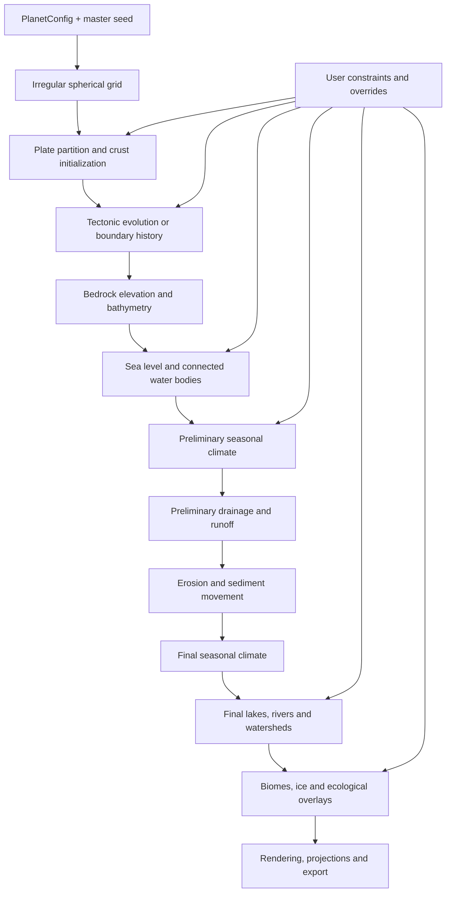

# Worldbuilding Planet Generator

**Status:** Initial architecture and generation plan  
**Date:** 2026-09-01  
**Primary focus:** Generation algorithms and their data dependencies  
**Likely implementation language:** C3  
**Candidate libraries:** [`c3cg.c3l`](https://github.com/fesoliveira014/c3cg.c3l) for spherical geometry and topology; [`gpu.c3l`](https://github.com/fesoliveira014/gpu.c3l) for visualization

---

## 1. Purpose

The project is a native worldbuilding tool whose central feature is a procedural generator for plausible terrestrial planets. A generated world should be causally coherent at a global scale:

1. A tectonic history establishes continents, ocean basins, mountain systems, trenches, and ridges.
2. Topography, latitude, rotation, land distribution, and ocean state establish long-term atmospheric and ocean circulation.
3. Circulation transports heat and moisture.
4. Moisture interacts with topography to produce precipitation, rain shadows, snow, and aridity.
5. Precipitation, evaporation, topography, and ground properties determine drainage, lakes, rivers, and erosion.
6. Temperature, moisture, seasonality, elevation, and hydrology determine biomes and ecological overlays.

The generator is not intended to be a predictive geophysical model. It should preserve the important causal relationships while using approximations, heuristics, reduced-order models, and bounded simulation passes where they provide a better complexity-to-result ratio.

The first version should generate **long-term climate normals**, not day-to-day weather. Storm systems, individual fronts, hurricanes, and hourly atmospheric evolution are outside the initial scope.

---

## 2. Decision status

### Selected decisions

- Use a **fixed spherical cell graph** as the authoritative simulation domain.
- Generate that graph from an **irregularized icosphere**:
  1. build an icosphere;
  2. perturb its sites tangentially on the sphere;
  3. reconstruct the spherical Delaunay triangulation;
  4. derive the spherical Voronoi dual;
  5. apply only limited, selective quality relaxation when required.
- Store simulation quantities as fields over cells or edges rather than embedding all state in a large object per cell.
- Keep tectonic plates separate from both simulation cells and continents.
- Use circumcentric spherical Voronoi cells as the authoritative geometric control volumes.
- Keep the generator headless and independent from rendering and editor code.
- Implement a single explicit generation pipeline rather than a generic node graph or plugin framework.
- Start with a simplified boundary-history tectonics model and preserve an upgrade path to actual advected crust.
- Use a bounded feedback sequence:

  ```text
  preliminary climate
      -> preliminary hydrology
      -> erosion and sediment movement
      -> final climate
      -> final hydrology
  ```

### Assumptions for the initial implementation

- The planet is approximately spherical.
- It is a rotating, Earth-like terrestrial world with surface liquid water and an atmosphere.
- Four seasonal samples are sufficient for the first climate model.
- Global cells represent tens to hundreds of kilometres; local terrain requires a later regional refinement layer.
- The authoritative simulation is CPU-side initially. GPU compute is an optimization option only after profiling.

### Deferred decisions

- Whether high-resolution spherical Delaunay reconstruction should use global convex-hull reconstruction or local edge legalization.
- Whether regional refinement uses projected planar meshes, nested spherical meshes, or a hybrid.
- Whether the advanced tectonics engine should use plate-local crust fields or moving crust parcels.
- Whether a full vector-rendering dependency is eventually needed for cartographic output.

---

## 3. Overall architecture

The generator should be organized as transformations between explicit world fields:



Rendering is a consumer of the generated state. It must not become the source of topology or simulation truth.

---

# Part I — Spherical simulation grid

## 4. Why the grid is separate from plates

The globe should contain a relatively fine set of irregular polygonal cells. Approximately 16–24 tectonic plate regions are then assigned over those cells.

The distinctions are important:

- A **cell** is a numerical control volume used by every simulation.
- A **plate** is a moving lithospheric region containing many cells.
- A **continent** is a connected or historically related region of continental crust and may cross plate-history boundaries.
- A **render polygon** is a visualization of a cell and may use duplicated vertices or alternative edge styling.

The coarse plate Voronoi partition must not be used as the simulation grid. Climate, hydrology, erosion, and topography need substantially more spatial resolution than the plate count.

---

## 5. Selected irregular-cell construction

### 5.1 Pipeline

The selected grid-generation algorithm is:

```text
regular icosphere sites
    -> deterministic tangent-space jitter
    -> spherical Delaunay reconstruction
    -> quality analysis
    -> optional selective relaxation
    -> final spherical Delaunay
    -> circumcentric spherical Voronoi dual
    -> immutable PlanetGrid
```

This is preferred over random topology modification because the irregularity originates in the **site distribution**, while connectivity is derived from geometry.

### 5.2 Why the previous random-edge-flip approach is not retained

The earlier [`godot-world-gen`](https://github.com/fesoliveira014/godot-world-gen) experiment subdivided an icosahedron, randomly flipped valid edges, and built a centroid dual. That can change cell degree, but it leaves the original sites regular and changes connectivity without a geometric objective.

A topologically valid flip may replace a short diagonal with a much longer one. The result can be stretched triangles, locally distorted dual cells, and a mostly regular grid interrupted by isolated defects. Random edge flips therefore do not provide controlled organic irregularity.

The existing half-edge flip operation remains useful for a different role: **local spherical Delaunay legalization** after sites are moved.

### 5.3 Tangent-space jitter

For each unit site position `p`, generate a deterministic random vector and project it onto the tangent plane:

```text
r = deterministic_random_unit_vector(seed, site_id)
t = normalize(r - p * dot(p, r))
```

Choose a bounded angular displacement `theta`, then move the point with the spherical exponential map:

```text
p' = p * cos(theta) + t * sin(theta)
```

The displacement is based on local spacing rather than a global Cartesian distance:

```text
local_spacing = median angular distance to one-ring neighbors

theta =
    irregularity
    * max_jitter_fraction
    * local_spacing
    * random_radius
```

A practical initial range for `max_jitter_fraction` is approximately `0.20–0.35`. This is a tuning range, not yet a correctness requirement.

The random radius should avoid pushing every site close to the maximum displacement. A square-rooted uniform sample gives uniform density over a tangent disk:

```text
random_radius = sqrt(random_0_1)
```

### 5.4 Separation guard

Even bounded jitter can move adjacent sites too close together. Each candidate should therefore be rejected or shortened when it violates a local minimum-separation rule:

```text
new_distance(i, neighbor) >=
    min_separation_fraction
    * original_local_spacing(i)
```

This can initially check only the original one-ring and two-ring neighbors because the displacement is bounded. The final spherical Delaunay triangulation determines the authoritative neighborhood.

### 5.5 Spherical Delaunay reconstruction

`c3cg.c3l` already provides:

- `cg::primitives::icosphere`
- `cg::delaunay::delaunay_on_sphere`
- `cg::geometry::circumcenters_on_sphere`
- `cg::dual::dual_from_vertices`
- `cg::voronoi::voronoi_on_sphere`
- half-edge topology and edge flips

The simplest first implementation is global reconstruction:

```text
jittered sites
    -> 3D convex hull
    -> project hull vertices onto sphere
    -> spherical Delaunay mesh
```

The current 3D hull implementation has a quadratic worst case, so it should be benchmarked rather than assumed suitable for every target resolution. If global reconstruction is expensive at level 7 or above, the alternative is:

1. retain the original icosphere connectivity;
2. move the sites;
3. queue affected edges;
4. test each edge for spherical Delaunay legality;
5. flip illegal edges;
6. requeue the local neighborhood.

This is a conditional optimization, not part of the initial implementation unless profiling requires it.

### 5.6 Selective relaxation

Full Lloyd relaxation would progressively regularize the cells and work against the desired appearance. Relaxation should be limited to cells that fail quality constraints.

For a bad cell:

```text
site = slerp(site, spherical_cell_centroid, relaxation_strength)
```

Initial policy:

- zero or one quality pass in ordinary cases;
- at most two passes;
- move only failing sites and possibly their immediate neighbors;
- use a low blend strength, such as `0.15–0.30`;
- reconstruct Delaunay after moving sites.

### 5.7 Authoritative dual

Use spherical circumcenters to produce a true Voronoi dual.

Benefits:

- Every polygon is the region closest to its site.
- Delaunay site-to-site edges and Voronoi interfaces are orthogonal.
- Cell areas and shared-interface lengths form useful finite-volume coefficients.
- Neighbor relationships have a direct geometric meaning.

A centroid or barycentric dual may remain available as a diagnostic or visual mode. It should not be the authoritative simulation geometry unless circumcentric quality proves inadequate after bounded jitter and filtering.

### 5.8 Cell identities

Site IDs must remain stable even when Delaunay connectivity changes. If the hull implementation reorders points, the grid builder must retain or reconstruct an input-site-to-output-vertex mapping.

This gives stable field indexing for a fixed seed and grid configuration even though neighbor topology varies with irregularity.

---

## 6. Resolution levels

For an icosphere with subdivision level `L`, the site count is:

```text
N = 10 * 4^L + 2
```

Approximate Earth-scale equivalent cell widths are:

| Level | Cells | Approximate equivalent width | Intended use |
|---:|---:|---:|---|
| 5 | 10,242 | 223 km | fast previews, tests, early algorithm work |
| 6 | 40,962 | 112 km | initial normal-quality generation |
| 7 | 163,842 | 56 km | higher-quality global generation |
| 8 | 655,362 | 28 km | expensive global generation and export |

These widths are square roots of average cell area, not exact cell diameters.

Start implementation and tuning at levels 5 and 6. Level 7 should be treated as a benchmark target after the complete vertical slice works.

---

## 7. Grid quality criteria

The goal is controlled irregularity, not maximum randomness.

Desired properties:

- no visible latitude seam or pole singularity;
- no obvious icosahedral bands at ordinary display scale;
- moderate cell-area variation;
- varied polygon shape and neighbor count;
- no extremely short interfaces;
- no very acute Delaunay triangles;
- no disconnected, inverted, or concave spherical cells;
- sufficiently isotropic diffusion and transport.

### 7.1 Metrics

Record at least:

```text
cell area coefficient of variation
cell area p95 / p05
minimum and p01 Delaunay angle
edge-length p95 / p05
minimum dual-interface length / median interface length
cell degree histogram
count of quality-rejected sites
count of selective relaxations
```

Useful initial guardrails, subject to tuning:

```text
cell-area coefficient of variation: 0.10–0.25
cell-area p95 / p05:               below approximately 2
p01 Delaunay angle:                above approximately 15 degrees
typical cell degree:               5–7
extreme degree values:             rare
very short Voronoi interfaces:     absent
```

### 7.2 Topological invariants

For a closed spherical mesh:

```text
V - E + F == 2
all undirected edges have exactly two incident faces
all directed neighbor relationships have a reverse relationship
sum(6 - cell_degree) == 12
```

The final invariant means that a sphere cannot be tiled entirely by hexagons. A regular icosphere dual has twelve pentagons and otherwise hexagons; an irregular mesh can introduce heptagons and other degrees, but the total topological defect remains twelve.

### 7.3 Numerical isotropy test

A visual grid can look acceptable while biasing simulation.

For several source cells:

1. initialize a scalar impulse;
2. diffuse it for a fixed number of steps;
3. render equal-value contours;
4. measure value as a function of geodesic distance;
5. compare results after rotating the source relative to the original icosahedron.

Directional lobes or systematic orientation dependence indicate that jitter, weighting, or graph operators need adjustment.

---

## 8. Immutable `PlanetGrid`

The geometric mesh produced by `c3cg` should be converted into a simulation-oriented immutable structure.

Illustrative C3 layout:

```c
module worldgen::grid;

import cg;

typedef CellId = inline uint;
typedef EdgeId = inline uint;

struct CellArc
{
    CellId neighbor;
    EdgeId edge;

    // Unit tangent at the source cell pointing toward the neighbor.
    Vec3f tangent_to_neighbor;

    float site_distance_m;
    float interface_length_m;

    // interface_length / site_distance
    float conductance;
}

struct SurfaceEdge
{
    CellId a;
    CellId b;

    Vec3f midpoint;
    float interface_length_m;
}

struct PlanetGrid
{
    float radius_m;

    // Unit vectors. Multiply by radius for world-space surface positions.
    Vec3f[] cell_centers;

    double[] cell_areas_m2;

    // CSR-style directed adjacency.
    uint[] cell_arc_offsets;
    CellArc[] arcs;

    SurfaceEdge[] edges;

    // Ordered spherical Voronoi rings.
    uint[] polygon_offsets;
    Vec3f[] polygon_vertices;
}
```

Precompute:

- cell center unit vectors;
- cell areas;
- Voronoi polygon rings;
- unique cell interfaces;
- great-circle site distance;
- shared-interface length;
- tangent direction between neighboring sites;
- finite-volume conductance;
- latitude and longitude as derived metadata when useful for climate and export.

Latitude and longitude are not topology and should not be used as array coordinates.

---

## 9. Operators on an irregular grid

Simple unweighted neighbor averages would bias calculations toward cells with particular sizes or degrees. The irregular grid should use area- and interface-aware operators.

### 9.1 Diffusion and Laplacian

For scalar field `f` at cell `i`:

```text
laplacian(f)[i] ~=
    1 / area[i]
    * sum over neighbors j (
        interface_length[i,j]
        / site_distance[i,j]
        * (f[j] - f[i])
      )
```

This operator can support:

- temperature diffusion;
- pressure smoothing;
- sea-surface-temperature relaxation;
- terrain smoothing;
- soil creep;
- low-frequency tectonic influence spreading.

### 9.2 Scalar gradient

A first implementation can use a weighted least-squares fit in each tangent plane. A finite-volume gradient can be added later if required.

### 9.3 Divergence and flux

Transport should operate through interfaces:

```text
flux(i -> j) =
    interface_length
    * max(0, dot(velocity_at_interface, outward_normal))
    * transported_quantity
```

Divide accumulated net flux by cell area when converting to a rate of change.

Use upwind transport initially. Higher-order transport is unnecessary until the simpler scheme demonstrates unacceptable numerical diffusion.

### 9.4 Graph algorithms

The grid should expose reusable operations for:

- multi-source physical distance;
- connected components;
- priority queues over cells;
- watershed traversal;
- topological sorting of drainage receivers;
- breadth-first and Dijkstra-like growth;
- scalar and vector smoothing;
- area-weighted reductions and percentiles.

---

# Part II — World state and pipeline

## 10. Field-oriented planet state

Use structure-of-arrays storage. Most stages read or write only a subset of fields, and contiguous arrays are easier to parallelize, serialize, inspect, and upload to the GPU.

Illustrative model:

```c
module worldgen::model;

import worldgen::grid;

typedef PlateId = inline ushort;
typedef BasinId = inline uint;
typedef BiomeId = inline ushort;

enum CrustKind : byte
{
    OCEANIC,
    CONTINENTAL,
}

struct Plate
{
    Vec3f angular_velocity;
    float growth_bias;
}

struct GeologyFields
{
    PlateId[] plate;
    CrustKind[] crust_kind;

    float[] crust_age_myr;
    float[] crust_thickness_km;
    float[] tectonic_uplift_m;
    float[] sediment_m;

    float[] bedrock_elevation_m;
    float[] surface_elevation_m;
}

struct ClimateFields
{
    uint season_count;

    // season * cell_count + cell
    float[] temperature_c;
    float[] pressure;
    Vec3f[] wind;
    float[] humidity;
    float[] precipitation_mm;
    float[] evaporation_mm;

    float[] sea_surface_temperature_c;
    Vec3f[] ocean_current;

    // Annual summaries.
    float[] mean_annual_temperature_c;
    float[] annual_precipitation_mm;
    float[] temperature_range_c;
    float[] dry_season_fraction;
    float[] aridity_index;
}

struct HydrologyFields
{
    CellId[] receiver;
    BasinId[] basin;

    float[] spill_elevation_m;
    float[] runoff_m3_s;
    float[] discharge_m3_s;
    float[] lake_depth_m;
}

bitstruct EcologicalOverlays : ushort
{
    bool alpine     : 0;
    bool wetland    : 1;
    bool floodplain : 2;
    bool coastal    : 3;
    bool glacier    : 4;
    bool volcanic   : 5;
    bool salt_flat  : 6;
}

struct EcologyFields
{
    BiomeId[] base_biome;
    EcologicalOverlays[] overlays;
    float[] vegetation_density;
}

struct Planet
{
    PlanetGrid grid;
    Plate[] plates;

    GeologyFields geology;
    ClimateFields climate;
    HydrologyFields hydrology;
    EcologyFields ecology;

    float sea_level_m;
}
```

Persistent planet memory and stage scratch memory should be separate:

```c
struct GenerationContext
{
    Allocator persistent;
    Allocator scratch;
    ulong master_seed;
}
```

Reset scratch allocations after each major stage.

---

## 11. Configuration

The configuration should express observable generation choices rather than expose internal coefficients indiscriminately.

```c
struct GridConfig
{
    uint subdivision;
    float irregularity;          // normalized authoring control
    float max_jitter_fraction;   // implementation parameter
    float min_separation_fraction;
    uint max_quality_passes;
    float relaxation_strength;
}

struct TectonicsConfig
{
    uint plate_count;
    float continental_fraction;
    uint tectonic_epochs;
    float mountain_scale;
    float ridge_scale;
    float trench_scale;
}

struct ClimateConfig
{
    uint season_count;
    float axial_tilt_degrees;
    float mean_temperature_c;
    float rotation_scale;
    float moisture_transport_scale;
}

struct HydrologyConfig
{
    float infiltration_scale;
    float river_threshold;
    uint erosion_iterations;
}

struct PlanetConfig
{
    float radius_m;
    float target_ocean_fraction;

    GridConfig grid;
    TectonicsConfig tectonics;
    ClimateConfig climate;
    HydrologyConfig hydrology;
}
```

Low-level tuning constants can live in algorithm-versioned defaults or advanced settings. The primary editor should initially expose only parameters that produce understandable world-level effects.

---

# Part III — Geology and tectonics

## 12. Plate initialization

Plate regions are assigned over the immutable irregular cell graph.

### 12.1 Seed placement

Choose approximately 16–24 plate seed cells with farthest-point sampling or another separation-aware method. This avoids accidental seed clustering.

### 12.2 Region growth

Use weighted multi-source graph growth rather than nearest-seed assignment by cell hops.

```text
claim_cost =
    physical_edge_distance
    * local_boundary_noise
    / plate_growth_bias
```

Use physical distance because the irregular cells have varying size. Unequal plate growth biases create a mixture of large and small plates.

The result should remain connected per plate. A cleanup pass may reconnect tiny fragments or reassign isolated cells.

### 12.3 Plates are not continents

Initialize crust independently from plate ownership:

```text
plate_id
crust_kind
crust_thickness
crust_age
```

A plate can contain continental and oceanic crust. A continent can later rift, collide, or span crust that has changed plate membership during the generated history.

Begin with several old continental nuclei, grow irregular continental crust around them, and fill the remaining area with oceanic crust. Sample all noise from 3D unit positions rather than latitude/longitude to avoid seams.

---

## 13. Plate motion and boundary classification

Represent plate motion with angular velocity:

```text
velocity(position) = angular_velocity x position
```

The resulting vector is tangent to the sphere.

For an interface between plates `A` and `B`, evaluate both velocities near the edge midpoint:

```text
relative_velocity = velocity_B - velocity_A
normal_motion = dot(relative_velocity, boundary_normal)
shear_motion  = dot(relative_velocity, boundary_tangent)
```

Classify continuously:

```text
normal_motion < -threshold -> convergence
normal_motion > +threshold -> divergence
large absolute shear       -> transform contribution
```

Avoid binary classification at zero. Small relative motion should not produce large mountain belts.

---

## 14. Boundary responses

Deposit tectonic source fields near plate interfaces:

| Boundary | Primary effects |
|---|---|
| continental–continental convergence | broad fold mountains, crustal thickening, plateaus |
| oceanic–continental convergence | ocean trench, continental uplift, volcanic arc |
| oceanic–oceanic convergence | trench, island arc, local deep basin |
| divergence | mid-ocean ridge, young crust, continental rift |
| transform | fault zone, linear valleys or roughness, limited net uplift |

Accumulate global source fields instead of computing one distance field per boundary edge:

```text
continental_collision_source
subduction_source
ridge_source
trench_source
transform_source
```

Spread each source with multi-source graph distance or limited diffusion using different attenuation lengths.

---

## 15. Two tectonics engines

### 15.1 Version 1: boundary-history tectonics

Implement this first.

Plate ownership remains fixed while boundary stress is accumulated over several epochs. Each epoch may alter plate angular velocities moderately.

Between epochs:

- age oceanic crust;
- add tectonic uplift and subsidence;
- lower older oceanic crust through thermal subsidence;
- relax extreme slopes;
- apply limited erosion.

This does not literally simulate continental drift, but it provides a causal tectonic provenance for the rest of the generator.

### 15.2 Version 2: advected crust

Preserve the same downstream `GeologyFields` contract while replacing the internals with one of:

1. **Plate-local crust fields** rotated with each plate and sampled onto the fixed grid.
2. **Moving crust parcels** conservatively remapped onto the fixed grid.

Discriminating tests before selecting either implementation:

- identical plate velocities create no collision or spreading;
- an isolated rotating plate does not develop internal holes;
- opposing velocities create overlap only around the shared boundary;
- surface area and crust mass remain within a defined tolerance.

---

# Part IV — Elevation and oceans

## 16. Elevation composition

Large-scale elevation should be tectonically driven:

```text
bedrock elevation =
    crust-type baseline
    + isostatic crust-thickness effect
    + accumulated tectonic uplift
    - thermal subsidence
    + inherited eroded relief
    + low-amplitude spherical noise
```

Noise adds variation but should not be responsible for defining the continents.

Ocean bathymetry should include:

- elevated active ridges;
- subsidence with oceanic crust age;
- deep subduction trenches;
- smoother abyssal plains away from active boundaries;
- continental shelves and slopes around passive margins.

## 17. Sea level and water bodies

Initially expose target ocean fraction and choose sea level by an area-weighted elevation quantile.

Because cells have unequal area, the quantile must be weighted by `cell_area` rather than cell count.

Then:

1. mark cells below sea level;
2. find connected water components;
3. distinguish global ocean, secondary seas, and enclosed basins;
4. calculate water depth;
5. derive coastlines and continentality distances.

A later version can replace target coverage with explicit water volume while retaining the same outputs.

---

# Part V — Seasonal climate

## 18. Climate outputs

Start with four seasons:

```text
northern spring equinox
northern summer solstice
northern autumn equinox
northern winter solstice
```

Produce per-season:

- surface temperature;
- pressure;
- prevailing wind;
- humidity;
- precipitation;
- evaporation or potential evapotranspiration;
- sea-surface temperature;
- surface ocean current.

Derive annual summaries for biome and hydrology stages.

Longitude is not a direct biome input. It matters only through land distribution, topography, currents, and the resulting climate fields.

## 19. Temperature

Calculate temperature from:

1. seasonal solar energy based on latitude and axial tilt;
2. global climate baseline;
3. elevation lapse-rate cooling;
4. land/ocean heat-capacity difference;
5. area-aware graph diffusion;
6. ocean-current and coastal moderation.

Use physical-looking units such as degrees Celsius even when the coefficients are heuristic. This keeps thresholds understandable.

## 20. Pressure and wind

Construct a scalar pressure field from:

- broad latitude-dependent pressure belts;
- seasonal land thermal lows and highs;
- elevation effects;
- optional user-authored pressure anomalies.

Derive wind from the pressure gradient and rotational deflection:

```text
pressure_force = -gradient(pressure)

wind =
    direct_pressure_component
    + coriolis_strength(latitude)
      * cross(surface_normal, pressure_force)
```

Then:

- project wind back to the tangent plane;
- apply terrain drag;
- optionally deflect flow around steep terrain;
- smooth weakly using area-aware operators.

User-placed circulation controls should preferably modify scalar pressure rather than directly paint arbitrary vectors. This preserves a coherent field while remaining editable.

## 21. Moisture and precipitation

Treat humidity as a transported scalar.

Ocean cells generate evaporation based on temperature, wind, and saturation deficit.

Move moisture with interface fluxes and remove it through:

- saturation caused by cooling;
- orographic uplift;
- tropical convective uplift;
- optional frontal convergence terms.

A simple orographic term:

```text
upslope = max(0, dot(wind, gradient(elevation)))
precipitation += orographic_factor * humidity * upslope
```

Because rainfall removes humidity, leeward rain shadows emerge naturally.

Track an approximate moisture balance:

```text
initial humidity + evaporation
    ~= final humidity + precipitation + numerical loss
```

## 22. Ocean currents

The first current model should remain lightweight:

1. restrict computation to ocean cells;
2. initialize from wind stress;
3. apply latitude-dependent rotational deflection;
4. remove components into coastlines;
5. relax along connected ocean cells;
6. advect sea-surface temperature.

Use a fixed coupling sequence:

```text
initial temperature
    -> wind
    -> provisional current
    -> adjusted sea-surface temperature
    -> final wind and precipitation pass
```

A divergence-reduction or streamfunction solve can be added later if the rule-based current field proves inadequate.

---

# Part VI — Hydrology and erosion

## 23. Drainage preparation

Adapt Priority-Flood to the cell graph, seeded from ocean cells rather than a rectangular map border.

Record:

- original surface elevation;
- drainage-adjusted elevation;
- spill elevation;
- flood parent;
- basin ID.

Do not discard depression information; it is required for lakes and endorheic basins.

## 24. Flow routing

For each land cell, select one downstream receiver using effective slope:

```text
slope(i -> j) =
    (effective_elevation[i] - effective_elevation[j])
    / site_distance(i, j)
```

Resolve flats through Priority-Flood parent relationships or a deterministic epsilon ordering.

The receiver graph must be acyclic.

## 25. Runoff and rivers

Estimate local runoff:

```text
runoff_volume =
    cell_area
    * max(0, precipitation - evapotranspiration - infiltration)
```

Accumulate discharge downstream in descending drainage order:

```text
discharge[receiver] += discharge[cell]
```

Classify rivers by physical discharge or area-weighted percentile. Rendering width can use a square-root or logarithmic mapping.

## 26. Lakes and closed basins

For each depression basin:

1. determine spill elevation and maximum storage;
2. estimate annual inflow;
3. estimate evaporation and infiltration;
4. classify the basin as overflowing, stable closed lake, seasonal lake, or dry/salt basin.

The first version may simplify this to overflowing versus closed based on annual water balance.

## 27. Erosion

Use a limited stream-power model:

```text
erosion_rate = K * discharge^m * slope^n
```

Then:

- remove capped bedrock or sediment;
- move sediment to the receiver;
- deposit sediment where slope or carrying capacity falls;
- apply thermal erosion above a talus threshold.

After erosion, recompute final climate and final hydrology once. Avoid iterating until arbitrary convergence.

---

# Part VII — Biomes and ecological overlays

## 28. Base biomes

Classify base biome from climate:

```text
base_biome = function(
    annual and seasonal temperature,
    annual precipitation,
    aridity or PET ratio,
    freeze duration,
    dry-season duration,
    elevation
)
```

Use a data-driven rule table so the biome set can remain worldbuilding-friendly and editable.

Example initial categories:

- tropical rainforest;
- tropical seasonal forest;
- savanna;
- hot desert;
- cold desert;
- Mediterranean shrubland;
- temperate grassland;
- temperate forest;
- boreal forest;
- tundra;
- polar desert.

## 29. Ecological overlays

Keep local conditions separate from the base biome:

- alpine;
- glacier;
- wetland;
- floodplain;
- riparian;
- coastal;
- volcanic;
- salt flat.

Also retain continuous fields such as vegetation density and aridity for smooth rendering and later gameplay or settlement models.

---

# Part VIII — Global and regional scale

## 30. Global grid responsibility

The global planet should determine:

- continents and ocean basins;
- major mountain systems;
- climate zones;
- major watersheds and rivers;
- biomes;
- large lakes and inland seas;
- global travel and geopolitical context for later modules.

Even hundreds of thousands of global cells are too coarse for village-scale geography or complete tributary systems.

## 31. Regional refinement

Generate local detail on demand:

1. select a global region;
2. project it to a local tangent plane or regional curved patch;
3. use global geology, elevation, coastline, climate, and river discharge as boundary conditions;
4. create finer terrain, tributaries, lakes, and biome transitions;
5. derive the regional seed from the planet seed and a stable region key.

This permits the whole world to be deterministic without keeping global metre-scale detail in memory.

---

# Part IX — Software architecture

## 32. Project boundaries

```text
worldgen_core
├── model
│   ├── config
│   ├── fields
│   └── planet
├── grid
│   ├── c3cg_adapter
│   ├── irregular_icosphere
│   ├── metrics
│   └── operators
├── generation
│   ├── tectonics
│   ├── topography
│   ├── climate
│   ├── hydrology
│   ├── erosion
│   └── ecology
├── pipeline
├── serialization
└── diagnostics

worldgen_render
├── globe
├── projections
├── overlays
└── export

worldgen_app
├── editor
├── commands
├── inspectors
└── persistence
```

Dependency direction:

```text
worldgen_app
    ├── worldgen_render -> gpu.c3l
    └── worldgen_core   -> c3cg.c3l
```

`worldgen_core` must not depend on GPU, windowing, UI, or editor code.

## 33. Explicit stage interfaces

Illustrative contracts:

```c
fn PlanetGrid? generate_grid(
    Allocator persistent,
    Allocator scratch,
    GridConfig config,
    ulong seed
);

fn GeologyFields? generate_geology(
    Allocator persistent,
    Allocator scratch,
    PlanetGrid* grid,
    TectonicsConfig config,
    ulong seed
);

fn void? generate_preliminary_climate(
    Planet* planet,
    ClimateConfig config,
    Allocator scratch,
    ulong seed
);

fn void? generate_hydrology(
    Planet* planet,
    HydrologyConfig config,
    Allocator scratch,
    ulong seed
);
```

Avoid a generalized task graph at first. The stage sequence and dependencies are known and relatively stable.

---

## 34. Determinism and algorithm versions

Do not consume randomness from one mutable global stream.

```text
stage_seed = hash(master_seed, stage_identifier, algorithm_version)
entity_seed = hash(stage_seed, stable_entity_id)
```

Benefits:

- changing rainfall does not change the plate partition;
- parallel execution order does not alter results;
- regional detail can be regenerated independently;
- algorithm changes can be versioned explicitly;
- cell jitter remains stable for a fixed grid seed.

Persist at least:

- master seed;
- `PlanetConfig`;
- stage algorithm versions;
- user constraints and overrides.

Generated fields can be cached, but the compact reproducible description should remain the primary persistent form until editing requires baked state.

---

# Part X — Editor and visualization

## 35. Generated state and user constraints

Represent authored changes as constraints or overlays rather than destructive edits to every generated array:

```text
generated value
user constraint or override
effective value
```

Examples:

- lock a region as land or ocean;
- move a plate seed;
- alter a plate Euler pole;
- paint continental-crust nuclei;
- place a pressure anomaly;
- bias rainfall;
- protect a river corridor;
- override a biome locally.

## 36. Dirty-stage regeneration

A simple dirty mask is sufficient:

```text
grid changed
    -> rerun everything

tectonics changed
    -> topography onward

sea level changed
    -> water bodies, climate, hydrology, ecology

climate controls changed
    -> climate, hydrology, ecology

biome rules changed
    -> ecology and rendering only
```

## 37. Diagnostic layers

Every intermediate field should be inspectable:

- regular versus jittered sites;
- Delaunay edges and Voronoi cells;
- cell area and degree;
- triangle quality;
- plate IDs;
- crust type, age, and thickness;
- convergence, divergence, and shear;
- tectonic source fields;
- elevation and bathymetry;
- ocean components;
- seasonal temperature;
- pressure and wind vectors;
- humidity and precipitation;
- ocean currents;
- basin IDs and receivers;
- runoff and discharge;
- erosion and deposition;
- biomes and overlays.

Intermediate visualization is a core development tool for this project, not optional polish.

## 38. Rendering and export

No vector-rendering dependency is required initially.

With `gpu.c3l`:

- render the displaced Delaunay surface or a per-cell triangulation;
- render Voronoi polygons for categorical layers;
- expand cell boundaries and rivers into strips;
- instance arrows for wind and currents;
- display scalar fields through color ramps;
- project the sphere to map views in shaders or CPU export code.

For 2D vector output, writing SVG directly is initially sufficient for:

- coastlines;
- plate boundaries;
- rivers;
- lake polygons;
- biome polygons.

A Cairo-, Blend2D-, NanoVG-, or Skia-style binding is justified only when advanced text layout, path styling, or native vector compositing becomes necessary.

---

# Part XI — Validation strategy

## 39. Focused automated tests

Avoid exhaustive over-testing. Concentrate on invariants and controlled fixtures.

### Grid

```text
all cells and neighbors are valid
all arcs have reverse arcs
the sphere has no topological boundary
sum of cell areas ~= 4 * pi * radius^2
all tangent vectors are orthogonal to cell centers
Voronoi polygon rings are consistently ordered
same seed and config produce identical site positions and topology
```

### Irregularization

```text
irregularity 0 reproduces the base icosphere sites
all moved sites remain on the sphere
minimum separation is respected
quality pass never worsens the configured metric threshold
Delaunay reconstruction produces a closed manifold
```

### Tectonics

```text
identical plate velocities produce negligible deformation
continental convergence creates positive boundary uplift
oceanic–continental convergence creates ocean-side trench response
divergence creates ridge and young-crust response
```

### Climate

```text
temperature decreases with elevation in a controlled fixture
wet wind crossing a ridge produces windward rain and leeward drying
wind and current vectors remain tangent to the sphere
moisture loss is approximately accounted for
```

### Hydrology

```text
every draining cell reaches an ocean or lake
receiver graph has no cycles
discharge does not decrease after stream merging
closed depressions receive valid spill elevations and basin IDs
```

## 40. Visual regression worlds

Keep several fixed seeds and export diagnostic images. The purpose is to detect:

- seams;
- pole artifacts;
- visible icosahedral orientation;
- broken cells;
- inverted wind fields;
- disappearing mountain systems;
- drainage cycles;
- implausible biome discontinuities.

Do not require pixel-perfect permanence across intentional algorithm-version changes.

---

# Part XII — Implementation milestones

## Milestone 0 — Irregular spherical field workbench

Deliver:

- regular `c3cg` icosphere sites;
- deterministic tangent-space jitter;
- minimum-separation guard;
- spherical Delaunay reconstruction;
- circumcentric spherical Voronoi cells;
- immutable `PlanetGrid`;
- cell areas, distances, interface lengths, and tangent directions;
- grid-quality report;
- regular/jittered comparison view;
- scalar and vector diagnostic rendering with `gpu.c3l`;
- isotropic diffusion test.

This milestone replaces the earlier random-edge-flip irregularization approach.

## Milestone 1 — Tectonic provenance and oceans

Deliver:

- separated plate and crust models;
- farthest-point plate seeds;
- physical-distance weighted plate growth;
- plate angular velocities;
- convergence, divergence, and shear fields;
- boundary-history tectonics;
- initial elevation and bathymetry;
- area-weighted sea-level selection;
- connected oceans and inland water components.

## Milestone 2 — Seasonal climate

Deliver:

- four seasonal temperature fields;
- pressure-derived winds;
- area-aware heat diffusion;
- evaporation and moisture transport;
- orographic precipitation and rain shadows;
- preliminary ocean surface currents;
- annual climate summaries.

## Milestone 3 — Hydrology and biomes

Deliver:

- graph Priority-Flood;
- receivers and basin IDs;
- runoff and accumulated discharge;
- major rivers;
- basic lake and closed-basin handling;
- data-driven biome classification;
- ecological overlays.

This is the first complete end-to-end planet generator.

## Milestone 4 — Surface evolution and climate refinement

Deliver:

- stream-power erosion;
- sediment movement and deposition;
- thermal erosion;
- final topography;
- final climate pass;
- final hydrology pass;
- improved current and sea-surface-temperature coupling.

## Milestone 5 — Advanced tectonics

Deliver one advected-crust model:

- moving plate-local crust or crust parcels;
- divergent crust creation;
- overlap and subduction;
- crust transfer and aggregation;
- continental collision and rifting;
- timeline visualization.

The downstream climate, hydrology, and ecology interfaces should remain unchanged.

## Milestone 6 — Regional refinement and authoring

Deliver:

- local high-resolution patches;
- regeneration from stable region keys;
- authored constraints and dirty-stage updates;
- cartographic export;
- project persistence.

---

# Part XIII — Immediate implementation sequence

The first concrete vertical slice should be:

```text
1. Generate c3cg icosphere sites.
2. Build original one-ring adjacency.
3. Compute per-site local angular spacing.
4. Apply deterministic tangent-space jitter.
5. Enforce local minimum separation.
6. Reconstruct spherical Delaunay.
7. Build circumcentric spherical Voronoi cells.
8. Compute cell areas and interface geometry.
9. Convert to immutable PlanetGrid.
10. Render cell area, degree, and quality diagnostics.
11. Run the scalar diffusion isotropy test.
12. Add weighted plate-region growth over the accepted grid.
13. Visualize plate-boundary kinematics.
```

Do not begin with:

- full moving-plate collision mechanics;
- atmospheric fluid dynamics;
- complex ocean solvers;
- a generic simulation framework;
- a vector-rendering binding;
- GPU compute versions of every stage.

The grid, geometric metrics, graph operators, and diagnostic views are required by every plausible later implementation and therefore form the safest initial investment.

---

# Part XIV — Deferred alternatives

## Poisson-disk sites

Spherical Poisson-disk or best-candidate sampling remains the strongest fallback if jittered icosphere sites retain visible global structure after Delaunay reconstruction and isotropy testing.

It would feed the same downstream pipeline:

```text
Poisson sites -> spherical Delaunay -> Voronoi -> PlanetGrid
```

No climate, geology, hydrology, or editor architecture would need to change.

## Fibonacci-sphere sites

A jittered Fibonacci sphere supports arbitrary exact cell counts and is used in Red Blob Games' spherical planet experiments. It is not selected initially because the icosphere provides a convenient hierarchy and known local spacing, while the Fibonacci spiral can retain directional or polar patterns.

## Fixed-topology jitter

Retaining the original icosphere indices after moving sites is simpler and preserves all neighbor IDs, but it cannot vary cell degree and may leave non-Delaunay triangles. It remains useful as a diagnostic baseline.

## Barycentric dual

Triangle centroids can produce robust-looking dual polygons when circumcenters create very short edges. Keep this as a rendering and comparison option rather than the initial simulation grid.

---

# References and prior art

- Felipe Oliveira, [`c3cg.c3l`](https://github.com/fesoliveira014/c3cg.c3l) — spherical Delaunay/Voronoi, half-edge topology, graph views, and icosphere construction.
- Felipe Oliveira, [`gpu.c3l`](https://github.com/fesoliveira014/gpu.c3l) — candidate native rendering backend.
- Felipe Oliveira, [`godot-world-gen`](https://github.com/fesoliveira014/godot-world-gen) — earlier subdivided-icosphere, random-edge-flip, and centroid-dual experiment.
- Red Blob Games, [Planet generation on a sphere](https://www.redblobgames.com/x/1843-planet-generation/).
- Red Blob Games, [Delaunay/Voronoi on a sphere](https://www.redblobgames.com/x/1842-delaunay-voronoi-sphere/).
- Red Blob Games, [Jittered grid experiments](https://www.redblobgames.com/x/1830-jittered-grid/).
- Red Blob Games, [Voronoi alternatives using triangle centroids](https://www.redblobgames.com/x/1721-voronoi-alternative/).
- Mindwerks, [`worldengine`](https://github.com/Mindwerks/worldengine) — modular procedural world-generation stages.
- Mindwerks, [`plate-tectonics`](https://github.com/Mindwerks/plate-tectonics) — approximate plate collision, subduction, crust transfer, and heightmap generation.
- Richard Barnes et al., [Priority-Flood depression filling](https://arxiv.org/abs/1511.04463).

