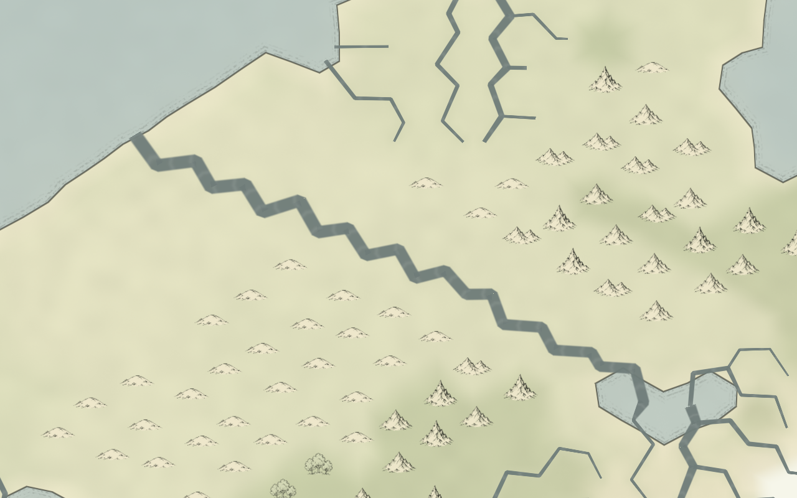

# v2.11.1 — River curve detail

The displayed river width no longer removes meanders. River courses also round the routing grid's angular joins, using the same geographic curve for water and bank pigment. This applies to Natural, Shaded relief, Ink atlas, and the other river-bearing layers in both layouts. Refresh the application to use the new renderer; changing a style or width needs no regeneration. Generation controls still require regeneration to change physical migration.

Application version is 2.11.1. Generator identity remains 2.10.0. This revision changes display curves, not drainage, discharge, terrain, reservoir balances, generated sinuosity, or resource and fertility fields.

## Why maximum settings looked straight

The previous water renderer simplified every reach with a tolerance of `0.35 × displayed half-width`. Widening a river therefore removed its bends. Bank pigment used the unsimplified course, so it could also disagree with the water stroke. Separately, each generated course began and ended on a routing-grid corner, leaving angular joins between neighboring reaches.

One retained AETHER-0004 seed snapshot contains 10,242 surface cells and 642 process cells. Holding its environment and drainage fixed, rebuilding only its courses with 5 Myr river evolution and 2× mobility produced 3,411 reaches carrying at least 100 m³/s. The old simplifier retained interior curve points in 928 of these at 1× display width, but only 3 at 2.5× width. Their median physical lateral displacement was about 542 m. These are course/simplification observations, not a full regeneration with those controls or the original large AETHER-0004 configuration.

## Shared curve construction

`RiverGeometry` records the strongest incoming channel at each receiver using annual discharge. This choice is independent of display width, visibility threshold, season, and layout. Junction positions remain the original anchored receiver locations.

`RiverCurve.ts` builds a cubic baseline for each dry reach. Let `a` and `b` be its unit-sphere endpoints and `L = |b-a|`. Initial controls lie one-third of the way along the chord. Where neighboring trunk reaches exist:

```text
start direction = tangent-plane projection of (b - upstream endpoint) at a
end direction   = tangent-plane projection of (downstream endpoint - a) at b
handle length   = min(current chord, adjacent chord) / 3
```

Forward-facing directions replace the corresponding initial controls. The shared incoming/outgoing context gives the main river a common tangent at its junctions. Tributaries end at that same junction using their own approach; they do not take over the trunk's upstream guide. Lake and ocean approaches keep the direct anchored construction that prevents doubled-back shoreline segments.

Physical per-reach bend detail is sampled by its cumulative chord length. The difference from its straight baseline is added to the cubic baseline. Smooth ramps taper that detail through the first and last 20% of the reach, preserving a common endpoint tangent; the middle retains the generated bend detail. Each resulting sample is normalized back to the sphere, and both endpoints are copied exactly from the anchored input.

The baseline is sampled at least twelve times, or twice per original segment for a more detailed course. Iterative Ramer–Douglas–Peucker simplification uses `0.0005 × reach chord length`. This is a geographic error bound and does not depend on the water stroke width. Single isolated reaches with no neighboring guides retain their generated samples directly.

Both `RiverStrips` and `RiverbankTexture` consume this curve. The water renderer no longer applies a second width-based simplifier. Width changes only the offsets on either side; seasonal flow activity and the phase at confluences remain intact. The curve is cached only in each caller's current working arrays; no new retained generation field or per-frame simulation pass is added.

## Keeping the ribbons stable

`RiverRibbon` retains the existing rectangular/trapezoidal spans and bounded bevel joins. It rounds stored positions to the GPU buffer's Float32 precision before deciding whether a tiny bevel has nonzero area. This avoids adding a bevel that would collapse when uploaded. There are no extended miter points and no curvature-dependent width pinches.

The retained sample at maximum width has no reversed or zero-area drawable triangles in the globe or flat-map geometry checks. The map projector deliberately leaves repeated-index placeholders for removed seam faces; these are not drawable water triangles.

## Verification and limits

All 30 existing tests pass, including the extended river-join regression. It checks a curved shared tangent, exact junction coincidence, and identical original flow-coordinate samples at 0.5× and 2.5× widths. TypeScript checking passes. The production build was also completed for publication.

A focused offscreen OpenGL comparison used the actual Ink atlas surface, river geometry, and bank textures on the retained sample. Both pictures use the same world, camera, maximum migration course settings, and 2.5× river width. The longest continuous dry chain in that sample supplies the framing. This was a rendered scene check, not an interactive browser test.



*Previous rendering: width-based simplification removes the smaller bends and exposes angular grid routing.*


*Revised rendering: shared curves round the joins and preserve meander detail at the same width.*

In the same reduced-world construction check, the revised curve lookup took about 65 ms for the 3,411 major reaches, and the complete maximum-width water mesh took roughly 0.25 seconds per layout before the small bevel precision adjustment. The mesh contains about 309,000 vertices rather than the preceding roughly 21,000: retaining bends requires more geometry. These are single-run construction observations, not full-generation or frame-rate measurements.

This remains cartographic rounding within the existing drainage network. It does not create large meandering floodplains, simulate multi-cell channel migration, or change the physical sinuosity reported by the inspector. Confined channels can still have little generated meander, and the underlying mesh continues to limit geographic detail. The geographic centerline is shared across projections; a globe's scale can make small bends harder to see.
