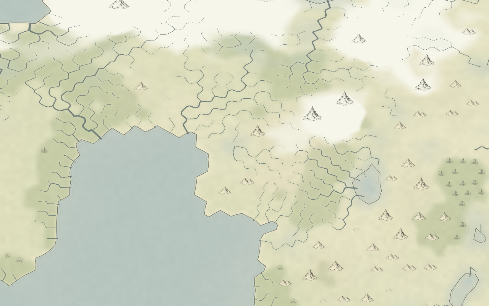
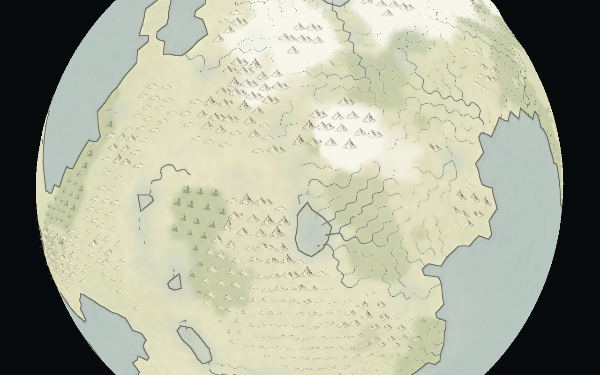
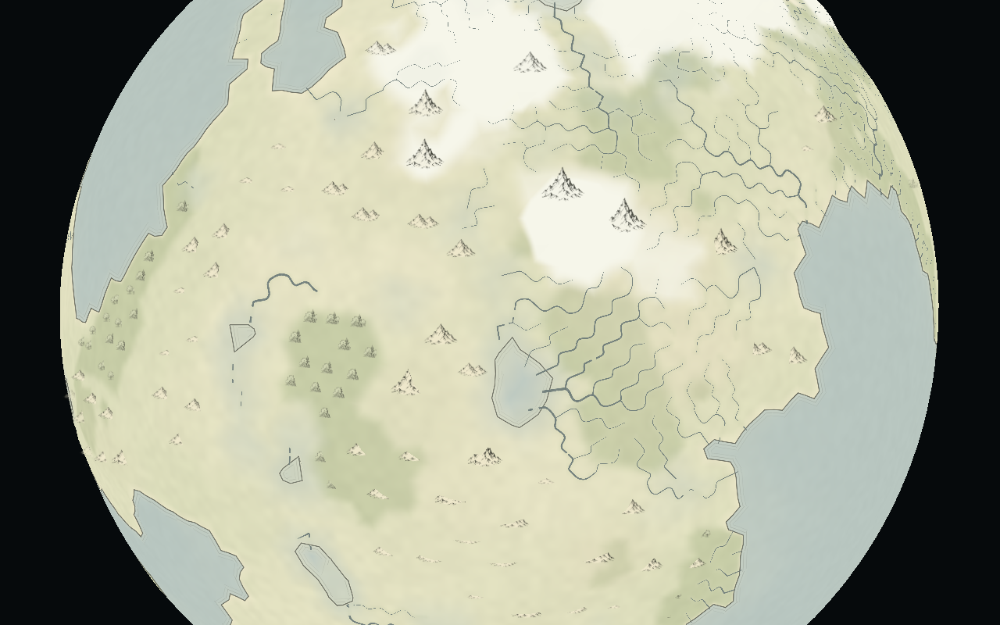

# v2.13.1 — ink atlas terrain hierarchy and shorelines

This changes the Ink atlas presentation in Globe and Flat map. Generation, climate, water budgets, lake footprints, rivers and the resource model keep their v2.13.0 data. No new generation is needed to apply the style within a loaded world.

## Mountain size and prominence

Mountains start at 1,400 m. Their angular symbol width is:

```text
heightScale = clamp((elevation − 1,400) / 5,000)^0.7
width = (0.045 + 0.047 × heightScale) × seededVariation
seededVariation ∈ [0.94, 1.06)
```

The atlas's taller peak drawings become more common above 2,200 m and 3,600 m. At close zoom, peak symbols have a size cap that rises from 64 to 118 pixels with their width; hills and forests cap at 56 pixels. This retains the height hierarchy instead of letting every mountain reach the same cap. These are cartographic scales, not literal mountain base widths.

## Fewer hills and space between groups

The separate seeded stream still bounds sampling to approximately 18,000 candidate cells. Hill candidates use 30% of the ordinary sampling probability, must be on exposed land at least 650 m high, and need a maximum neighboring height gradient of at least 0.0015 (1.5 m/km). This prevents elevation alone from carpeting broad flat uplands with hill marks. Existing forest criteria remain.

Candidates are processed in descending priority: mountains first, then hills, then forest groups. Mountain priority includes height and positive local prominence above the mean neighboring height. Accepted symbols reserve a spherical footprint proportional to their drawn width. Hills reserve more surrounding paper than mountains and forests. A 3D spatial hash checks only nearby buckets, works across the dateline and poles, and avoids an all-pairs search. Symbol positions remain fixed between seasons and camera changes.

Coastal clearance scales with the symbol width. Ocean neighbors, lake neighbors and major river corners are excluded, and the anchor must retain at least 80% exposed land. The existing atlas artwork and seasonal tinting are reused. A weak cache stores the selected list for each immutable world; season and layout changes reuse it.

On the retained full **AETHER-0004** snapshot (655,362 surface cells), glyph counts changed as follows:

| Symbol | Before | Revised |
| --- | ---: | ---: |
| Mountain groups | 599 | 101 |
| Hill groups | 742 | 46 |
| Forest groups | 694 | 264 |
| Total | 2,035 | 411 |

These are illustration counts; terrain and biome quantities do not change. The largest mountain width increased from 0.0517 to 0.0906 radians, while the median increased from 0.0448 to 0.0543. Selection took about 98 ms before and 78 ms after in one local run; reading the cached list plus measurement took about 0.1 ms. Timing varies by machine and is separate from generation performance. Raw data is in [full-world-metrics.json](../../observations/ink-refinement/full-world-metrics.json).

## Shoreline treatment

The previous ink outline used the combined terrain land fraction, which could disagree with the separate ocean and seasonal lake fields used to color the water. The revised ink uses each water coverage field directly:

```text
pixelDistance = (0.5 − wetCoverage) / length(screenGradient(wetCoverage))
shoreDistance = min(oceanPixelDistance, lakePixelDistance)
```

Positive distance is land-side and negative distance water-side. A uniform interior with no gradient receives a distant sentinel instead of an outline; constant partial coverage therefore cannot paint a whole face with ink. Euclidean derivatives keep pen width comparable on horizontal and diagonal shore segments.

The main line is a fine antialiased dark stroke. A pale land-side rim and a light water wash provide separation. Two faint parallel water-side strokes, at about four and eight pixels, replace the older broad broken hatching band. Ink intensity has a small variation from the existing pigment noise. The shader keeps the underlying water blend and seasonal coverage unchanged. There is no extra water mesh, detached patch or displaced river mouth.

Distances are local screen-space approximations. Coasts still follow the resolved mesh; this does not invent subcell bays or smooth away real islands. Finer surface detail remains necessary for finer geographic coast shapes. Inland water retains fractional coverage rather than becoming a new binary mask. Natural and Shaded relief styles keep their existing shoreline treatment.

## Rendered comparisons

The following are offscreen OpenGL renders of the actual geometry, shaders and atlas. They use the same reduced AETHER-0004 recipe with **10,242 surface cells and 642 process cells**, not the full-resolution world used for the count measurement. The coarse shore geometry is intentional so changes can be compared directly. They are not browser screenshots.

### Flat map before


### Flat map revised



### Globe before



### Globe revised



The ten existing projection/resource/rendering checks and TypeScript checking pass. Both layouts compiled and rendered successfully offscreen, and the production build passed. Interactive browser testing was not performed. There are no new dependencies, simulation passes or configuration options.
