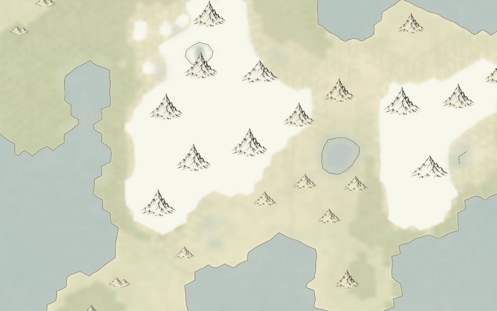
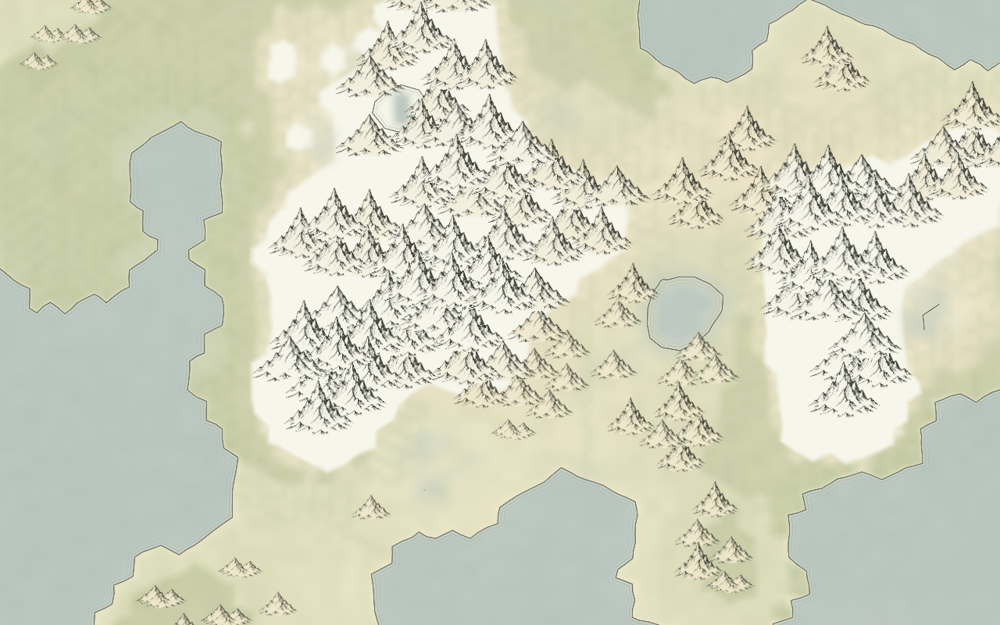
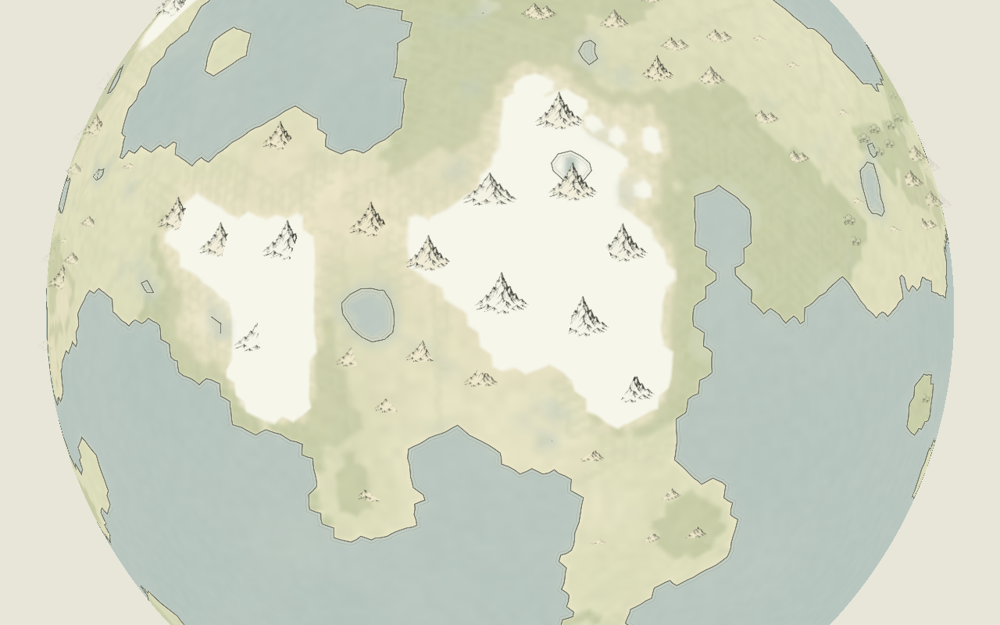
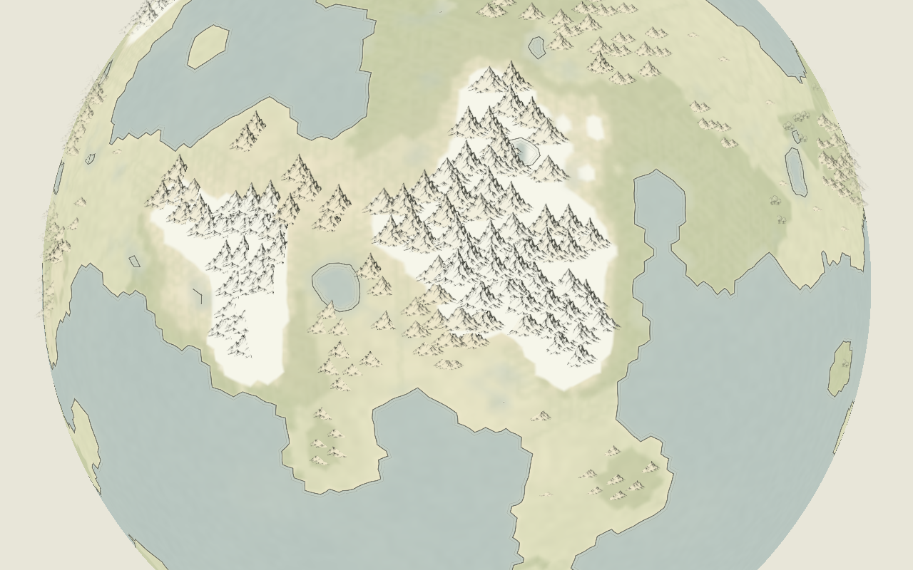

# v2.13.2 — connected mountain ranges in Ink atlas

The previous spacing rule required two mountain anchors to be at least `0.62 × (first width + second width)` apart. Elevation increases width, so high peaks excluded more of their neighbors. The result was isolated symbols where the terrain contained a range.

Mountain pairs now use a fixed minimum unit-sphere chord distance of **0.028**, about 1.6°. Their drawing widths and zoom caps still scale with elevation. Bases may overlap, allowing adjacent symbols to read as a chain. Mountain-to-hill, mountain-to-forest, and all other pairings retain the previous width-based separation.

This is a small change to the existing spherical spatial-hash check. It adds no pass, dependency, generation field, or control. The same seeded candidate cells, elevation priority, coast/water exclusions, cache, and seasonal tinting remain. More accepted mountains may displace some nearby hill or forest symbols through the existing mixed-pair spacing. Shorelines and generated geography are unchanged.

## Focused comparison

Both revisions used one regenerated **AETHER-0004 recipe at surface subdivision 6 and process subdivision 3**: 40,962 surface cells. This is a reduced rendering sample, not the original full-resolution world.

| Observation | v2.13.1 | v2.13.2 |
| --- | ---: | ---: |
| Mountain symbol groups | 197 | 715 |
| Mountain groups with another within 0.06 unit-sphere chord distance | 0 | 693 |
| Hill symbol groups | 43 | 28 |

These are symbol counts, not changes to mountains or hills in the simulation. The neighborhood measurement checks the spacing regression; it does not establish geological ridge connectivity. Symbols remain a cartographic sample of terrain above 1,400 m, rather than a reconstructed ridge graph.

The images below render the actual surface and symbol shaders offscreen with identical cameras. They isolate the changed placement; river ribbons and UI are omitted. Both layouts use the same world. The flat-map crop targets a dense mountain region so overlap can be inspected.

### Flat map before

### Flat map revised

### Globe before

### Globe revised

Ten existing projection/resource/rendering checks, TypeScript checking, and the production build passed. Both layouts were visually inspected through offscreen OpenGL renders. Interactive browser testing was not performed. Generator identity remains **2.13.0**.
